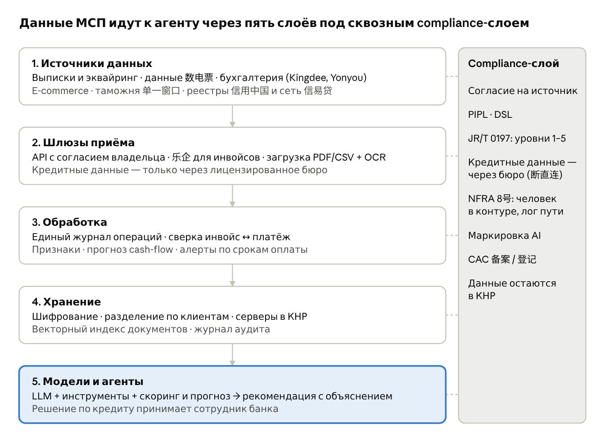

# SME Finance Copilot
## Полный контекст и техническое задание для реализации в Codex

**Версия:** 1.0 · **Дата сборки:** 12 октября 2026 года · **Трек:** E, International FinTechathon.

**Назначение:** передать исполнителю весь предметный контекст обсуждения, архитектуру продукта, границы полномочий, спецификацию данных, алгоритмы, последовательность реализации и критерии приёмки. Это спецификация будущей системы, а не отчёт о готовом продукте.

**Рабочее позиционирование:** Copilot для владельца небольшого китайского B2B-бизнеса с отсроченными поступлениями. Система связывает документы и платежи, обнаруживает кассовый разрыв, сравнивает допустимые действия и финансирование, исполняет подтверждённые шаги в песочнице и сверяет результат.

**Главный принцип:** LLM понимает и объясняет; финансовое ядро считает; оптимизатор подбирает план; независимые правила проверяют полномочия; исполнитель проводит действия; независимая среда подтверждает результат.

**Граница достоверности:** документ консолидирует доступную переписку и три приложенных источника. Новая внешняя проверка рынка, законов, моделей, библиотек и правил конкурса при этой сборке не выполнялась. Исторические проверки из переписки помечены как таковые. Неподтверждённые детали нельзя превращать в факты, нормы или реализованные интеграции.

# 0. Как читать документ и передавать его Codex

## 0.1. Состав передачи

Основной текст содержит все существенные решения и детали обсуждения в форме исполнимого ТЗ. Это не дословная стенограмма чата: повторения собраны по предметным областям, противоречия вынесены в отдельный реестр. Полные тексты трёх исходных документов приведены в приложениях; оригинальные DOCX, исходные гиперссылки и изображения сохранены отдельно в архиве.

В пакете находятся `MASTER_SPEC.md`, одноимённый по содержанию Word-документ, `CODEX_START_HERE.md`, проектный `AGENTS.md`, машинно-читаемые примеры контрактов, список проверок и папка `sources/`. Файлы контрактов — формализация проектных решений, не готовый backend и не официальные банковские API.

Codex должен сначала прочитать разделы 0–4, реестр уточнений и инструкцию запуска; затем реализовывать полный вертикальный сценарий. Не нужно начинать с обучения модели, подключения реального банка или выбора десятков инфраструктурных компонентов.

## 0.2. Обозначения происхождения

| Метка | Значение | Как использовать |
|---|---|---|
| R1 | Приложенные International Track — Topics & Rules | Источник требований конкурса; не подтверждение их неизменности после публикации |
| R2 | Приложенный каталог датасетов и схем | Каталог ссылок и заявленных статусов; не сами данные и не разрешение на использование |
| R3 | Приложенный технический ресёрч китайского рынка от 10.10.2026 | Авторские claims, verified, single source, гипотезы и неизвестные сохраняют исходный статус |
| C | Решения и анализ из доступной переписки | Контекст проекта; прежняя веб-проверка не считается повторённой при сборке |
| SPEC | Проектное требование, формализующее обсуждение | Требуется реализовать и проверить; это не утверждение о существующем продукте |
| OPEN | Неизвестное или требующее подтверждения | Не выдумывать значение и не блокировать несвязанные части разработки |
| DEMO | Условные данные, продукт или сценарий | Явно маркировать как тестовые; не выдавать за реальные банковские условия |

Числа про пользователей и инфраструктуру конкурентов — сведения из R3, часто заявления компаний. Они не являются результатами нашей системы. Предлагаемые метрики и объёмы тестов — цели разработки, а не уже достигнутые показатели.

## 0.3. Приоритет решений

Приоритет в проектировании: явный выбор пользователем трека E → последняя согласованная архитектура → уточнения анализа данных и китайского контекста → ранние варианты. Исторический выбор между E и F сохранён для контекста, но не даёт права переключать продукт на кошелёк или добавлять блокчейн ради бонуса.

При конфликте источников сохранять обе версии и статус разногласия. Нормативное требование нельзя вывести из нашего дизайн-решения. Например, хранение синтетики локально — ограничение прототипа, а не доказанный универсальный юридический запрет трансграничной передачи.

## 0.4. Приоритеты разработки

**P0 — обязательный сквозной контур:** данные → сверка → прогноз → варианты финансирования → оптимизация → подтверждение → исполнение в песочнице → сверка → отчёт и тесты.

**P1 — усиление:** неопределённость оплат, условные планы, значимые уточнения, граф доказательств, расширенные сбои, документный импорт, более удобный интерфейс.

**P2 — дальнейшая исследовательская и продуктовая работа:** обучение специализированных моделей, SFT/дистилляция/RL, реальные банковские адаптеры, несколько валют, новые сегменты, более сложные оптимизаторы.

P0 не означает «только красивое демо». Безопасность, идемпотентность, разграничение доступа, проверяемые расчёты и независимый evaluator входят в P0.

# 1. Конкурс, мотивация и история выбора

## 1.1. Цель команды

Пользователь намерен выступить максимально сильно и победить. Гарантии победы нет: неизвестны состав участников, оценка жюри и качество конкурирующих работ. Архитектура должна максимизировать качество проверяемого результата, а не обещать «100% победы» или фиктивные пилоты.

Ключевой стратегический вывод обсуждения: законченный узкий финансовый сценарий с доказательствами полезности и надёжности предпочтительнее огромной недоделанной финтех-платформы.

## 1.2. Все темы и почему выбрана E

R1 называет тему International Track «AI as a Financial Participant»: агент должен выполнять реальные задачи в финансовом сценарии. Есть шесть направлений.

| Тема | Содержание по R1 | Историческая оценка в обсуждении |
|---|---|---|
| A. Personal Finance Assistant | Бюджет, счета, расходы и рекомендации физлицу | Низкий порог входа; трудно отличиться от Cleo и обычного чата над выпиской; Actual Budget — возможная база |
| B. Wealth Advisory Agent | Сравнение продуктов, риск-профиль, консультирование, объяснимое распределение активов | Много готовых TradingAgents/FinRobot/PyPortfolioOpt; не подменять консультирование торговым ботом |
| C. Cross-border & Student Finance | Переводы, обучение, кредитная история, несколько валют | Зависимость от стран, провайдеров и доступа к API; Wise/Flywire — ориентиры, не автоматически доступные интеграции |
| D. Insurance Assistant | Полисы, пробелы покрытия, помощь по страховым случаям | Возможен сильный узкий сценарий; нужен предметный эксперт; FurtherAI и Docling обсуждались как ориентиры |
| E. SME Finance Copilot | Финансирование, cash flow и предупреждения, анализ бизнеса | Выбран пользователем; выгодное сочетание предметной глубины и реализуемости |
| F. Agent Wallet | Автономные on-chain операции, управление активами, риск-контроль | Сначала рассматривался из-за AgentPay/AgentGuard; требовал готовой Web3-компетенции; больше не целевой трек |

Оценки плотности конкуренции были гипотезами, не статистикой регистраций. Исторические аргументы: сообщалось о 1 709 студентах, 372 командах и 270 вузах в конкурсе 2025 года; это не число соперников International Track 2026. Упоминался победивший LingCopilot и самозаявление участника NYU о выборе Wealth Advisory; ни то ни другое не доказывает плотность текущего трека E. Эти сведения не нужны коду и не должны попадать в сравнение качества продукта.

В раннем обсуждении F стоял первым при наличии сильного разработчика смарт-контрактов, E — первым по надёжности исполнения без Web3. После явного выбора E архитектура полностью off-chain. AgentPay и AgentGuard используются только как идеи ограниченных полномочий, проверки действий и аудита; готовность их кода не подтверждена.

## 1.3. Оценка конкурса

По R1: выполнение задач — 40%; безопасность и соответствие требованиям — 30%; инновационность и взаимодействие — 30%; on-chain exploration — дополнительно 0–5 баллов. Бонус не гарантирован. Все шесть тем имеют общие критерии; отдельных квот наград для каждой темы в приложении не указано.

Для E это означает: показать не совет, а финансовое поручение, доведённое до состояния, которое можно проверить. Сильный safety-модуль без полезного сценария не закрывает 40%; полезный агент без прав и контроля исполнения не закрывает 30% безопасности.

## 1.4. Сдача, сроки и формальные условия

По R1 регистрация и сдача имеют общий дедлайн 20 октября 2026 года, 23:59 по Пекину. В исходнике одновременно приведено 16:00 UTC: это расхождение на одну минуту с 23:59 UTC+8. Для планирования ориентироваться на указанное исходное пекинское время; в коде использовать `Asia/Shanghai`, а не копировать неверный пересчёт. Актуальность дедлайна после приложенной версии отдельно не проверена.

Пакет: техническая документация; презентация до 10 минут; исходный код с README, ссылкой на GitHub, инструкциями запуска и тестами; self-assessment безопасности; доказательства исполнения. Видео в общем списке отмечено как optional и ограничено 5 минутами, но в пункте evidence для off-chain прямо указаны логи песочницы и видео. Для E подготовить видео обязательно как часть нашего плана, не стирая неоднозначность исходника.

R1 разрешает обновления до дедлайна и запрещает изменения после. Онлайн-ревью — в конце октября; финалисты — до 31 октября; заезд 20 ноября; финал 21–23 ноября в Шэньчжэне. Минимум один участник финалиста должен быть лично. Перелёт и проживание покрываются для приглашённых участников, число мест определяется приглашением.

Команда — 2–5 очных студентов; разрешены межвузовские команды; один человек может состоять только в одной команде Domestic/International; минимум 60% участников — не граждане Китая; рабочий язык английский. Точную формулировку о зарубежных вузах сохранять из R1, не переинтерпретировать неоднозначные географические скобки. Состав нашей команды и формальные подтверждения каждого участника в этом контексте не установлены.

Взноса нет. Фонд International Track в R1 — 250 000 RMB: 100 000 / 80 000 / 50 000 / 20 000 за первое, второе, третье и innovation; отдельные excellence awards; суммы до налогов. Права на работу остаются у участников; данные и сторонние компоненты требуют надлежащих лицензий. Полные условия отсылают к общему регламенту и privacy policy сайта.

## 1.5. Что уточнить у организаторов

Сохраняются вопросы из переписки: единый рейтинг или квоты тем; обязательные и скрытые сценарии; предоставленная песочница; ограничения моделей и внешних API; допустимость ранее созданных компонентов; расхождение отдельных публичных анонсов и международного документа о доработке на финале. Не ждать ответов, чтобы начать автономный синтетический P0. Не проводить реальные платежи из-за отсутствия ответа.

# 2. Продукт, пользователь, сценарии и границы

## 2.1. Целевая персона

Первая персона — владелец небольшой китайской B2B-компании с оплатой после поставки: поставщик, сервисный бизнес или небольшое производство без полного производственного планирования. Позиционирование — помощник владельца, не кредитное бюро и не собственная банковская система. R3 выделяет поставщиков и производство как авторскую сегментную гипотезу, а не доказанную свободную нишу.

Китайский 个体工商户 не следует механически считать тождественным российскому ИП. Наша подтверждённая постановка — малый B2B-бизнес; юридическая форма задаётся явно в профиле и влияет только на проверенные условия продукта. Не утверждать, что данные репрезентативны для всех китайских предпринимателей.

Вариант индивидуального merchant-бизнеса обсуждался отдельно: продажи, возвраты, расчёты через провайдеров, расходы владельца. Он требует другой калибровки. P0 не смешивает его с B2B только ради большего числа сценариев.

## 2.2. Главное поручение

«Проверь, хватит ли денег на ближайшие 30 дней. Зарплату и обязательные платежи не переносить. Сохрани резерв. Найди наименее затратный допустимый способ закрыть дефицит, сравни риски и подготовь действия».

Пользователь может выбрать: минимальные расходы; больший резерв; отсутствие нового долга. Система не обязана всегда найти осуществимый план. Корректные результаты включают `NEEDS_INFORMATION`, `CONDITIONAL`, `INFEASIBLE` и объяснение, какое конкретное ограничение мешает.

## 2.3. Пользовательские роли

Владелец подтверждает существенные действия и задаёт политики. Бухгалтер загружает и исправляет данные в разрешённом объёме. Наблюдатель/аудитор читает отчёты без права исполнять платежи. Технический администратор обслуживает систему, но не получает автоматически право одобрять операцию от имени владельца. Для P0 достаточно минимального набора ролей, но их разграничение должно быть реальным серверным механизмом.

## 2.4. Пользовательские потоки

**Первичная настройка:** создать компанию и роли; выбрать валюту CNY и часовой пояс; задать резерв и защищённые обязательства; загрузить историю; пройти проверку качества; подтвердить спорные поля; получить snapshot.

**Повседневная работа:** обновить данные; увидеть прогноз и предупреждения; раскрыть причину; сравнить планы; уточнить значимый факт; выбрать вариант; подтвердить точные действия; дождаться исполнения и сверки.

**Работа с задолженностью:** найти просроченный счёт; проверить договор, приёмку и фактические оплаты; подготовить напоминание; дождаться ответа; не менять срок автоматически; пересчитать после подтверждения.

**Финансирование:** определить величину и дату дефицита; отфильтровать неподходящие продукты; сравнить чистое поступление и все погашения; подготовить заявку; получить индивидуальное предложение; подтвердить; учесть деньги только после фактической выдачи в песочнице.

**Сбой:** система показывает `UNKNOWN`, `PARTIALLY_EXECUTED`, `NEEDS_RECONCILIATION` или иной точный статус; не маскирует проблему за зелёным сообщением; сверяет внешнее состояние и пересчитывает оставшуюся часть плана.

## 2.5. Non-goals

Не создавать полноценную нормативную бухгалтерию; не обещать реальный скор одобрения кредита; не продавать скор банкам; не выдавать тестовые финансовые продукты за действующие предложения; не подключать реальные счета без отдельного проекта; не автоматизировать налоговую отчётность; не строить склад и производство; не добавлять on-chain, кредитное плечо или поиск DeFi-доходности.

P0: одна валюта, один основной тип бизнеса, один связанный контур. Расширяемость архитектуры не означает, что все будущие возможности должны работать в первом релизе.

# 3. Непереговорные финансовые и инженерные инварианты

## 3.1. Три класса истины

Факт — подтверждённое наблюдение: остаток, проведённый платёж, полученный документ. Обязательство — действующее подтверждённое условие: сумма и срок оплаты. Оценка — прогноз или предположение. Все три класса хранятся отдельно.

Извлечённая из документа сумма может быть распознана уверенно, но подлинность документа и исполнение операции этим не подтверждаются. `extraction_confidence`, `validation_status`, `source_trust` и `forecast_uncertainty` не сводить в один confidence.

## 3.2. Инварианты I01–I24

- I01. Инвойс не создаёт банковское поступление самим фактом загрузки.
- I02. Договорная дата, прогнозная дата и фактическая дата оплаты — разные поля.
- I03. Запрошенная отсрочка не меняет обязательство без подтверждения.
- I04. Заявка или предварительно подходящий продукт не увеличивают остаток.
- I05. `SUBMITTED` и `SETTLED` — разные состояния; текст LLM не определяет успех.
- I06. Повтор импорта не создаёт вторую экономическую операцию.
- I07. Повтор отправки той же команды не создаёт вторую логическую оплату.
- I08. Ни одно действие не исполняется без актуальных прав и требуемого подтверждения.
- I09. Два параллельных действия не расходуют один резерв дважды.
- I10. Потерянный ответ не разрешает освобождать резерв или платить заново вслепую.
- I11. Суммы имеют валюту; расчёты разных валют не смешиваются без явной операции FX.
- I12. Деньги хранятся в минимальных единицах; нет float для денежных итогов.
- I13. Частичная оплата уменьшает задолженность только на связанную сумму.
- I14. Суммарные аллокации не превышают доступную сумму соответствующего платежа.
- I15. Неизвестное назначение платежа не убирает реальное движение денег из учёта.
- I16. Торговая выручка и её перечисление через провайдера не считаются двумя продажами.
- I17. Факторинговый аванс и исходное поступление не могут быть независимыми двойными доходами.
- I18. Регулярный прогноз не дублирует известные конкретные обязательства.
- I19. Изменения сохраняют версии; прошлое решение воспроизводится по прошлому snapshot.
- I20. Исторический расчёт видит только сведения, известные на момент решения.
- I21. Нельзя финансировать утренний платёж вечерним поступлением без допустимого механизма.
- I22. Обязательства по финансированию не исчезают за концом 30-дневного экрана.
- I23. Жёсткое правило нельзя обменять на снижение стоимости в целевой функции.
- I24. Скрытое будущее симулятора недоступно агенту, инструментам и retrieval.

## 3.3. Дополнительные инварианты I25–I36

- I25. `UNKNOWN` solver не равен доказанной несовместимости; `FEASIBLE` не равен доказанному оптимуму.
- I26. Тестовая вероятность не называется вероятностью реального банкротства без калибровки.
- I27. Подтверждение относится к конкретной версии команды, сумме, получателю и условиям.
- I28. Чужая компания недоступна через API, фоновые задачи, кэш, embeddings и документы.
- I29. Инструкция внутри документа не расширяет права агента.
- I30. Модельный checkpoint не является платёжным checkpoint.
- I31. Исполненный платёж не откатывается удалением записи; компенсация — новая операция.
- I32. Недоступность LLM не ослабляет авторизацию или обязательные проверки.
- I33. Непроверенный внешний источник не обновляет каталог кредитов прямо в процессе платежа.
- I34. Результаты измерений содержат реальные значения и границы; запрещены фиктивные KPI.
- I35. Публичный код и публичные данные могут иметь разные лицензии.
- I36. Наши внутренние резервы не гарантируют контроль операций владельца в стороннем приложении.

Все I01–I36 должны иметь тест, ответственную функцию и ссылку в матрице приёмки. Расширение объёма не может отменять инварианты.

# 4. Общая система и доверенные границы

## 4.1. Логические контуры

```text
Owner / Accountant / Auditor
             |
          Web + API
             |
    Auth / tenant / policy
             |
   +---------+----------------------+
   |                                |
Data ingestion                Agent workflow
   |                                |
Validated facts <--- Financial snapshots ---> Evidence retrieval
   |                                |
   +---- Analytics / Forecast / Financing ---+
                                             |
                                      Planner + solver
                                             |
                                      Independent validator
                                             |
                                      Owner approval
                                             |
                                      Execution service
                                             |
                                   Sandbox / future adapter
                                             |
                                      Reconciliation
                                             |
                                      New snapshot + alerts

Across all layers: audit, data governance, versioning, evaluation.
```

Оркестратор не имеет прямого пути в финансовую среду. Он готовит предложение действия. Исполнитель получает только проверенную команду и сам заново проверяет применимость разрешений.

## 4.2. Два независимых источника состояния

Финансовое ядро хранит наблюдаемую систему учёта и историю решений. Песочница хранит фактическое состояние тестового финансового мира. Они синхронизируются через API/события и сверку, а не через общую таблицу, из которой агент мог бы читать скрытые данные.

Ошибки нашего ядра должны обнаруживаться независимым evaluator. Нельзя объявлять оценщиком ту же функцию, которая уже рассчитала нужный ответ, без дополнительной проверки.

## 4.3. Модульный монолит с раздельными полномочиями

Рекомендуемый P0: один репозиторий, модульный backend, отдельные процессы API, orchestration-worker, execution-worker, parser-worker и simulator. Финансовая БД, agent-checkpoints и очередь могут начинаться в одном PostgreSQL с отдельными схемами/ролями. Симулятор использует отдельную БД/роль. Модельный сервер не получает прямой доступ к таблицам денег.

Не требуются Kafka, Kubernetes, Spark, федеративное обучение, GNN, отдельная графовая БД и множество микросервисов. При доказанной нагрузке модуль можно выделить, не переписывая доменные контракты.

## 4.4. Политика доступа к внешнему миру

По умолчанию `DATA_MODE=synthetic`, `EXECUTION_BACKEND=sandbox`, `MODEL_PROVIDER=mock` для воспроизводимых тестов. Mock-модель — детерминированный тестовый заменитель, не доказательство качества реального AI. Демонстрация агентного качества должна иметь отдельный запуск реальной выбранной модели и честные метрики.

Подключение LLM-провайдера выполняется конфигурацией, секретами и allowlist. Разрешение на inference не разрешает платежи, отправку писем или загрузку реальных данных. Платные API и реальные операции требуют явного решения владельца проекта.

# 5. Каноническая модель данных

## 5.1. Общие поля и типы

Все tenant-сущности имеют `id`, `tenant_id`, `created_at`, `updated_at` или append-only эквивалент, `schema_version`. UUID/ULID выбирается один раз в ADR. Времена событий — timezone-aware UTC; договорные даты хранятся как date вместе с business timezone/calendar. Валюта — явный код. Денежные суммы — int64 minor units с проверкой переполнения; процентные промежуточные величины — Decimal с явным округлением.

Идентификаторы внешних систем уникальны только в своём namespace. Одинаковый `event_id` у двух провайдеров или компаний не означает один объект. Дедупликация: tenant + source + external ID + согласованная версия; для файлов дополнительно hash и семантический ключ.

## 5.2. Компания, пользователь и право

`Company`: display_name, legal_form, jurisdiction, timezone, base_currency, industry, demo_flag. Не использовать зарегистрированный капитал как свободные деньги.

`Membership`: user_id, tenant_id, role, status, validity. `Consent`: субъект, источник данных, разрешённая цель, срок, отзыв. `AccessPolicyVersion`: разрешённые виды действий, лимиты, scope счетов/получателей, защищённые обязательства, срок действия и версия.

`BeneficiaryVersion`: контрагент, реквизиты, fingerprint, источник, статус проверки, подтверждающее лицо, срок применимости. Обновление реквизитов создаёт новую версию, а не незаметно заменяет значение под старым approval.

## 5.3. Источники и извлечение

`SourceDocument`: original_name, mime_type, storage_key, content_hash, source_type, provider, received_at, observed_at, access_class, retention_policy, parser_version.

`ImportBatch`: adapter_id/version, file_id, статус, счётчики строк, диапазон событий, idempotency key, предупреждения. Ошибочная строка не должна бесследно исчезать: quarantine record содержит причину и исходную позицию.

`ExtractedField`: entity_candidate, field_name, raw_value, normalized_value, source_location, extraction_method, extraction_confidence, validation_status. `FactVersion`: value, source_refs, effective_at, observed_at, supersedes_id, decision_status. `EvidenceReference`: страница/таблица/ячейка/строка и hash версии источника.

## 5.4. Экономические отношения и обязательства

`Counterparty`: тип, связи, проверенные идентификаторы, обычные условия оплаты. `Contract`: стороны, версия, применимый период, ссылки на документы. `Order`: договор, позиции при необходимости, согласованная сумма. `AcceptanceEvent`: что и когда принято/оспорено, источник.

`Invoice`: номер и namespace, дата выставления, стороны, валюта, сумма без налога, налог, общая сумма, статус документа, корректирующая связь. Входящий/исходящий вид не должен быть спутан с направлением банковской операции.

`Receivable` / `Payable`: counterparty_id, contract_id, gross_due, outstanding_minor, original_due_date, current_confirmed_due_date, payment_terms_ref, dispute_state, priority, flexibility, source_refs. Инвойсов на одно обязательство может быть несколько; связь не обязана быть 1:1.

`RecurringCommitment`: recurrence, amount/estimate, earliest/latest payment, protected flag, generated_obligation_ids. Будущие экземпляры регулярного платежа должны иметь стабильные ID, чтобы пересчёт не создавал дубли.

`ExtensionRequest` / `PromiseToPay`: запрошенное или обещанное условие, ответ, подтверждение, срок ожидания. Обещание оплаты влияет на прогноз с отмеченной неопределённостью, а не создаёт факт settlement.

## 5.5. Денежные сущности

`Account`: provider, currency, account_type, external_ref, capabilities. `BalanceObservation`: ledger_balance, provider_available_balance, provider_holds, as_of, observed_at, confidence/status, источник. Семантика доступности определяется адаптером.

`Transaction`: direction, amount_minor, currency, event_time, observed_time, booking_time, provider_status, external_ref, counterparty, related_action, source. `PaymentAllocation`: transaction_id, obligation_id, allocated_minor, allocation_status, source/method, reviewed_by. Нельзя превышать остаток оплаты или погашать счёт другой валютой без отдельной FX-связи.

`LedgerEntry` / `LedgerLine`: операционный журнал собственных действий, балансирующие записи, currency, effective_at, external linkage. Это не полноценная китайская statutory accounting система. Corrections оформляются reversal/replacement, не переписыванием прошлых проводок.

`Reservation`: account_id, action_id, amount_minor, status, external_hold_ref, included_in_provider_available, expires_at, reconciled_at. Статус «истёк» сам по себе не освобождает деньги, если внешняя операция могла исполниться.

## 5.6. Финансирование

`FinancingProductVersion`: lender/demo provider, scope, eligibility rules, amount bounds, term rules, fees, day-count/rounding basis, disbursement timing, collateral/guarantee, documents, current_from/to, source and review status.

`Quote`: product_version, requested_amount, net_disbursement, repayment_cashflows, expires_at, binding_status, evidence. `Application`: версия данных, согласие, status, events, requested amount. `LoanAgreement`: подтверждённые условия и подписи/тестовые аналоги. `RepaymentSchedule`: даты, principal, interest, fees, residual balance. Catalog, quote, application, agreement, disbursement — разные сущности.

## 5.7. Прогноз, план и действие

`FinancialSnapshot`: as_of, cutoff_observed_at, data_version, policy_version, source coverage, quality flags, materialized references. `ForecastRun`: snapshot, horizon, model_version, scenario_set, assumptions, seed/config, outputs, calibration_status.

`PlanVersion`: objective, snapshot, policy, scenario set, solver status, constraints, cost/risk metrics, conditions, expires_at, validation reports. `Action`: logical ID, kind, parameters, dependencies, preconditions, state, external references, execution attempts. `Approval`: actor, scope, canonical payload hash, exact versions, created_at, expires_at, revoked_at.

`ExecutionAttempt`: attempt_id, action_id, request_hash, sent_at, response/status, retry classification. `OutboxEvent` / `InboxReceipt`: event ID, aggregate ID/version, delivery state, dedupe key. `ReconciliationResult`: observed external truth, mapped records, discrepancies, remediation.

## 5.8. Ограничения БД

Foreign keys для tenant-связей не должны допускать cross-tenant references. Использовать составные ключи/проверки либо другой явно проверенный механизм. Уникальные ключи для логической команды и импортов; checks для суммы и валюты; индексы по tenant, status, due_date, observed_at; блокировки или version compare-and-swap для финансовых изменений.

Политика удаления: операционный аудит не удалять каскадом из-за удаления карточки контрагента. Персональные данные и требования удаления обрабатывать отдельным процессом, отделяя минимальный технический audit от содержимого документов. Нужная политика хранения — OPEN для реального deployment.

# 6. Импорт, документы и китайские форматы

## 6.1. Последовательность приёма

Приём → проверка размера и типа → сохранение исходника → определение адаптера → извлечение → нормализация → schema validation → экономические проверки → сопоставление → review спорных полей → публикация snapshot.

Код не должен считать все PDF сканами. Для текстовых PDF сначала использовать текстовый слой и таблицы; OCR включать только при недостатке пригодного текста. Структурированный CSV/XLSX/XML обрабатывается обычным парсером. LLM может предложить mapping неизвестных колонок, но его нужно проверить.

## 6.2. Контракт адаптера

Каждый адаптер определяет provider, export_type, schema_version, encoding, delimiter, column semantics, amount semantics, status mapping, timezone, dedupe keys и правила корректировок. Поле `amount` нельзя без подтверждения считать чистой выручкой.

Ошибка формата возвращает `UNSUPPORTED_SCHEMA` с ожидаемыми вариантами. Отсутствие актуальной схемы Alipay/WeChat не должно блокировать общий CSV-адаптер. Не подставлять выдуманные API или нестабильные публичные примеры как production contract.

## 6.3. Изоляция парсеров

Не выполнять макросы, JS, shell, инструкции внутри файла. Запретить произвольные внешние обращения и автоматическое следование URL/QR из документа. Ограничить архивы, глубину вложений, размер распаковки и время обработки. Исходный файл недоверенный, даже если его загрузил владелец.

Docling и PaddleOCR — кандидаты документного слоя из обсуждения. Выбрать версию по тестам на разрешённых образцах; не объявлять точность по статье/учебному примеру точностью нашей end-to-end цепочки.

## 6.4. Проверки перед публикацией

Суммы и налоги должны согласовываться с правилами формата. Начальный остаток + движения = конечный остаток для полного окна; иначе quality flag и ограничение действий. Проверить дубли, частичные оплаты, сторно, валюту, даты, уже закрытые счета, версии реквизитов и связь корректирующих документов.

Если окно неполное, не «исправлять» его искусственной балансирующей операцией без явного происхождения. Система может сохранять confirmed balance observation и отдельно отмечать, что история не объясняет изменение полностью.

## 6.5. ChinaBusinessPack

Отдельный версионированный пакет содержит Chinese field aliases, legal form labels, invoice document types, календарь, локализацию, reference product templates и rules с областью применения. Поддержка китайского языка не доказывает реалистичность бизнеса.

Из R2/R3: цифровые инвойсы 数电票, 20-значный номер, поля сторон и налога, корректирующие красные инвойсы — опорная схема. Полная XML/OFD-спецификация и конкретные merchant-экспорты в исходных материалах подтверждены не полностью. Хранить sample_id и schema_version каждого поддержанного формата. Генерируемые документы маркировать SYNTHETIC / NOT VALID FOR PAYMENT.

Не вводить универсальное правило «все платят invoice_date + 60 дней». Договор, статус покупателя, приёмка, применимый нормативный режим и прогноз фактической оплаты разделены. Правовые проверки — reviewable policy pack, не самодельный юридический движок.

# 7. Сопоставление и финансовый анализ

## 7.1. Reconciliation engine

Сначала точные совпадения по external ID, invoice ref, валюте и контрагенту. Затем — кандидаты по сумме, времени, тексту назначения и истории связей. Score модели предлагает связь, но не безусловно погашает обязательство.

Продвинутый вариант: двудольное сопоставление или flow/optimization с ограничениями на суммы, частичные и объединённые оплаты. Ложная автоматическая связь более опасна, чем необходимость review: порог автоприменения калибруется по отдельному набору. Не использовать только cosine similarity текста.

Примеры: один платёж на три счета; два платежа на один счёт; отдельная комиссия; возврат; переплата; ошибочный перевод; платёж без назначения. Unmatched cash сохраняется в состоянии денег; related obligation остаётся открытым до подтверждения связи.

## 7.2. Перечисления через провайдера

В обсуждении был условный пример: продажи 10 000 CNY, возвраты 500, комиссия 30, перевод в банк 9 470. Это не реальные тарифы. Перечисление 9 470 — перемещение соответствующих средств, а не ещё одна независимая продажа. Генератор, импорт и анализ должны согласованно понимать эту семантику.

## 7.3. Показатели бизнеса

P0: confirmed cash, available cash с объяснением резервов, receivables/payables outstanding, aging, overdue amounts, ближайшие защищённые выплаты, концентрация поступлений по контрагентам, cash gap dates, largest cash drivers, доля спорных/неполных данных.

P&L, маржа, EBITDA и полноценные бухгалтерские коэффициенты показываются только при достаточных учётных данных и явно описанной методике. Не реконструировать прибыль из банковской выписки без оснований. DSO по ограниченной истории не выдавать за точную характеристику отрасли; указать окно и знаменатель.

## 7.4. Объяснение причины

Объяснять расчётную структуру: несовпадение сроков, зависимость от крупного клиента, дорогое погашение, перенос без подтверждения, удержанная комиссия. Это не доказательство причин поведения контрагента и не вывод о его мошенничестве.

Каждая значимая цифра имеет metric_id, calculation_version, snapshot_id и evidence_refs. UI должен позволять открыть происхождение без чтения свободного текста рассуждения LLM.

# 8. Прогноз денежных потоков и неопределённость

## 8.1. Декомпозиция

Будущее разделяется на подтверждённые обязательства, поступления по существующим требованиям и остаточные операции, ещё не представленные конкретными счетами. Из статистического residual-потока исключаются уже известные экземпляры, иначе возникает двойной счёт.

Основной UI-горизонт — 30 дней. История может включать 12 месяцев демонстрационных данных. Полная проверка выбранных финансовых обязательств продолжается до существенных дат погашения за горизонтом. Конкретный максимальный горизонт вычислений задаётся конфигом и отражается в отчёте.

## 8.2. Уровни зрелости прогноза

F0: все подтверждённые платежи по срокам, no-delay baseline.

F1: прозрачные сценарии задержек, частичных оплат и связанных контрагентских шоков; параметры явно помечены как DEMO или external-calibrated.

F2: статистическая модель времени оплаты и её калибровка на подходящей истории; отдельная оценка на новых компаниях/периодах.

F3: условные обновления после событий, более сложная зависимость и остаточные временные ряды. Chronos обсуждался как возможный baseline residual-потоков, не замена модели обязательств и не обязательная зависимость.

## 8.3. Оплата и цензурирование

Для счёта i моделируется распределение времени оплаты T_i условно на сведения, доступные сейчас. Неоплаченные счета не выбрасываются: фактическое время ещё неизвестно и наблюдение цензурировано. Для просроченного счёта использовать условие, что он до текущей даты не оплачен.

Дискретная hazard-постановка: h_i(d) = P(оплата в день d | не оплачен до d, доступные признаки). Survival S_i(d) — произведение вероятностей неоплаты до d; прогноз пересчитывается по актуальной информации. Обучение допускается только при понятных временных labels и отсутствии утечки observed_at.

Признаки: текущая просрочка, сумма относительно истории клиента, предыдущие задержки, концентрация, тип обязательства, частичная оплата, dispute, подтверждённое обещание, известные календарные факторы. Не использовать будущую фактическую дату или признаки, сформированные после решения.

Частичные оплаты: outstanding уменьшается после каждого settlement; модель следующей суммы/даты отделена от модели полного закрытия. При недостатке данных использовать сценарные доли, не мнимую статистическую точность.

## 8.4. Холодный старт и уровни доверия

Показывать, что оценено по истории, что перенесено из внешнего источника, что принято как сценарий. Иерархические оценки могут использовать контрагента → сегмент → общий fallback, но слабая история должна увеличивать неопределённость.

Фраза «дефицит в 18 из 100 смоделированных сценариев» допустима как описание симуляции. Фраза «18% вероятность банкротства» недопустима без отдельной модели, определения события и внешней калибровки.

## 8.5. Зависимость и сценарии

Несколько счетов одного клиента разделяют общий фактор задержки. Возможны общие отраслевые/операционные шоки, задержка финансирования, частичная оплата, неожиданный расход и отсутствие ответа поставщика. Сценарии должны быть воспроизводимы по версии генератора и конфигурации.

При сравнении планов использовать одинаковые внешние сценарии и случайные числа там, где это корректно: иначе разные реализации среды могут создать ложное преимущество. Дополнительные стресс-сценарии не смешивать с вероятностными частотами без объяснения весов.

## 8.6. Денежные траектории

Для сценария s и момента t:

`B[s,t] = B[s,t-1] + receipts[s,t] + financing[s,t] - payments[s,t] - debt[s,t] - fees[s,t]`.

Выход: траектории/квантили, минимальный остаток, дата первого нарушения резерва, максимальная чистая потребность, длительность дефицита, затронутые обязательства, assumptions и calibration_status. Прогноз поступления финансирования не считать фактической выдачей.

Для критичных дат соблюдать event ordering. Системное UTC-время, локальные бизнес-даты и банковское время доступности — разные уровни. Нельзя округлить всё до одного дня и закрыть утренний кассовый разрыв вечерними деньгами.

## 8.7. Оценка прогноза

Rolling-origin/temporal validation, company-level holdout, контроль observed_at. Метрики: MAE/ошибка остатков, ошибка минимального баланса, выявление дефицита, coverage и ширина интервалов, калибровка по горизонтам. Сначала сравнить F0 и F1; F2 не становится лучше автоматически из-за сложности.

Историческая проверка не доказывает причинный эффект напоминания или переговоров. Влияние таких действий в симуляторе — отдельное предположение с чувствительностью результатов.

# 9. Каталог и подбор финансирования

## 9.1. Не RAG по рекламе кредитов

Сначала определяем потребность: чистая сумма, самая ранняя критичная дата, длительность дефицита, доступные подтверждённые активы и документы. Затем проверяем применимость продуктов. Цель — решить задачу владельца, а не максимизировать объём долга или число заявок.

Обязательно сравнивать вариант без нового долга. Если он не проходит ограничения, объяснить почему. Напоминание и запрос отсрочки — действия с неопределённым ответом; не считать их гарантированным финансированием.

## 9.2. Структура правил и источников

Каталог содержит версионированные eligibility rules, документы, суммы, валюту, срок, выдачу, комиссии, график погашения, обеспечение, ограничения, источник и актуальность. Типы правил ограничены schema: membership, range, required_document, date/term, legal_form, jurisdiction, dependency. Не выполнять произвольный код из текста условий.

Каждое условие получает `PASS`, `FAIL` или `UNKNOWN`. Для общего результата сохраняются причины, отсутствующие сведения и evidence. `PASS` означает только прохождение известных условий; это не решение банка и не предсказание одобрения.

## 9.3. Полный денежный график

Рассчитывать номинал, удержания, чистое поступление, даты, principal, проценты, фиксированные и периодические комиссии, возможные дополнительные условия. Не сравнивать продукты только по headline rate или LPR. Day-count, округление, treatment досрочного погашения должны быть указаны в продукте; отсутствующее условие делает расчёт неполным.

Сравнение: total paid, total cost в пределах известных условий, net proceeds, дата доступности, минимальный баланс после погашений. Эффективную годовую ставку можно рассчитывать только с явно определённой методикой и ограничениями; не выдавать её автоматически за нормативный APR.

## 9.4. Факторинг и существующая дебиторка

При факторинге моделируется уступка/связь с исходным receivable, аванс, удержание, финальный расчёт, комиссии и договорные риски. Исходная оплата покупателя после финансирования должна распределяться по соответствующим правилам, а не полностью оставаться вторым доходом бизнеса.

Для P0 использовать небольшой полностью заданный DEMO-продукт. Не пытаться охватить все разновидности recourse/non-recourse без конкретных условий. Неподдержанный вариант возвращает `UNSUPPORTED_PRODUCT_TERMS`, а не приблизительный выгодный расчёт.

## 9.5. Обновление каталога

Новые условия проходят отдельный путь: source ingestion → parsing → review → published version. Во время исполнения плана модель не ходит по случайным сайтам и не заменяет продукт. Quote и approval привязаны к версии; истёкшее предложение требует пересчёта.

В P0 разрешены только явно синтетические продукты. Наименование известного банка нельзя использовать для выдуманных условий. Реальное предложение допускается после проверки источника, срока и прав на использование; подготовка пакета не должна автоматически передавать данные внешнему банку.

# 10. Планировщик, оптимизация и условные решения

## 10.1. Разделение смыслового и числового планирования

LLM формирует кандидаты действий: порядок платежей, финансирование, напоминание, запрос отсрочки, уточнение. Детерминированный компилятор берёт подтверждённые условия и строит задачу оптимизации. Модель не может ослабить ограничение или изменить сумму ради красивого ответа.

Выход компилятора содержит variables, domains, constraints с источниками, objective priorities и допустимые scenario branches. Недоступная информация не заменяется удобным default без явной метки.

## 10.2. Переменные и ограничения

В P0: дата каждого гибкого платежа, выбор продукта, сумма из небольшой сетки, дата выдачи согласно продукту, набор разрешённых действий. CP-SAT работает в целочисленной денежной и временной сетке; точность сетки указывается. Следить за масштабированием и overflow.

Жёсткие ограничения: полномочия; защищённые обязательства; подтверждённые сроки; условия финансирования; доступность средств; отсутствие недопустимых двойных назначений; лимиты; запрет новых получателей без подтверждения; минимальный резерв, если пользователь определил его именно как жёсткий.

Если резерв допускается нарушать в модели предпочтений, это должно быть отдельное явное правило пользователя. Нельзя превратить жёсткий резерв в soft penalty автоматически. Риски сценариев и контрактные/правовые ограничения также не смешиваются.

## 10.3. Целевая функция

Применять лексикографические приоритеты: соблюдение обязательных правил → риск дефицита → стоимость → устойчивость плана/число изменений. Взвешенная сумма допустима только для согласованных soft preferences, с явными единицами и масштабом.

`G_s(x) = max_t max(0, minimum_reserve[t] - balance[s,t](x))` — размер максимального нарушения желаемого резерва в сценарии. P0 может использовать худший из фиксированных stress-сценариев и прозрачные пороги. P1/P2 — CVaR и сценарные ограничения, если есть основание для весов.

Для конечного набора с вероятностями p_s:

`CVaR_alpha(G) = min_eta [eta + (1/(1-alpha)) * sum_s p_s * max(G_s - eta, 0)]`.

Это проектный риск-функционал, не гарантия реального риска банкротства. Нельзя предъявлять стресс-набор как эмпирическое распределение рынка.

## 10.4. Статусы solver и точность утверждений

`OPTIMAL`: оптимальность доказана в заданной дискретной модели. `FEASIBLE`: найден допустимый план, оптимальность не доказана. `INFEASIBLE`: доказана несовместимость именно заданных ограничений. `UNKNOWN`: результата недостаточно — тайм-аут или другой предел. `MODEL_INVALID`: ошибка построения задачи.

Записывать objective, bound/gap когда доступно, time limit, solver version, seed/config, discretization и constraints digest. Не выдавать оптимальность дискретной модели за лучшую стратегию в реальном мире.

При `UNKNOWN` можно показать уже независимо проверенный feasible incumbent, если он действительно существует. При его отсутствии — объяснить невозможность завершить поиск и предложить уменьшить пространство или использовать безопасный baseline; не придумывать план.

## 10.5. Неантиципативность

До поступления новой информации одинаковые наблюдаемые состояния должны приводить к одинаковым допустимым решениям, независимо от скрытого будущего сценария. План не может заранее знать, кто задержит платёж.

В P0 первая стадия фиксирована; пересчёт после событий. В P1 граф условий допускает contingent actions, но выбор ветки происходит только по наблюдаемому событию. Общий бюджет резервируется для реально разрешённого пути, с проверкой взаимного исключения веток.

## 10.6. Plan DAG

Каждое действие имеет dependencies, preconditions, expected outputs, timeout handling, approval policy и completion predicate. DAG должен быть ацикличным; новая итерация перепланирования создаёт новую версию, а не скрытый цикл в старом плане.

Пример: `REQUEST_EXTENSION → WAIT_RESPONSE → IF_CONFIRMED_UPDATE_TERMS / ELSE_KEEP_ORIGINAL → REPLAN`. Заявка: `PREPARE → OWNER_APPROVE_SUBMISSION → SUBMIT → RECEIVE_QUOTE → OWNER_APPROVE_TERMS → CONTRACT → DISBURSEMENT → PAYMENT`.

Нет права проводить оплату на основании `Application.submitted`. Нет права менять срок после отправки письма. Зависимости проверяет исполнитель, а не только оркестратор.

## 10.7. Статусы плана

`DRAFT`, `NEEDS_INFORMATION`, `CONDITIONAL`, `VALIDATED`, `AWAITING_APPROVAL`, `AUTHORIZED`, `EXECUTING`, `PARTIALLY_EXECUTED`, `COMPLETED`, `INVALIDATED`, `CANCELLED`, `FAILED`.

`COMPLETED` требует проверки целей и обязательных действий. План с исполненными действиями не удаляется при invalidation: сохраняется результат, новая версия работает с оставшимися обязательствами. `CANCELLED` не отменяет уже отправленные внешние операции автоматически.

## 10.8. Три понятных варианта

Показывать минимальные расходы; больший резерв; отсутствие нового долга — только когда такие планы существуют. Если варианты совпадают, не создавать искусственное разнообразие. Для каждого: сумма/срок финансирования, расходы, минимальный остаток, стресс-риски, условия, неподтверждённые сведения и действия человека.

Запретить косметическое улучшение за счёт вынесения погашения за горизонт. Непогашенный долг и последующие существенные даты видны пользователю.

## 10.9. Ценность уточняющего вопроса

Система перебирает существенные значения неизвестного факта и оценивает, меняется ли допустимый план. Вопрос «Подтверждена ли отсрочка?» имеет приоритет, если меняет потребность в финансировании. Можно рассчитывать ожидаемое/худшее уменьшение неопределённости или разницу решений без заявления о точной probabilistic value of information.

Обязательная идентификация получателя и approval не пропускаются из-за низкой экономической ценности информации. Ответ пользователя обновляет только соответствующий факт с источником; не меняет всю политику без отдельного подтверждения.

# 11. ИИ-оркестрация и контракты инструментов

## 11.1. Управляемый граф, а не свободный совет агентов

Один оркестратор ведёт процесс. Специалисты cash-flow, financing и analytics — ограниченные задачи с отдельным контекстом и доступными инструментами, не обязательно разные модели или процессы. Извлекатель документов не имеет финансовых write-инструментов. Проверяющий объяснение не разрешает операции.

Последовательность: access check → task parsing → snapshot → data sufficiency → parallel analysis/forecast/financing → candidate actions → optimize → independent validation → explain → approval → command submission → observe → reconcile → replan/finish.

Каждый этап имеет входную/выходную схему, timeout, retry classification и budget. Самопроверка может повторяться ограниченное число раз; бесконечные циклы запрещены. Неудачу оформлять структурированно.

## 11.2. Состояние графа

```yaml
workflow_id: wf_demo_001
tenant_context_ref: auth_context_01
objective: preserve_liquidity
snapshot_id: snap_118
policy_version: pol_07
constraints_refs: [constraint_salary, constraint_reserve]
evidence_refs: []
missing_fields: []
analysis_result_ids: []
forecast_run_id: null
candidate_plan_ids: []
selected_plan_version: null
approval_refs: []
action_refs: []
phase: DATA_SUFFICIENCY
budget_ref: budget_01
```

Полные таблицы и секреты не кладутся в prompt. Контекст содержит компактные результаты и ссылки; детали извлекаются инструментом с tenant-фильтром. Состояние графа не должно хранить авторизацию как редактируемую моделью строку.

## 11.3. Реестр инструментов

| Инструмент | Тип | Результат |
|---|---|---|
| `get_financial_snapshot` | READ | Версия наблюдаемого состояния и quality flags |
| `get_evidence` | READ | Разрешённые фрагменты с источником и версией |
| `calculate_business_metrics` | COMPUTE | Числа с calculation IDs |
| `forecast_cashflow` | COMPUTE | Сценарии и неопределённость |
| `screen_financing_products` | COMPUTE | PASS/FAIL/UNKNOWN по условиям |
| `simulate_financing` | COMPUTE | Полные денежные последствия |
| `optimize_plan` | COMPUTE | Планы и статус solver |
| `stress_test_plan` | COMPUTE | Проверка заданных стрессов |
| `prepare_action` | PROPOSE | Неисполняемое предложение действия |
| `get_action_status` | READ | Наблюдаемый статус исполнения |

Финальная команда не создаётся произвольным `send_money` инструмента LLM. Universal SQL, Python execution, shell и произвольный браузер запрещены для агента. Административные инструменты разработчика не экспонируются модели.

## 11.4. Общий ответ инструмента

```json
{
  "status": "OK",
  "result_id": "result_demo_01",
  "snapshot_id": "snap_118",
  "result": {},
  "evidence_refs": [],
  "warnings": [],
  "missing_fields": [],
  "calculation_version": "calc_v1",
  "error": null
}
```

Ошибки: `STALE_SNAPSHOT`, `INSUFFICIENT_DATA`, `POLICY_DENIED`, `SOURCE_CONFLICT`, `UNSUPPORTED_SCHEMA`, `UNSUPPORTED_PRODUCT_TERMS`, `TEMPORARY_UNAVAILABLE`, `BUDGET_EXCEEDED`, `INVALID_TOOL_ARGUMENTS`. Код ошибки, safe message и retry policy отделены от внутреннего stack trace.

## 11.5. Промпты и валидация

Промпты хранятся в репозитории с версиями. Системный шаблон описывает роль, trust boundaries, отсутствие полномочий менять факты, обязанность ссылаться на tool outputs и допустимые статусы. Документы обрамляются как untrusted data, но одна такая маркировка не считается достаточной защитой.

JSON Schema/Pydantic проверяют типы и структуру, затем доменные функции — смысл и права. Структурированный вывод не доказывает правильность суммы, законность продукта или актуальность данных. При schema failure разрешён ограниченный repair; повторный сбой останавливает этап.

Не просить модель выдавать скрытый полный chain of thought. Требуются короткие проверяемые rationale, источники, расчёты и причины правил. Audit строится по действиям и доказательствам.

## 11.6. ModelGateway

ModelGateway выбирает провайдера по задаче, разрешённым данным, стоимости и задержке. Настройки: model ID/version, temperature, context budget, max calls, total token/cost budget, timeout, retry, structured-output mode, tool allowlist. Секреты находятся только в backend.

P0: mock для deterministic tests; отдельная реальная модель для оценки agentic behavior. Упоминания GPT/Qwen в ранней переписке не являются валидированным текущим списком API-моделей. Конкретный доступный ID и условия проверяются при реализации, не выдумываются. Qwen3-8B из R3 — исторический кандидат, не обязательная «лучшая модель».

Маршрутизация: простое извлечение/классификация может использовать меньшую модель, orchestration — сильнейшую из проверенных. Fallback не расширяет права и не передаёт данные в неразрешённый регион. Cache key включает tenant, source/snapshot, prompt/tool/model versions и policy scope.

# 12. Retrieval, память и доказательства

## 12.1. Не хранить все деньги в векторной базе

Остатки, суммы и статусы читаются из структурированного ядра. Документы и условия — через retrieval. Настройки владельца — отдельный версионированный профиль. Краткосрочная история задачи — checkpoint workflow; она не подменяет постоянные политики.

Фраза «в этом месяце давай рискнём» не меняет постоянный резерв сама собой. Новая политика проходит отдельный процесс подтверждения и получает новую версию.

## 12.2. Поиск

До поиска применять tenant и ACL, источник, документную версию, тип и дату действия. Сочетать точный поиск по реквизитам и семантический по смыслу. BGE-M3 обсуждался как кандидат; выбрать retrieval по собственному тесту, не включать его ради названия.

Контекст содержит location, source hash, effective dates и confidence статуса источника. Истёкшие условия не подавать модели без отметки. Если источник противоречит другому — показать конфликт и запросить разрешение, не выбирать молча удобную версию.

## 12.3. Evidence graph

Документ → факт → обязательство → денежный сценарий → расчёт → рекомендация → approval → действие → settlement → reconciliation. Хранить связи реляционно; графовая БД не обязательна.

При исправлении источника определять затронутые расчёты и планы. Уже исполненные действия не исчезают, но отчёт показывает, что основание было исправлено. Audit должен воспроизводить исходные основания и новую интерпретацию.

## 12.4. Числа в объяснении

LLM выбирает смысл и структуру текста, formatter подставляет существенные числа по metric/calculation IDs. Нельзя получать разные суммы в таблице и параграфе. Report validator проверяет значения, unit, currency, даты, источник и отсутствие неподтверждённых обещаний.

LLM-критик проверяет смысловые пропуски и чрезмерные утверждения, но не считается независимой гарантией числовой корректности. При провале можно показать безопасный структурированный отчёт без красивого prose.

# 13. Проверка безопасности, права и согласование

## 13.1. Уровни автономности

READ — просмотр разрешённых данных. COMPUTE — расчёты. PROPOSE — подготовка плана, документов и черновиков. EXECUTE_WITH_APPROVAL — реальные по смыслу операции только в песочнице и только после разрешения. FUTURE_MANDATE — будущие низкорисковые действия по заранее ограниченному мандату, не включать неявно.

P0 требует явного подтверждения денежных и кредитных действий, изменения получателей/реквизитов и существенной передачи данных. Уточнение, draft и расчёт не требуют той же церемонии, но остаются под ACL.

## 13.2. Approval payload

Approval связывает пользователя, tenant, plan version, action payload hash, сумму, валюту, account, beneficiary version, quote/product version, срок и policy version. Канонизация payload должна быть определена и одинакова при подписи и проверке.

Изменение суммы, получателя или условий требует нового approval. Изменение snapshot проверяется на существенность: нельзя просто игнорировать новый остаток; для P0 безопаснее переоценить план и подтвердить заново при любом материальном изменении.

Approval одноразовый в отношении логического действия: повторная доставка не создаёт новый расход. Отзыв блокирует ещё не отправленные действия; уже отправленную операцию нельзя считать отменённой без ответа провайдера.

## 13.3. Серверная авторизация

Tenant берётся из authenticated membership, не из ответа модели. Права проверяются на каждом API, tool и worker boundary. Использовать RLS как дополнительный барьер, но проверять приложение под непривилегированными ролями: owner/superuser/BYPASSRLS могут обходить обычные политики.

Кэш, job queue, search index, object storage и embeddings должны соблюдать ту же изоляцию. Object key и internal ID не являются разрешением. Signed URL имеют короткую жизнь и ограниченный scope.

## 13.4. Prompt injection и недоверенные документы

Документ может содержать подмену инструкций, реквизитов, ссылок и псевдо-system blocks. Защита: минимум инструментов, неизменяемые server-side policies, разделение data/control, проверка адресатов, отдельные approvals, отсутствие произвольного web/shell, источники и типизированные outputs. Injection detector — дополнительный сигнал, не единственная защита.

Атаку оценивать по реально исполненному недопустимому действию и утечке, а не только по словам «я отказываюсь». Не блокировать все документы подряд: измерять false refusal на нормальных задачах.

## 13.5. Аварийная остановка

Kill switch на компанию и глобальный executor. Он останавливает новые команды и оркестрацию исполнения, но не делает неизвестные внешние операции отменёнными. Read-only status/reconciliation продолжаются, чтобы восстановить состояние. Резервы освобождаются после безопасного определения исхода.

Нужен журнал кто включил/выключил stop, когда и почему. Восстановление требует explicit operator action, проверки очереди и состояния внешних операций.

# 14. Исполнение, идемпотентность и транзакционная надёжность

## 14.1. Отдельный исполнитель

Execution service принимает проверенные команды от backend, не свободный текст LLM. Перед исполнением он независимо проверяет tenant, policy, approval, preconditions, актуальность ресурсов и отсутствие уже исполненного logical action.

Команда содержит action_id, plan/version, snapshot, kind, obligation, account, beneficiary version, amount/currency, quote при необходимости, approval ID, policy version и stable idempotency key. Секреты не находятся в команде и не логируются.

## 14.2. Состояния платежа

```text
PROPOSED -> VALIDATED -> AWAITING_APPROVAL -> AUTHORIZED
                                                   |
                                                   v
                                                RESERVED
                                                   |
                                                   v
                                                SUBMITTED
                                           /       |       \
                                      SETTLED   UNKNOWN    FAILED
```

Промежуточные provider statuses маппятся адаптером. `FAILED` означает подтверждённый отказ, не просто timeout. `UNKNOWN` требует polling/reconciliation. Для отмены использовать отдельные `CANCEL_REQUESTED`/`CANCELLED` при поддержке провайдера. Для кредитной заявки, письма и договора нужны свои state machines.

## 14.3. Атомарная подготовка

В одной DB-транзакции: lock/version check account и budget → проверить доступные средства → проверить approval/policy → создать reservation → записать action transition → записать outbox event. При конфликте конкурентного исполнения повторять всю транзакцию безопасно, а не только последний SQL.

Концептуально свободные средства = подтверждённо доступные у провайдера минус активные внутренние резервы, которые ещё не включены в его available balance. Адаптер обязан явно определить treatment provider holds, чтобы не вычитать одну блокировку дважды.

Проверка нескольких ресурсов имеет стабильный порядок блокировок, чтобы уменьшить deadlock. Даже при выбранном уровне изоляции нужны unique keys и тесты на race.

## 14.4. Outbox/inbox

Outbox записывается атомарно с доменным изменением. Worker доставляет событие с at-least-once семантикой; consumer хранит inbox receipt/dedupe key. Сообщение может прийти дважды или не по порядку. Aggregate version позволяет обнаружить устаревшее событие.

Разрыв между записью action и enqueue не должен терять операцию. После crash worker продолжает с lease/claim protocol. Просроченный lease не означает, что внешний платёж не отправлялся: статус команды и provider reference обязательны для восстановления.

## 14.5. Идемпотентность

Один business action имеет один стабильный ключ. Каждая техническая попытка имеет отдельный attempt ID. Новый retry не меняет logical idempotency key.

Одинаковый ключ + одинаковый canonical payload возвращает тот же logical result. Одинаковый ключ + другой payload — conflict, не новый платёж. Срок хранения ключей должен покрывать возможные повторы; provider-specific TTL фиксируется в capabilities.

Нельзя заявлять глобальную exactly-once гарантию всей внешней финансовой системы. Наша цель: идемпотентные команды, контроль повторов и сверка, с честной моделью ограничений адаптера.

## 14.6. Тайм-аут и неопределённость

После отсутствия ответа записать request attempt и `UNKNOWN`. Сначала запросить status по stable ref; затем найти transaction в выписке/событиях. Не возвращать деньги в свободный бюджет только по timeout. Retry допустим лишь по правилам адаптера и с тем же ключом.

Если статус длительно неизвестен, показать оператору task с доказательствами и заблокировать конфликтующие действия. Не продолжать автоматически, как будто payment failed. При позднем settlement обновить резерв и ledger один раз, повторно сверить план.

## 14.7. LangGraph replay

Resume/checkpoint графа может повторно выполнить часть узла. Поэтому внешнее списание нельзя помещать в код между рассуждениями и human interrupt без идемпотентного execution service. Граф вызывает только request_command; состояние финансовой операции хранится отдельно.

После рестарта оркестратор читает существующий action по ID и продолжает наблюдение. Он не формирует новый платёж, потому что забыл tool response.

## 14.8. Частичное исполнение и компенсация

Исполненные действия фиксируются. Если следующий шаг невозможен, план становится partial и пересчитывается. Реальный платёж не удаляется из учёта. Возврат/отмена/компенсация — новая команда со своим разрешением и возможным отказом.

Перед оплатой учитывать, что владелец мог провести внешний платёж через другое приложение. Наш резерв не блокирует весь банковский мир: refresh, provider check и reconciliation обязательны. Ограничения гарантии отображаются в security report.

## 14.9. Минимальные capabilities адаптера

`supports_idempotency`, `idempotency_retention`, `supports_status_lookup`, `supports_cancel`, `supports_external_hold`, `settlement_finality_semantics`, `balance_semantics`, `time_semantics`, `webhook_verification`, `rate_limits`. Неподдержанная возможность не эмулируется ложным success.

Песочница должна реализовать эти capabilities явно и предоставлять fault injection. Production adapter остаётся интерфейсом, пока нет реального подключения и тестов.

# 15. Событийная работа и перепланирование

## 15.1. Триггеры

Новая выписка; поступление/частичная оплата; изменение договора; подтверждение/отказ отсрочки; новая quote; отказ заявки; фактическая выдача; истечение предложения; изменение политики; сбой операции; приближение защищённого платежа; устаревание данных.

Сначала детерминированная обработка события и инвалидирование зависимых расчётов. LLM вызывается только для нового решения, объяснения или уточнения. Не запускать дорогой агент по каждой технической строке.

## 15.2. Materiality и предотвращение постоянного дёргания

Пересчитывать затронутые части по evidence graph. Сохранить уже исполненные/отправленные действия. Для остальных — новая plan version. Небольшие изменения не обязаны создавать новое уведомление: использовать materiality threshold, debounce и стоимость изменения плана, не ослабляя жёсткие проверки.

Порог — configurable product policy, не доказанная финансовая норма. Независимо от debounce перед исполнением всегда проверяется актуальность.

## 15.3. Уведомления

Сообщение показывает причину, старое и новое состояние, затронутые действия и что требуется от владельца. Например: «Поступление задержалось; план не сохраняет резерв; требуется пересогласовать два ещё не исполненных действия». Не отправлять реальную внешнюю почту/WeCom без отдельного разрешения; P0 использует внутриигровой/внутренний inbox и draft.

## 15.4. Проактивный режим

Плановые проверки могут выполняться обычным scheduler/job worker. При отсутствии новых фактов не генерировать разные советы ради активности. Запуск имеет as_of и stable workflow key. Повторная проверка одного периода не создаёт новые операции.

# 16. Интерфейс и взаимодействие

## 16.1. Главный экран — рабочая панель, не чат

Показывать состояние денег и timestamp, качество/полноту данных, календарь обязательств, прогноз с неопределённостью, актуальный план, pending approvals и статусы исполнения. Чат — способ поставить задачу и задать вопрос; он не скрывает финансовые факты в длинной переписке.

English — основной язык конкурсных материалов по R1. Китайские имена полей и документы поддерживаются, русский остаётся языком этой спецификации и внутренней разработки. Нельзя случайно переводить идентификаторы или валюты.

## 16.2. Экраны

**Onboarding и импорт:** компания, роли, demo banner, policy setup, файлы, mapping, quality report, review критичных полей.

**Обзор ликвидности:** подтверждённые/доступные средства, резервы, прогноз, ближайшие дефициты, protected obligations и data freshness.

**Обязательство:** документ, договорный срок, прогноз и факт оплаты, история изменений, частичные оплаты, dispute, источники.

**Сравнение планов:** расходы, чистое финансирование, timing, риск, условия, неподтверждённые факты, проверка погашения; разные варианты только если реально различаются.

**Согласование:** точная команда, сумма/валюта, получатель, версия условий, scope подтверждения, expiry, что нельзя отменить после отправки.

**Операции:** state timeline, external ref, attempts, reserves, UNKNOWN и remediation. Не рисовать зелёное «успешно» до reconciliation/completion predicate.

**Доказательства и аудит:** вкладка источников, расчётов, правил, действий и изменений. Просмотр доступен по ролям.

## 16.3. Контроль сценариев

What-if должен быть визуально отдельным от фактов. Изменение даты в сценарии не правит actual obligation. Для сохранения реального изменения нужен отдельный workflow с источником и подтверждением.

Прогнозные интервалы не называть гарантированными. Условные планы помечать зависимостями. Для UNKNOWN/INFEASIBLE показать содержательное объяснение и следующий разрешённый шаг, а не пустой экран.

## 16.4. Проверки интерфейса

Playwright/e2e: загрузка demo → конфликт данных → подтверждение исправления → прогноз → план → approval → сбой → восстановление → итог. Проверить keyboard navigation, читаемость сумм/даты/валюты, длинные китайские названия, разные ширины экрана, отсутствие секретов в client logs.

Конкурсный интерфейс не должен быть статическим мокапом: изменение входных данных обязано менять расчёт и состояние. Визуально хорошая презентация не заменяет функциональность.

# 17. Китайский рынок и конкуренты: что учитывать, а что не копировать

## 17.1. Общий вывод R3

R3 описывает модельный слой, атомарные навыки, базы знаний, контроль прав и человека на существенном кредитном решении. Внутренние модели конкретных клиентских SME-агентов, алгоритмы скоринга, базы и инфраструктура в основном не раскрыты. Reference pipeline на странице 6 — авторская сборка пяти слоёв со сквозным compliance, не схема промышленного конкурента.

Gap «инвойс → прогноз → подбор финансирования» обозначает отсутствие описания в просмотренных источниках, а не доказанное отсутствие продукта на рынке. MYbank уже описан как клиентский агент; запрещено позиционирование «у всех только инструменты для банка, у нас первый помощник владельца».

## 17.2. Игроки из ресёрча

**WeBank:** R3 приводит claims о мультимодельной платформе, быстрой смене моделей, reusable Skills, цифровых сотрудниках и вертикальных приложениях; FATE/FATE-LLM — открытая исследовательская инфраструктура. Применение конкретной FL-технологии в текущем SME-кредите не подтверждено. Не копировать масштабы токенов/GPU как требования к нам.

**MYbank / Ant:** агент 百灵 2.0, атомарные экспертные навыки, библиотека предприятия, harness/evaluation, человек на решении. Связь его модели с Ling не подтверждена; совпадение названия не доказательство. Исторические данные Alipay и сетевые признаки — baseline, не общедоступный датасет для команды.

**JD Technology:** JoyAI и JoyAgent/DAG — общий стек; SME-финансовое применение в R3 не найдено. **Du Xiaoman:** XuanYuan/FinX1, copilot для банковского кредитного ревью; ускорение и снижение дефолтов — company claims, не независимые benchmark-результаты.

**Kingdee:** ERP-ориентированный мультимодельный/онтологический и агентный слой, API; конкретные закрытые реализации неизвестны. **Yonyou:** YonClaw упомянут, детали не раскрыты. **Lufax/OneConnect:** актуальные SME-AI функции в данном проходе не найдены, что не доказывает их отсутствие.

**慧算账:** агент/RPA для бухгалтерского аутсорсинга в WeCom; показатели производительности — claim. **Servyou:** вертикальная налогово-финансовая модель и Agentic 2.0; объёмы данных, точность и охват клиентов — claims. Все точные исходные числа сохранены в полном R3, не используются как наши KPI.

Ранний международный контекст: QuickBooks/Intuit уже связывают анализ, прогнозы и agentic finance; ERPNext даёт учёт и API. Наше отличие нельзя свести к «чат + график». ERP Payment Entry не является доказательством банковского перевода.

## 17.3. Сегменты и каналы

B2B-поставщики и малое производство — выбранная гипотеза. Экспорт/FX — расширение, не P0. Сельский бизнес не объявлять пустой нишей: R3 прямо указывает существующие агро-функции MYbank. WeCom — возможный следующий канал, синергия с Tencent/WeBank была гипотезой, не договорённостью.

Голос для владельцев 50+ и Douyin Shop в R3 не подтверждены ни как свободная ниша, ни как существующая функция. Не добавлять их в обязательный объём.

## 17.4. Право на данные и production-границы

R3 подчёркивает ограничения доступа к кредитным/налоговым данным и маршруты согласия. Для нас это означает не продавать скор и не выдавать собственную передачу в банк за юридически разрешённую по умолчанию. Реальный deployment требует отдельной проверки роли сервиса, типа данных, согласий, договоров и применимых норм.

R3 обсуждает PIPL/DSL, 征信, 断直连, JR/T 0197, NFRA, CAC, маркировку AI, трансграничную передачу, 乐企. При этой сборке их действительность и применимость не перепроверены. Статусы «подтверждено» в исходнике принадлежат его автору. Они не являются юридическим заключением этого ТЗ.

В переписке отдельно уточнялись две чрезмерно общие формулировки: 60 дней не универсально invoice_date+60; не все данные любого бизнеса безусловно обязаны оставаться в КНР. Порог 24%, регистрация GenAI и конкретные банковские требования не кодировать как универсальные hard rules без отдельного review.

## 17.5. Что заимствуем

Полезный принцип: один агент + ограниченные специализированные навыки + финансовые инструменты + независимый policy guard + evidence + человек на существенном действии. Не требуется имитировать сотни моделей, огромные внутренние feature stores, GNN/FL или отраслевые масштабы данных.

Innovation hooks: полный invoice-to-cash процесс; проверяемые what-if ограничения; мини-бенчмарк SME-задач; корректное восстановление после сбоев. Формулировка «что изменить, чтобы банк сказал да» заменена на «какие ограничения мешают плану и что изменится при подтверждённом изменении условий».

# 18. Данные: аудит каталога и разрешённые роли

## 18.1. Общий вывод анализа

R2 — 27 строк ссылок, среди них дубликаты описаний и зеркала; это не 27 независимых датасетов и не полученные выгрузки. Подборка полезна для документов, отдельных ML-базовых линий и внешних параметров, но не подтверждает связанную историю китайского малого бизнеса.

Не найден в этой подборке подтверждённый единый набор: продажи/заказы → обязательства → платежи → комиссии/возвраты → остатки → финансирование. Нельзя утверждать «таких открытых данных вообще нет» на основании списка. Фактические CSV/XLSX, дубли, пропуски и балансовые инварианты ещё не проверены.

## 18.2. D1 CUMCM 2020 C

В предыдущем анализе статьи указаны 123 предприятия с кредитной историей, 210 947 входящих и 162 484 исходящих инвойса, а также 302 предприятия без кредитной истории. Поля описывают документ, сумму, налог, контрагента и статус; фактические оплаты и банковские остатки не подтверждены.

Роль: invoice analytics, концентрация контрагентов, статусы документов, отдельная калибровка генератора. Не использовать для обучения точной модели сроков платежей, если таких labels нет. Число независимых кредитно размеченных предприятий — не число инвойсов. Делить по компаниям, а не случайным строкам одной компании.

Каталог заявлял отсутствие официальной страницы; в переписке была найдена официальная страница CUMCM 2020, но содержимое архива и права не подтверждены. Сохранить обе версии в provenance. Исходные файлы и лицензию нужно проверить до использования.

## 18.3. D2 Tianchi

По предыдущей проверке Datawhale это прогноз дефолта личных кредитов: employmentLength, homeOwnership, annualIncome, FICO-поля и другие признаки физлица. Китайская платформа не доказывает китайское происхождение данных и тем более SME-аудиторию. Конкретный origin не следует угадывать по знакомым колонкам.

Исключить из обязательного SME-скоринга. Допустим изолированный учебный pipeline табличного ML, не влияющий на рекомендации бизнесу. Нельзя переносить модель в продукт и выдавать её за вероятность банковского одобрения.

## 18.4. D3 CFLUE

Финансовые экзаменационные и прикладные языковые задачи; не операционные траектории бизнеса. В R3 фигурируют 38 636 вопросов и 16 522 прикладных задачи; точный доступный состав скачанных файлов в переписке не подтверждён полностью.

Роль: дополнительная оценка терминологии/рассуждений; опциональное обучение под измеренную ошибку. Не обучаться на evaluation split, по которому затем заявляется качество. Код MIT, данные CC BY-NC-SA 4.0 по материалам обсуждения; разрешение на конкретное конкурсное/коммерческое использование проверять отдельно.

## 18.5. D4 PaddleOCR

38 изображений: 30 train и 8 validation по предыдущей проверке документации. Учебная демонстрация извлечения использует эталонную разметку распознавания/детекции; её score не есть end-to-end точность фото → поля в нашем приложении.

Роль: небольшой smoke test извлечения, не репрезентативный Chinese-invoice benchmark. Baidu AI Studio 165561 — ссылка на файлы; доступ и отдельная лицензия изображений не подтверждены. Открытость OCR-кода не лицензирует изображения.

## 18.6. Все остальные строки каталога

| Строки R2 / источник | Что переносим в проект | Ограничение |
|---|---|---|
| 2, CSDN о CUMCM | Справка к D1 | Не отдельный обучающий набор и не лицензия |
| 6, Baidu AI Studio | Потенциальные файлы D4 | Доступ и права не подтверждены |
| 7–8, Home Credit / IEEE | Резервный табличный учебный пример | Не ядро SME; правила и файлы требуют проверки |
| 9–10, Give Me Some Credit / OpenML | Такой же изолированный baseline | Не переносить consumer-risk выводы на китайский бизнес |
| 11, Berka / Czech Financial | Связанные таблицы, временная корректность | Не китайская экономическая калибровка; контроль future leakage |
| 12–13, PaySim и зеркало | Идеи событийного симулятора, fraud-тесты | Mobile money/fraud, не модель B2B cash flow |
| 14, IBM TabFormer | Нагрузочные/технические эксперименты | 24 млн синтетических карточных операций не закрывают domain mismatch |
| 15, XFUND | Мультиязычные формы, китайская часть | Документный benchmark; CC BY-NC-SA, не финансовая динамика |
| 16, CORD | Извлечение информации из чеков | Индонезия, не китайская калибровка; CC BY по материалам |
| 17, SROIE | Резерв документного слоя | Права и конкретные файлы проверить |
| 18, EATEN | Резерв документов | Не связанные денежные истории; состав/права проверить |
| 19, World Bank China 2024 | Отдельные профили и распределения | Не ежедневные платежи; аудитория и веса выборки важны |
| 20, FinEval | Дополнительные agent/safety/NLP задачи | Не реальные истории; часть материалов может быть синтетической |
| 21, FinCorpus | Опциональный языковой корпус | Публичные тексты, не деньги конкретного SME |
| 22, XuanYuan / FinanceIQ | Дополнительная языковая оценка | Не основной pipeline данных |
| 23, DISC-FinLLM | Опубликованные sample/eval | Не считать статью доказательством доступа к полному SFT |
| 24, неофициальный DISC-FIN-SFT | Не использовать по каталогу | Происхождение/лицензия не установлены |
| 25, BBT-FinCorpus / FinCUGE | Дальний исследовательский резерв | Доступ по заявке, права и объём не решают нашу задачу |
| 26, FinGPT | Резерв языковых экспериментов | Не заменяет собственный benchmark действий |
| 27, DISC-LawLLM | Только вспомогательные исследования | Не источник актуального права для production-RAG |

Полные исходные ссылки и формулировки каждой строки сохранены в R2-приложении. Указанные роли — уточнения нашей переписки; они не переписывают исходный каталог задним числом.

## 18.7. World Bank отдельно

В предыдущей проверке обследование China 2024/2025 описано как зарегистрированные частные предприятия минимум с пятью сотрудниками в определённых отраслях; единица наблюдения — establishment. Это не выборка всех индивидуальных предпринимателей и не обязательно компания целиком.

Использовать только подходящие профили и учитывать sampling weights/design при оценке распределений. Нельзя из опроса восстановить ежедневные задержки конкретных счетов или доказать репрезентативность нашего симулятора для микробизнеса с 1–3 людьми.

## 18.8. Схемы и генераторы из второй части R2

**STA №11/2024:** опорные поля цифрового инвойса и номера, но не готовая полная налоговая/денежная модель. **Sina об XML/PDF/OFD:** вторичный источник форматов, не заменяет техническую спецификацию.

**Alipay / Tencent Cloud «24 колонки»:** не закреплён универсальный контракт; конкретная выгрузка требует образца. **WeChat trade-bill:** схема версии и права доступа требуют подтверждения; не смешивать merchant-операции и bank settlement.

**Tianyancha API 1116 / Huawei:** схема профиля; в обсуждении отмечены платный доступ и пример крупной компании. Не генерировать типичного ИП по значениям этой карточки. **Годовой отчёт предприятия:** возможная структура профиля, не ежедневная финансовая история.

**Кредитный отчёт People’s Daily:** категории разделов, не данные, не машинный контракт и не разрешение на доступ к 征信. **LPR:** внешняя reference rate с датой, не полная цена кредита. Историческую ссылку 20.09.2026 не использовать как текущую ставку.

**Faker zh_CN:** локальные имена/адреса, не экономика и не автоматически согласованная география. **SDV 1.37.3:** обсуждался как инструмент статистической синтетики под BUSL; не заменяет событийное ядро и не восстановит отсутствующие платёжные labels из воздуха.

## 18.9. Лицензионный шлюз

Для каждого источника: origin URL, скачанный file hash, версия/дата, schema audit, лицензия данных отдельно от кода, разрешённое назначение, redistributability, ограничения обучения/коммерции, provenance reviewer. Статус `page_opened` не равен `files_downloaded` или `usage_approved`.

При UNKNOWN license данные не входят в публикуемый репозиторий и training corpus. Файл может быть зарегистрирован как кандидат с disabled loader. NonCommercial не объявлять автоматически допустимым или запрещённым для призового конкурса без разбора; BUSL SDV не трактовать как простой «только некоммерческий» запрет.

Чужие персональные данные не копируются в демо. Реальные consented файлы не становятся публичными из-за того, что их обработал генератор. Проверка memorization/re-identification обязательна для будущей learned synthesis.

# 19. Генератор данных и независимый финансовый симулятор

## 19.1. Назначение и честные границы

Генератор создаёт согласованный тестовый мир выбранного типа бизнеса. Он может воспроизводить форматы и явно заданные экономические механизмы; без проверки на реальных наблюдениях его нельзя называть репрезентативной моделью китайских ИП.

Корректная формулировка результата: «Сценарная среда на основе опубликованных китайских форматов и отдельных эмпирических источников». Некорректная: «обучено и проверено на реальном китайском малом бизнесе», если использовалась только синтетика.

## 19.2. M1 / M2 / M3 и единое происхождение

M1 — профили компании и контрагентов: legal form, отрасль, размер, календарь, условия, регулярные расходы. M2 — экономические события, документы, платежи и выписки. M3 — демонстрационные характеристики готовности и финансовые продукты, но не поддельный реальный кредитный отчёт.

Модули не генерируют несвязанные таблицы независимо. Сначала latent business world, затем события продаж/заказов/обязательств, после — платежи/задержки/комиссии, затем остатки и наблюдаемые документы. Всё связано стабильными IDs.

## 19.3. Истинное и наблюдаемое состояние

`WorldState` содержит скрытое будущее, реальные для сценария ответы контрагентов, даты settlement, fault schedule и private seed. `ObservationState` содержит только сведения, которые доступны компании к текущему времени. Агент читает исключительно Observation API.

БД evaluator и скрытые файлы не монтируются в контейнер агента. Инструменты не могут запросить private labels. Scenario ID не должен кодировать правильный ответ в имени. Train/development/holdout имеют разные компании, периоды и виды сбоев.

## 19.4. Виды событий

Создание/изменение заказа; поставка/приёмка/спор; выставление/коррекция инвойса; возникновение обязательства; payment scheduled/submitted/settled/failed; частичная оплата; возврат; provider settlement; комиссия; зарплата/аренда; quote/application/approval/disbursement/repayment; ответ на напоминание или отсрочку; изменение наблюдаемости/поздняя загрузка.

Внутренние правила double-entry/балансовых инвариантов проверяются на каждом значимом событии. Нельзя сгенерировать остаток независимо от истории и скрыть разницу.

## 19.5. Дефекты наблюдения и fault injection

После формирования истинного мира добавить пропуски файлов, поздние события, дубли, неверный encoding, ошибку OCR, конфликт документов, changed beneficiary, сетевой timeout, потерянный ответ, duplicate/out-of-order webhook, worker crash, конкурентные операции и устаревшие quotes.

Проверять отдельно (а) устойчивость к дефектам данных, (б) финансовое решение на правильных данных, (в) надёжность исполнения. Иначе нельзя понять источник ошибки.

## 19.6. Параметры и калибровка

Каждый параметр имеет name, value/range/distribution, unit, provenance, applicability, review status. Персоны A–C из «предыдущего ресёрча» упомянуты в R3, но их конкретные определения и значения не предоставлены: не выдумывать реальные отраслевые распределения.

DEMO-диапазоны можно задать как проектные предположения для разнообразия тестов, но не называть эмпирическими. CUMCM даёт отдельные признаки инвойсов; World Bank — отдельные характеристики подходящих предприятий; ни один не заполняет автоматически даты реальных оплат.

Рекомендованный следующий этап из переписки — 2–5 согласованно полученных обезличенных примеров бизнеса выбранного типа и проверка бухгалтером. Это качественная проверка реалистичности, а не репрезентативная рыночная выборка.

## 19.7. Воздействие действий

Напоминание не гарантирует раннюю оплату. Если симулятор моделирует изменение поведения клиента после напоминания, эффект и его распределение — отдельный параметр. Показать sensitivity analysis с нулевым, слабым и сильным эффектом, не выдавать его за causal estimate из исторической выписки.

Успех просьбы об отсрочке также задаётся средой. Агент обязан ждать наблюдаемого подтверждения. В holdout должны быть отказы и отсутствие ответа.

## 19.8. Объём и разделения

Начальный demo world — 3–5 компаний и 12 месяцев истории по R3. Мини-бенчмарк 30–50 задач — историческая рекомендация R3; в архитектурной переписке цель расширена примерно до 100 разнотипных эпизодов с независимыми тестами. Ни один объём ещё не является выполненным результатом.

Открытые примеры обучают пользоваться системой; development выявляет ошибки; закрытый holdout не редактируется после просмотра результатов без создания новой версии. Смена имён и seed в одном шаблоне не считается достаточным разнообразием.

# 20. Оценка качества и тестовая программа

## 20.1. Независимый evaluator

Evaluator получает конечный WorldState, цели задачи и разрешения. Он проверяет фактические остатки, обязательства, оплату, стоимость, соблюдение ограничений и отсутствие запрещённых действий. Текст «успех» модели не влияет на оценку.

Числовой oracle для небольших кейсов должен иметь отдельную простую реализацию/ручной эталон. Не строить reference answers тем же кодом solver/forecast, который оценивается, без независимых инвариантов и проверки.

## 20.2. Baselines и абляции

B0 — календарь по срокам + прозрачная эвристика без LLM. B1 — сильная LLM с теми же данными и инструментами, без оптимизатора. B2 — LLM + оптимизатор, но без моделирования задержек. B3 — полный контур. Дополнительные safety-абляции допустимы только внутри изолированной песочницы.

Сравнения должны иметь одинаковые доступные наблюдения, финансовые действия, внешний мир, бюджет вычислений и критерии. Не давать нашей модели преимущество скрытого доступа к будущему. Стандартные safeguards baseline не отключаются скрытно ради красивого результата.

## 20.3. Метрики

Task success по конечному состоянию; корректные отказ/уточнение; числовая точность; правильность eligibility; доля/размер/длительность дефицита; нарушение protected obligations; total financing cost; число ложных остановок; реально исполненные запрещённые действия; двойные списания; незакрытые резервы; reconciliation discrepancies; latency, calls, tokens и стоимость.

Для прогноза — temporal error и calibration. Для data extraction — field accuracy/exact match по критичным полям и end-to-end pipeline, а не только качество текста. Для matching — precision/recall и особенно ошибочные автоматические аллокации. Для retrieval — support recall и cross-tenant leakage.

Не сводить всё к одной красивой сумме баллов. Конкурсные 40/30/30 — критерии R1, а не наша формула гарантированного судейского score. Доля задач на синтетике не превращается в ROI реального бизнеса.

## 20.4. Повторяемость и статистика

Фиксировать версии мира, модели, prompts, tools, policies, dependencies, seeds и условия запуска. Повторять stochastic episodes; показывать число попыток, знаменатели, дисперсию/интервалы при корректной методике. «0 нарушений из N тестов» так и формулировать, не «нулевой риск».

Если inference недоступен, запуск mock можно использовать для проверки интеграции, но модельный benchmark помечается NOT_RUN. Ни нулевой score, ни success не подставлять автоматически. Пропущенные тесты видны отдельно.

## 20.5. Каталог проверок T001–T100

Ниже acceptance-цели, не результаты выполненных тестов. Машинно-читаемая версия приложена в пакете. Каждый тест должен ссылаться на модуль, инварианты и полученный evidence artifact.

### Данные и деньги

- T001: корректный CSV импортируется; сумма движений согласуется с остатком.
- T002: повтор того же файла не меняет balances/обязательства второй раз.
- T003: одинаковые external IDs у разных providers не склеиваются.
- T004: одинаковые IDs у разных tenants не создают cross-tenant связи.
- T005: повреждённая строка попадает в quarantine с причиной, остальные обрабатываются по политике.
- T006: неизвестная схема возвращает UNSUPPORTED_SCHEMA, без ложного success.
- T007: частичная оплата уменьшает outstanding только на фактическую сумму.
- T008: один платёж может корректно закрыть несколько обязательств.
- T009: сумма allocations не превышает сумму платежа.
- T010: переплата остаётся явным credit/unallocated balance, а не исчезает.
- T011: unmatched transaction сохраняется в cash history.
- T012: corrected/red invoice связывается с исходником и не дублирует деньги.
- T013: commission/refund/settlement считаются согласованно, без двойной выручки.
- T014: разные валюты не складываются как одна сумма.
- T015: округление fees и процентов воспроизводимо в minor units.
- T016: поздно полученное событие не видно в прошлом snapshot.
- T017: исправление факта сохраняет прежнюю версию и evidence.
- T018: неполная выписка создаёт quality flag, а не искусственную проводку.
- T019: конфликт суммы/даты/получателя требует review критичного поля.
- T020: перестановка независимых строк не меняет итоговый financial state.

### Прогноз и анализ

- T021: invoice_date не создаёт cash receipt до фактической/сценарной оплаты.
- T022: обязательство и residual forecast не учитываются дважды.
- T023: неоплаченный счёт не исключается из обучающего survival набора как будто его нет.
- T024: прогноз overdue invoice условен на отсутствие оплаты до текущей даты.
- T025: частичный платёж уменьшает последующее прогнозируемое поступление.
- T026: счета одного клиента получают общий сценарный shock.
- T027: morning payment не финансируется evening receipt того же дня.
- T028: forecast включает repayment после основного UI-горизонта.
- T029: sparse history использует явно маркированный fallback.
- T030: сценарная частота не выводится как «вероятность банкротства».
- T031: временная валидация не использует признаки после cutoff.
- T032: компании holdout не попадают в обучение через invoice-level split.
- T033: изменённый snapshot инвалидирует зависимый forecast cache.
- T034: недостаток бухгалтерских данных блокирует неподтверждённый P&L.
- T035: объяснение метрик ссылается на правильные calculation IDs.

### Продукты и оптимизация

- T036: eligibility UNKNOWN сохраняет missing fields, не становится PASS.
- T037: заведомое несоответствие выдаёт FAIL с источником условия.
- T038: дешёвый продукт с поздней выдачей исключается из закрытия раннего дефицита.
- T039: upfront fee учитывается в чистом поступлении.
- T040: график долга включает проценты, комиссии и остаток principal.
- T041: factoring не создаёт двойного прихода от invoice и advance.
- T042: устаревшая quote требует обновления/пересогласования.
- T043: неподтверждённая extension не изменяет due_date.
- T044: loan application не увеличивает current cash.
- T045: solver не нарушает protected salary ради уменьшения cost.
- T046: hard reserve не превращается в soft penalty без согласия.
- T047: FEASIBLE не отображается как OPTIMAL.
- T048: UNKNOWN не отображается как INFEASIBLE.
- T049: независимый validator обнаруживает искусственно испорченный план.
- T050: отсутствующий допустимый план объясняет конфликт без выдуманного решения.
- T051: contingent branch активируется только наблюдаемым подтверждением.
- T052: решение не меняется от скрытого будущего при одинаковых наблюдениях.
- T053: план содержит нециклические зависимости и completion predicates.
- T054: no-debt вариант сравнивается, но не выдумывается при невозможности.
- T055: what-if меняет scenario, но не actual facts без отдельного workflow.

### AI, контекст и доступ

- T056: неизвестное название инструмента отвергается allowlist.
- T057: аргумент SQL/shell не исполняется как код.
- T058: prompt injection в PDF не меняет policy и tool permissions.
- T059: подмена банковских реквизитов требует новой beneficiary version и approval.
- T060: cross-tenant API request получает отказ независимо от текста prompt.
- T061: cross-tenant retrieval не возвращает документы/embeddings.
- T062: кэш с чужим tenant или policy scope не используется.
- T063: LLM output invalid JSON проходит bounded repair или явный failure.
- T064: schema-valid, но экономически неверная сумма отклоняется доменным validator.
- T065: превышение call/time/cost budget завершает этап контролируемо.
- T066: outage LLM не разрешает обход approval или policy.
- T067: fallback provider не получает запрещённые данные.
- T068: секреты отсутствуют в prompt, клиентском bundle и логах.
- T069: пользовательская фраза не меняет постоянную политику без подтверждения.
- T070: объяснение не обещает банковское одобрение или гарантированную доходность.

### Исполнение и восстановление

- T071: action без approval не отправляется.
- T072: истёкший/revoked approval не используется.
- T073: изменённый payload не проходит approval hash check.
- T074: тот же idempotency key и payload возвращают прежнее logical action.
- T075: тот же key и другой payload дают conflict.
- T076: две параллельные команды не расходуют один бюджет дважды.
- T077: crash после commit до dispatch не теряет outbox event.
- T078: повтор outbox delivery не создаёт вторую внешнюю операцию.
- T079: crash после отправки до сохранения ответа восстанавливается через status lookup.
- T080: timeout переводит в UNKNOWN, не в подтверждённый FAILED.
- T081: UNKNOWN удерживает необходимый резерв до безопасного reconciliation.
- T082: поздний settlement закрывает резерв и ledger ровно один раз.
- T083: повторный webhook не дублирует проводку.
- T084: out-of-order event не откатывает SETTLED в SUBMITTED.
- T085: provider hold и внутренний резерв не вычитаются дважды.
- T086: LangGraph resume не создаёт новую логическую оплату.
- T087: partial execution сохраняет проведённые действия при replan.
- T088: kill switch блокирует новые sends, но позволяет читать статус и сверять.
- T089: отмена плана не притворяется отменой уже отправленного платежа.
- T090: операция владельца вне Copilot обнаруживается refresh/reconciliation и влияет на план.

### Продукт и оценка

- T091: изменение data source приводит к новому snapshot и видимой причине пересчёта.
- T092: materiality/debounce не скрывает обязательную pre-execution проверку.
- T093: пользователь видит различие actual/scenario и confirmed/expected cash.
- T094: английский UI корректно отображает китайские строки, суммы и валюту.
- T095: полный golden path проходит из чистого окружения без ручной правки БД.
- T096: evaluator определяет успех по WorldState, не по словам агента.
- T097: агент не читает private truth files, seeds и labels.
- T098: baseline/full используют одинаковые наблюдения и внешние сценарии.
- T099: отчёт различает PASSED, FAILED, SKIPPED и NOT_RUN без фиктивных значений.
- T100: source/license manifest и attribution соответствуют включённым файлам и моделям.

# 21. Обучение и развитие моделей

## 21.1. Что не входит в критический путь

Не начинать с RL или «дообучим LLM на всех финансах». Отсутствие корректных событий, дат оплаты, независимого evaluator и безопасного executor обучением не исправить. Большой корпус экзаменационных вопросов не создаёт навык корректного исполнения платежа.

Раннее предложение R3 о Qwen3 8B–14B + LoRA сохранено как исторический вариант. Последнее решение: сначала работающая система и измеренные ошибки; обучение — после baseline. Оценки GPU в ресёрче были гипотезами без замеров, не бюджетом проекта.

## 21.2. Порядок специализированного ML

Сначала extraction/matching и detection плохих данных, затем прогноз времени/доли оплаты при подходящей истории. Для каждого: train labels, temporal cutoff, company holdout, метрики, calibration и fallback. Не использовать consumer-credit модель как hidden approval predictor.

Исследовательские альтернативы CatBoost/GBM/survival, residual time-series models и embeddings проверяются изолированно. Принять модель можно только при приросте на релевантном holdout, а не на рекламном benchmark.

## 21.3. Траектории для LLM

Сохранять наблюдаемое состояние, допустимые tools, корректные вызовы, их реальные ответы, итоговое действие и evaluator outcome. Для SFT брать только проверенные примеры, включая правильные уточнения, отказы, recovery и признание UNKNOWN.

Не обучать на закрытых labels, которые не мог видеть агент. Удалять секреты/персональные данные по политике. Не сохранять скрытые chain-of-thought как обязательную часть train set. Reason summaries и evidence links достаточно для многих instructional задач.

## 21.4. Дистилляция, preferences и RL

P2: большая модель создаёт кандидаты в песочнице; детерминированные проверки отбирают допустимые траектории; малая модель обучается на проверенных данных. Preference pairs должны сравнивать конечный результат и безопасность, не длину рассуждения.

RL только при устойчивом evaluator и защищённых инструментах. Reward не должен компенсировать запрещённое действие высокой прибылью. Оценка на holdout, adversarial scenarios, OOD и без утечки генератора. Правила безопасности остаются вне модели независимо от обучения.

## 21.5. Реестр моделей

Model card: ID/version/hash, задача, лицензия, training sources, split, запреты, metrics, latency/cost, hardware, known failures, approval to deploy, rollback version. Названия текущих API и условия доступа проверяет реализация. Не объявлять конкретную модель доступной лишь потому, что она упомянута в старом ответе.

# 22. API, события и ошибки

## 22.1. Контракт API как инженерная конкретизация

Следующие пути — SPEC: предложенная форма реализации ранее описанных модулей, не API существующей китайской платформы. Имена можно менять через ADR, сохранив семантику, тесты и backward compatibility внутри версии.

Все методы требуют auth; tenant scope проверяется сервером. Для write используется `Idempotency-Key`, request_id и optimistic version там, где нужно. Не передавать client-controlled privileged tenant context в LLM.

## 22.2. Основные endpoints

| Endpoint | Назначение | Побочный эффект |
|---|---|---|
| `POST /v1/imports` | Загрузить источник/создать import job | Только приём данных |
| `GET /v1/imports/{id}` | Статус и quality report | Нет |
| `POST /v1/imports/{id}/reviews` | Подтвердить спорные поля | Новая версия фактов |
| `GET /v1/snapshots/{id}` | Наблюдаемое состояние | Нет |
| `GET /v1/obligations` | Счета и обязательства | Нет |
| `GET /v1/evidence/{id}` | Разрешённый источник | Нет |
| `POST /v1/forecasts` | Расчёт прогноза | Создание calculation run |
| `POST /v1/financing/screens` | Проверка продуктов | Calculation run |
| `POST /v1/plans` | Построить варианты | Draft/validated plans |
| `GET /v1/plans/{id}` | Состояние и версии | Нет |
| `POST /v1/plans/{id}/what-if` | Отдельный сценарий | Не меняет actual facts |
| `POST /v1/approvals` | Подтвердить конкретный payload | Approval record |
| `POST /v1/approvals/{id}/revoke` | Отозвать разрешение | Блокирует допустимые будущие sends |
| `POST /v1/actions/{id}/dispatch` | Проверить и поставить команду | Через execution service |
| `GET /v1/actions/{id}` | Статус/attempts/reconciliation | Нет |
| `POST /v1/workflows` | Запустить агентное поручение | Agent workflow |
| `GET /v1/workflows/{id}/events` | SSE/polling событий | Нет |
| `POST /v1/controls/stop` | Emergency stop | Ограничение новых операций |

Политики и каталог публикуются отдельными административными endpoints с role checks. Не давать агенту методы изменения собственного policy registry.

## 22.3. Событийный envelope

```json
{
  "event_id": "evt_demo_001",
  "event_type": "payment.settled",
  "schema_version": 1,
  "aggregate_id": "action_demo_042",
  "aggregate_version": 6,
  "occurred_at": "2026-10-12T08:00:00Z",
  "observed_at": "2026-10-12T08:00:02Z",
  "correlation_id": "wf_demo_001",
  "causation_id": "evt_demo_000",
  "payload": {"transaction_id": "txn_demo_042"}
}
```

Tenant transport metadata берётся из доверенного сервиса/канала и проверяется при consumption. Событие не должно позволять перескочить aggregate state без соответствующей версии. Provider webhooks проверяются по реальному механизму подписи адаптера; simulator умеет тестировать поддельную подпись/повтор.

## 22.4. Ошибки и ретраи

HTTP 4xx для invalid input/access/conflict, 5xx для временной системной ошибки; business UNKNOWN — не всегда HTTP error. Response содержит machine code, safe message, retryable, request_id и details без секретов.

Ретраи только для разрешённых классов, с backoff/jitter и max attempts. Финансовая неопределённость не лечится generic HTTP retry новым ключом. Dead-letter/manual review queue должна иметь runbook и deadline, а не быть местом исчезновения операций.

# 23. Репозиторий, инфраструктура и воспроизводимость

## 23.1. Предлагаемая структура

```text
apps/
  api/
  web/
  agent_worker/
  execution_worker/
  parser_worker/
packages/
  domain/
  ingestion/
  reconciliation/
  analytics/
  forecasting/
  financing/
  planning/
  agents/
  policies/
  execution/
  audit/
  shared_contracts/
simulator/
  world/
  observation_api/
  faults/
evaluation/
  baselines/
  oracle/
  suites/
  reports/
tests/
  unit/
  integration/
  property/
  e2e/
  security/
docs/
  architecture/
  adr/
  data_cards/
  model_cards/
  runbooks/
  submission/
config/
  demo/
  policies/
  products/
scripts/
```

Для маленькой команды директории могут быть Python packages в одном приложении. Важны зависимости: domain не импортирует LLM SDK; executor не доверяет prompt; simulator truth не импортируется production tools; UI не рассчитывает официальные денежные итоги независимо от backend.

## 23.2. Стек

Backend: Python, FastAPI, Pydantic, PostgreSQL. Orchestration: LangGraph с persistent checkpoint. Расчёты: проверяемые Python-функции, NumPy/pandas; solver: OR-Tools. Frontend: React/TypeScript. Документы: Docling/PaddleOCR по качеству. Объектное хранилище с локальным adapter для разработки. Jobs/outbox в PostgreSQL достаточно для P0.

Согласовать runtime, версии библиотек и пакетный менеджер в ADR после проверки доступности. Не брать `latest` в Docker или зависимостях. Lockfiles обязательны. Не обещать GPU-производительность без замера. CPU-only deterministic mode должен быть достаточен для проверки домена и симулятора.

## 23.3. Минимальная конфигурация

```dotenv
APP_ENV=development
DATA_MODE=synthetic
EXECUTION_BACKEND=sandbox
MODEL_PROVIDER=mock
DEFAULT_CURRENCY=CNY
BUSINESS_TIMEZONE=Asia/Shanghai
ALLOW_REAL_FINANCIAL_ACTIONS=false
ALLOW_EXTERNAL_NOTIFICATIONS=false
ALLOW_UNAPPROVED_DATA_EGRESS=false
```

Это proposed config contract. Реализация должна валидировать значения и fail closed при опасной комбинации. `.env.example` содержит только placeholders, реальные ключи не коммитятся. Переход к реальному провайдеру не может автоматически включать реальные платежи.

## 23.4. Команды, которые Codex должен реализовать

`make setup`, `make up`, `make migrate`, `make seed-demo`, `make test`, `make test-integration`, `make test-security`, `make e2e`, `make demo`, `make benchmark`, `make report`, `make down` — целевой интерфейс будущего репозитория, не уже работающие команды данного пакета.

`make demo` запускает документированный сценарий и сохраняет evidence. `make benchmark` различает mock/live режимы. `make report` берёт реальные результаты, не шаблонные проценты. Сброс demo environment не должен удалять production-данные; контуры разделены конфигурацией и credentials.

## 23.5. CI и quality gates

Lint/format/type checks, unit tests, migrations on fresh DB, integration with sandbox, security tenancy/races, property tests денежных инвариантов, OpenAPI/schema drift, e2e golden path. Пропущенные проверки видны в summary. Не разрешать merge только потому, что часть suite не запускалась без ключа LLM.

Секреты и потенциальные реальные данные сканируются перед публикацией. Dependency/license inventory фиксируется. Внешние модели не обязательны для unit/integration CI; отдельный manually configured job проверяет реальную модель и сохраняет run metadata.

## 23.6. Deployment и границы процессов

API и web не имеют полномочий делать внешние финансовые запросы напрямую. Execution worker имеет ограниченные sandbox credentials и сеть. Parser изолирован по CPU/memory/time/network. Model service не подключён к БД. Simulator/evaluator truth недоступен agent worker.

Перед запуском migrations проверять backup policy; destructive migration — отдельное подтверждение. Readiness отражает DB/queue availability и выбранный inference mode. Если live LLM не доступна, интерфейс показывает degraded mode, а не притворяется полным AI.

# 24. Наблюдаемость, приватность и эксплуатация

## 24.1. Трасса решения

Единая correlation chain: request → workflow → snapshot → calculations → plan/version → approval → action → attempts → provider transaction → reconciliation. Трасса содержит версии и safe identifiers; не сохраняет секреты, лишние персональные данные и полный сырой prompt по умолчанию.

Хранить structured decision summary, rules fired, evidence refs и outcomes. Это проверяемый аудит, не обещание доступа к внутренним мыслям модели. Hash chain может помогать проверке целостности, но обычная БД с hash не называется абсолютно неизменяемой.

## 24.2. Операционные метрики

Количество/возраст UNKNOWN actions; reservations без соответствующего статуса; outbox lag; duplicate deliveries; reconciliation mismatches; policy denials; stale snapshots; incomplete imports; latency/cost по этапам; model failures; количество human reviews.

SLO/timeout/budget — проектные настройки, не достигнутые числа. Сначала измерить baseline на заявленном окружении. Не задавать фиктивное «100 ms для всего» или обещание zero downtime.

## 24.3. Runbooks

Потеря ответа платёжного адаптера; зависший reservation; duplicate settlement; конфликт данных; обнаруженная cross-tenant ошибка; утечка секрета; недоступность LLM; падение worker; изменение схемы выгрузки; восстановление из backup; остановка и безопасный restart.

Каждый runbook: как обнаружить, что запрещено делать, как собрать evidence, безопасное действие, проверка результата, эскалация и postmortem. Не предлагать «обнулить статус в БД» как универсальное исправление.

## 24.4. Работа с реальными данными в будущем

Data classification, purpose limitation, consent, minimization, access logs, retention/deletion, encryption, permitted regions/providers и training opt-in определяются до production. Синтетический конкурсный пакет не является автоматическим разрешением работать с любыми реальными данными.

Права на документы и лицензии моделей сохраняются независимо от выбранного hosting. Не отправлять необезличенные реальные выписки во внешнюю модель без установленной политики. Переход от mock/sandbox к production требует отдельного security/legal review и тестов адаптера.

# 25. Golden demo: числовые примеры и доказательства

## 25.1. Основной сценарий из последней архитектуры

Все суммы и кредитные условия ниже DEMO. Начальный confirmed cash — 120 000 CNY. День 4: зарплата 80 000; день 5: аренда 20 000; день 7: поставщик 90 000; день 10: ожидаемое поступление покупателя 100 000. Минимальный резерв — 20 000.

Без финансирования на день 7 баланс: `120000 - 80000 - 20000 - 90000 = -70000`. Для сохранения резерва нужно `90000` чистого дополнительного поступления, а не только `70000` до нуля.

Продукт с выдачей на день 9 не решает проблему дня 7 независимо от выгодной ставки. Если другой DEMO-продукт удерживает фиксированную комиссию 1 000 при выдаче, номинальная сумма 91 000 даёт чистые 90 000. После перечисленных выплат баланс дня 7 — 20 000.

Поступление покупателя в день 10 увеличит cash до 120 000; если погашение на день 30 — 92 000, останется 28 000 при отсутствии других операций в этом упрощённом примере. Это не универсальный кредитный расчёт: все дальнейшие расходы и сроки должны быть заданы. Задержка покупателя за погашение создаёт другой риск и проверяется отдельно.

## 25.2. Ветки демонстрации

Ветка A: нормальное выполнение с подходящим финансированием и явным подтверждением.

Ветка B: поставщик подтвердил отсрочку — новая версия обязательства, пересчёт, возможно меньший долг. Отправленного запроса недостаточно.

Ветка C: клиент задержал оплату — прогноз и план обновлены, старые approvals проверены на применимость, завершённые действия сохранены.

Ветка D: потерян ответ оплаты — UNKNOWN, резерв сохранён, status lookup и последующий settlement без дубля.

Ветка E: подменены реквизиты в документе — новая неподтверждённая beneficiary version, остановка денежного действия при сохранении разрешённых аналитических функций.

## 25.3. Demo evidence

До/после: snapshot hashes, обязательства, balances, product conditions, solver status, plan/approval payloads, action state timeline, sandbox transaction IDs, reconciliation report, invariant results. Не использовать настоящие on-chain hashes: для E нужны sandbox operation logs.

Видео начинается с пользы и бизнес-задачи, затем показывает безопасность и сбой. Не начинать с длинной атаки без демонстрации нормального выполнения. Заканчивать независимым финансовым результатом, а не количеством агентов.

# 26. План реализации и задачи для Codex

## 26.1. Первый обязательный рубеж

Одна компания, одна задача, один полный цикл: данные → дефицит → допустимый план → approval → sandbox operation → подтверждённый итог. До прохождения этого рубежа не расширять на несколько отраслей и не обучать LLM.

Исторические планы в переписке использовали даты 8–10 или 10–20 октября. Это записи тогдашнего планирования, не автоматически актуальный календарь исполнения. Дата этого документа 12.10.2026; финальный план команда соотносит с дедлайном из R1 и текущим прогрессом. В реализации использовать этапы и gates, а не жёстко зашитые старые даты.

## 26.2. Этапы и deliverables

| Этап | Что сделать | Условие завершения |
|---|---|---|
| S0 | Осмотр репозитория, ADR, environment, skeleton, contracts | Чистый запуск тестов и описание mode boundaries |
| S1 | Domain, DB, money semantics, source/import, snapshots | I01–I20 и базовая сверка проходят на fixtures |
| S2 | Simulator world/observation, golden demo, oracle | Независимый evaluator подтверждает balances |
| S3 | Forecast F0/F1, analytics, products, eligibility | Расчёты и UNKNOWN semantics проверены |
| S4 | Planner, validation, approvals, executor/outbox | Полный цикл и recovery без дублей |
| S5 | Agent workflow, retrieval, UI, evidence | Задача проходит через реальный интерфейс |
| S6 | Security, race/fault tests, baselines, benchmark | Отчёт с реальными результатами и known limits |
| S7 | English docs/deck script/video/runbooks/release | Запуск из чистого окружения, сдача и архив evidence |

S2 может идти параллельно с S1, но evaluator не должен зависеть от единственного непроверенного solver. Security-границы проектируются с S0, а не добавляются после интерфейса.

## 26.3. Рабочий backlog W01–W36

- W01: инвентаризировать существующий репозиторий, не уничтожая файлы и инструкции.
- W02: создать ADR для стеков, типов денег, времени и режима доступа.
- W03: настроить lint/type/test/CI и lockfiles.
- W04: реализовать tenant/auth/roles и ограниченные DB roles.
- W05: создать базовые entities/migrations и финансовые checks.
- W06: source storage, hashes и provenance.
- W07: CSV adapter и quarantine/review workflow.
- W08: snapshots с observed/effective time.
- W09: exact и partial matching с безопасным review.
- W10: balances, reservations semantics и операционный ledger.
- W11: simulator world, observation API, isolated truth.
- W12: golden fixtures и независимый arithmetic oracle.
- W13: cash analytics и data-quality UI/API.
- W14: deterministic calendar forecast F0.
- W15: scenario delays/shocks F1 и labels происхождения.
- W16: product catalog/version/eligibility PASS-FAIL-UNKNOWN.
- W17: financing cashflows, fees и repayments.
- W18: candidate action compiler и CP-SAT model.
- W19: независимый plan validator и solver statuses.
- W20: plan DAG/conditional branches/what-if.
- W21: approval canonical payload, expiry/revocation.
- W22: execution state machine и transaction-safe reservations.
- W23: outbox/inbox, retry/status lookup, reconciliation.
- W24: kill switch, partial execution и safe recovery.
- W25: tool registry и типизированные errors.
- W26: LangGraph workflow с bounded retries и resume safety.
- W27: ModelGateway mock/live, costs, privacy и fallback.
- W28: source retrieval/evidence graph и report formatter.
- W29: полноценный английский UI для main flow.
- W30: ingestion/doc parsing P1 после стабильного CSV.
- W31: event-driven replan/materiality/notifications.
- W32: T001–T100 automation и дополнительные property/race cases.
- W33: baseline/ablation runs с независимым evaluator.
- W34: model/data cards, license inventory и security self-assessment.
- W35: English README, architecture, demo script, runbooks и packaging.
- W36: fresh environment rehearsal, actual results report и release tag.

В каждой задаче: requirement refs, files, tests, commands run, result, remaining limits. Для нескольких исполнителей разделить domain/simulator и agents/UI, но shared contracts сначала согласовать. Число участников команды в этом пакете не предполагается как подтверждённое.

## 26.4. Definition of Done для задачи

Код реализован, tests действительно запущены, ошибки описаны, миграции/схемы согласованы, документация обновлена, нет секретов/реальных данных, роли и safety не обойдены, metrics не подменены. Если тест не запускался, статус NOT_RUN с причиной. «Реализовано» не означает «набросан интерфейс».

# 27. Матрица требований конкурса и артефакты сдачи

## 27.1. Выполнение задач — 40%

Финансовый анализ: корректные показатели с evidence. Управление cash flow: прогноз, предупреждение, варианты действий и пересчёт. Financing matching: правильная проверка условий и полный timing/cost. Исполнение: реальные изменения в самостоятельной песочнице и проверенные balances/obligations. Показать долю успешных эпизодов и корректные отказы.

## 27.2. Security & compliance — 30%

Permission tiers, запрет обхода через LLM, tenant isolation, approvals, beneficiary versioning, limits/reservations, repeat protection, UNKNOWN/recovery, prompt injection tests, минимизация данных, emergency stop, audit, known risks. Не заявлять юридическую сертификацию или регистрацию CAC как сделанную.

Security report: активы и угрозы; trust boundaries; разрешения; данные/лицензии; сценарии атак; реальные результаты; ограничения; процессы восстановления; что нужно для production. Утверждение «всё безопасно» заменяется конкретными контролями и тестами.

## 27.3. Innovation & interaction — 30%

Связанный invoice-to-cash workflow; условные планы; значимые уточнения; evidence-linked numbers; явное actual vs scenario; устойчивое исполнение и replan; сравнение с сильным baseline. Не заявлять «первые в мире» или «лучше MYbank» без доказательств.

## 27.4. Release checklist

English technical documentation, архитектура, алгоритмы, API, README, deployment instructions, GitHub source link, тесты, security report, execution logs, видео ≤5 минут по лимиту R1, презентация ≤10 минут, data/model/license cards, documented demo reset и actual benchmark report. Пакет должен запускаться из чистого окружения с понятными зависимостями и секретами вне репозитория.

Ограничение демо: не показывать разработчикский прямой доступ к скрытому simulator truth как будто это инструмент агента. Не подменять незавершённый сценарий заранее записанной успешной таблицей.

# 28. Реестр уточнений и неподтверждённых пунктов

## 28.1. Явные изменения прежних предложений

| ID | Ранний вариант | Последнее решение / статус |
|---|---|---|
| D01 | E или F; F первым при Web3-компетенции | Пользователь выбрал E; on-chain не требуется |
| D02 | Универсальный AI-CFO | Узкий B2B cash-gap / invoice-to-cash workflow |
| D03 | «Китайские ИП» как общий термин | Малый китайский B2B-бизнес; legal form явная, репрезентативность не доказана |
| D04 | Tianchi для SME-скоринга | Убрать из ядра: consumer loans и domain mismatch |
| D05 | CUMCM для модели готовности/платежей | Ограниченная invoice analytics; actual settlement labels не подтверждены |
| D06 | Обязательное LoRA на CFLUE/DISC | Сначала baseline; доступ/лицензии и split проверить; SFT не критический путь |
| D07 | «Нет официальной страницы CUMCM» | В переписке найдена страница; архив/права остались неподтверждёнными |
| D08 | «Открытых наборов вообще нет» | В этой подборке не подтверждён нужный связанный набор |
| D09 | 38 инвойсов как точность OCR | Малый учебный тест; GT-assisted KIE не равно end-to-end |
| D10 | 60 дней от инвойса для всех | Не универсальная норма; договор, приёмка, применимость и прогноз разделены |
| D11 | Универсальный запрет вывоза данных | Консервативная граница демо; реальная применимость требует review |
| D12 | Порог 24% как общий safety rule | Не включать как универсальный закон без проверки scope |
| D13 | «Что изменить, чтобы банк сказал да» | Проверяемый what-if по ограничениям; не обещание одобрения |
| D14 | Любая payment entry означает перевод | ERP accounting entry не является банковским settlement |
| D15 | Прямой send_money в агентном узле | Отдельный executor, approval, outbox и reconciliation |
| D16 | «Нулевая ошибка/риск» после тестов | Только фактически измеренное N ошибок из M тестов |
| D17 | Выгодный план в 30-дневном окне | Обязательная проверка последующих погашений |
| D18 | Число invoice rows = число кредитных labels | Независимость на уровне компаний, контроль утечек |
| D19 | Видео optional достаточно не снимать | Для E планируем видео в evidence, сохраняя неоднозначность R1 |
| D20 | Старые даты плана автоматически актуальны | Использовать gates; дедлайн — из R1 с отмеченным расхождением UTC |

## 28.2. OPEN register

OPEN-01: актуальные общие правила, скрытые задачи, модельные/API ограничения, квоты и использование прежнего кода.

OPEN-02: фактический состав команды, ресурсы, бюджет API/GPU и существующий репозиторий. Не придумывать имена, FTE, ARR, пилоты или клиентов.

OPEN-03: реальные исходные выгрузки CUMCM и других источников; лицензии данных; доступная training/eval часть CFLUE/DISC.

OPEN-04: точные схемы актуальных банковских/merchant выгрузок и поддерживаемые версии документов.

OPEN-05: эмпирические параметры выбранной китайской B2B-персоны; персоны A–C из предыдущего ресёрча не приложены.

OPEN-06: реальные продуктовые предложения, полные fees/eligibility, права интеграции; в P0 заменить явно маркированным DEMO-каталогом.

OPEN-07: правовой scope production, регистрационные обязанности, data egress, право обработки/передачи кредитных данных.

OPEN-08: текущие API model IDs, hardware fit, стоимость и качество. Упомянутые модели — кандидаты, не обязательные рабочие endpoint names.

OPEN-09: реальные метрики, latency, calibrations, robustness. До запуска всё — проектные цели.

Для каждого OPEN создать owner/status/impact/next_action. Блокирующее для production не обязательно блокирует synthetic sandbox P0. Не заполнять неизвестное ложным «подтверждено».

# 29. Инструкция Codex: как выполнять это ТЗ

## 29.1. Первый проход

Прочитать инструкцию пакета, этот документ, источники R1–R3 и реестр уточнений. Осмотреть текущий repo, существующий AGENTS.md, язык/стек, тесты и незакоммиченные изменения. Не перезаписывать чужие файлы и не начинать массовую миграцию без причины.

Создать implementation plan с P0/P1/P2, ADR и traceability. Если текущий repo уже решает часть задач, расширять его, а не создавать параллельный игрушечный проект. Но не объявлять непроверенные функции реализованными.

## 29.2. Выполнение

Работать небольшими вертикальными increments, запускать релевантные tests после каждого изменения. Сначала безопасное финансовое ядро и simulator; затем агенты/UI. Нельзя остановиться на плане или scaffold, если среда позволяет реализовать следующий обязательный шаг.

Внешние данные/ключи неизвестны — реализовать интерфейс, валидированный DEMO-adapter и явную ошибку unsupported для production. Не выдумывать реальный API, не обходить платный доступ, не скачивать данные с неясной лицензией в публичный репозиторий.

## 29.3. Требования к честности

Никаких fake successful tools, hardcoded final balances под один UI, вымышленных benchmark процентов, искусственных labels «real China SME», мнимого кредитного одобрения и доказательств «нулевого риска». Mock-mode должен быть маркирован; live model runs должны иметь свои реальные logs.

Если шаг заблокирован, записать точную причину, что проверено, что не выполнено и как безопасно продолжить остальной scope. Не маскировать исключение через `except: return success`.

## 29.4. Отчёт каждой итерации

Что изменено; какие требования покрыты; файлы; команды тестирования и реальные результаты; открытые проблемы; следующий конкретный шаг. Не просить подтверждения каждой безрисковой операции в локальном проекте, но запрашивать разрешение на реальные финансовые действия, передачу реальных данных и платные внешние операции.

## 29.5. Финальный отчёт

Список реализованного по модулям; результаты T001–T100 с NOT_RUN/limitations; reproducible launch; demo; benchmark; security known risks; отличие P0 от P1/P2; production blockers. Инициировать release только после clean environment rehearsal, а не после успешного запуска на машине с ручными исправлениями.

# 30. Происхождение, внешние ссылки и полнота переноса

## 30.1. Что покрыто

Переданы: исходная стратегия соревнования и выбор E; критерии/сдача; все три функции продукта; целевая аудитория и нецели; китайский рынок/конкуренты с оговорками; аудит всех категорий данных; неопределённости лицензий/доступа; основные и продвинутые алгоритмы; доменная модель и временная семантика; оркестрация/модели/RAG; approvals/policies/execution; симулятор/обучение/evaluation; интерфейс/инфраструктура; порядок реализации, numerical examples и приёмка.

Тексты источников R1–R3 приложены полностью в текстовом представлении; оригинальные DOCX сохраняют исходные таблицы, иллюстрации и гиперссылки. При различии текстовой сериализации и исходной вёрстки использовать оригинал для чтения источника, а не делать из форматного артефакта новый факт.

Не переносились посторонние личные сведения из других проектов пользователя: для реализации SME Copilot они не нужны. Нет подтверждённого готового кода, бюджета, клиентов или состава команды; нельзя приписывать их этому проекту.

## 30.2. Как читать внешние ссылки

В приложениях раскрыты исходные URL. Дополнительные ссылки из переписки сохранены в `context/REFERENCE_LINKS.md`. Они предназначены для проверки и реализации; их присутствие не означает, что страницы повторно проверены 12.10.2026. Особенно это касается current models, цен, законов и будущих анонсов.

Для технической реализации использовать официальную документацию выбранной версии и фиксировать её в ADR. Для рыночных claims сохранять источник и дату. Для права — первичный текст и применимость, не только статья или предыдущая реплика ассистента.

## 30.3. Последний ориентир

Не самая большая модель и не самое большое число агентов, а финансовый план, который можно проверить до источника, выполнить в пределах разрешений и восстановить после сбоя. Каждый новый компонент должен измеримо улучшать этот сквозной контур.


# Приложение A. Карта переноса переписки


Это предметная карта, не дословная стенограмма и не новое исследование. Полный технический смысл перенесён в MASTER_SPEC; повторяющиеся объяснения объединены, уточнения не скрыты.

### C01. Выбор соревнования и темы

Пользователь хотел максимально повысить вероятность победы, учитывая конкуренцию и существующие решения. Рассматривались A–F. Исторический порядок: F при наличии Web3-разработчика, E как более надёжная ставка; D с экспертом, C с API/пользователями, B/A только с готовым отличием. Оценки конкуренции — гипотезы. F привлекал из-за AgentPay/AgentGuard, но сами идеи не означают готовую реализацию.

В F обсуждались Coinbase Agentic Wallets, Crossmint, Safe spending limits, Zodiac Roles, AgentKit и AgentDojo: инфраструктура уже существует, поэтому «кошелёк с лимитом» не новизна. Предлагались общий бюджет, повторная оплата, UNKNOWN, связь поручения с платежом и аудит. Эти инженерные идеи перенесены в executor E. Вопросы F к организаторам — разрешённые сети/testnet, необходимость конкретных технологий и критерии 0–5 бонуса — исторические и не блокируют выбранный E.

Для D обсуждались FurtherAI и Docling; для C — Flywire и Wise с ограничениями доступа; для B — TradingAgents, FinRobot, PyPortfolioOpt и недопустимость подмены wealth advisory трейдингом; для A — Cleo и Actual Budget. Исторические масштабы конкурса 2025 не равны конкуренции International 2026.

### C02. Явный выбор E и первая AI-архитектура

Пользователь выбрал E. Продукт — закрытие кассового разрыва малого бизнеса, не универсальный CFO и не чат над таблицей. Все три функции Topic E объединены в одном сценарии. LLM понимает, числовой движок считает, solver выбирает, policy/executor контролируют.

Изначальный сценарий мог быть агентством, студией или B2B-сервисом; затем китайский ресёрч сузил предпочтение до B2B-поставщика. Сохраняются 30-дневный UI-горизонт и проверка погашений за его пределами, protected зарплата/обязательства, резерв, варианты без долга и с финансированием. ERPNext — возможный адаптер, не обязательная основа и не банковский перевод.

### C03. Аудит каталога данных

R2 содержит ссылки, не сами транзакционные файлы. Данные полезны частично, но не доказаны как реалистичные истории китайских ИП. CUMCM подходит ограниченно для invoice analytics; Tianchi — consumer loan, не SME approval; CFLUE — supplementary benchmark; PaddleOCR — 38 изображений, не полноценная end-to-end оценка. World Bank имеет ограничения аудитории/выборки. Все 27 строк и 10 схем рассмотрены/сохранены.

Смысл: не соединять случайные источники по выдуманным ID и не выдавать синтетику за реальные наблюдения. Лицензии кода/данных различны. Raw CSV quality и реальные параметры не проверены без файлов.

### C04. Китайский рыночный контекст

R3 уточнил персону, invoice-to-cash, сторону владельца, границы банковского скоринга, ручной импорт/synthetic MVP, конкурентные архитектурные принципы, модельные гипотезы и ограничения. Gap analysis — отсутствие описаний в просмотренных источниках, не доказанное отсутствие конкурентов.

Сохранены неизвестные: конкретная модель MYbank/WeBank, алгоритмы, хранилища, GPUs, реестры, product licenses. Уточнения: 60 дней не универсально invoice+60; data localization не универсальное юридическое утверждение. Qwen+LoRA и FATE mock — исторические варианты, не P0.

### C05. Продвинутая end-to-end архитектура

Финансовые факты/обязательства/оценки; bitemporal provenance; канонические сущности; parser/import/review; сопоставление; analytics; survival/scenario forecasts; financing rules/cashflows; CP-SAT/risks/nonanticipativity; conditional DAG; approvals; outbox/inbox/idempotency/UNKNOWN; replan; ModelGateway; tool registry; RAG and memory; evidence formatter; tenant security; sim truth isolation; baselines и tests; UI, repo, ops, обучение после baseline.

Числовой golden example: 120k начальных, 80k+20k+90k выплат, 100k позже, 20k reserve, 90k net financing, 91k gross при 1k fee, 92k repayment, 28k после него при указанных упрощениях.

### C06. Передача на реализацию

Пользователь попросил включить весь контекст с деталями в документ для Codex. MASTER_SPEC содержит консолидированный контекст, полные текстовые приложения и разработческие контракты. Формализация тестов T001–T100, инвариантов I01–I36, backlog W01–W36, API и JSON Schema — спецификация, не уже реализованный продукт.

Папка источников сохраняет оригинальные файлы и SHA-256. При новой внешней проверке её дату/источник следует добавить отдельно, не переписывать прошлые статусы без следа.

# Приложение B. Ссылки из переписки


Это сохранённые указатели из предыдущих обсуждений. Страницы не перепроверялись при сборке 12.10.2026. Технические версии, цены, права и действующие нормы проверять перед использованием. Полные 37 гиперссылок R2 и 47 гиперссылок R3 сохранены в исходных приложениях и manifest.

### Конкурс и ранний выбор

- Основной сайт: https://fintechathon.g-ican.com/
- Исторический отчёт о конкурсе 2025: https://www.hkust-gz.edu.cn/zh/2025/12/17/%E5%96%9C%E6%8A%A5%EF%BC%81%E6%88%91%E6%A0%A1%E5%AD%A6%E5%AD%90%E8%8D%A3%E8%8E%B72025-fintechathon%E6%B7%B1%E5%9C%B3%E5%9B%BD%E9%99%85%E9%87%91%E8%9E%8D%E7%A7%91%E6%8A%80%E5%A4%A7%E8%B5%9B%E9%87%91/?variant=zh-cn
- Анонс WeBank: https://www.linkedin.com/posts/webank%E5%BE%AE%E4%BC%97%E9%93%B6%E8%A1%8C_thrivewithwebank-fintechathon-fintech-activity-7502637165017948160-GUW6
- Самозаявление потенциального участника Wealth Advisory: https://www.reddit.com/r/EngineeringStudents/comments/1wtgcnh/looking_for_a_team_for_the_fintechathon_2026/
- Другой общий анонс, обсуждавшийся при проверке сроков: https://m.bjnews.com.cn/detail/1788316040129485.html

### Другие темы и готовые ориентиры

- Coinbase Agentic Wallets: https://www.coinbase.com/developer-platform/discover/launches/agentic-wallets
- Crossmint agent wallet actions: https://docs.crossmint.com/agents/payment-methods/stablecoin-wallets/on-chain-actions
- AgentKit: https://github.com/coinbase/agentkit
- AgentKit discussion, гипотеза риска, не подтверждённое двойное списание: https://github.com/coinbase/agentkit/issues/1483
- Safe concepts: https://docs.safe.global/advanced/smart-account-concepts
- FurtherAI policy checking: https://www.furtherai.com/customers/policy-check-compare-ai-teammate
- Flywire: https://www.flywire.com/resources/video-flywire-education-payments
- Wise platform: https://docs.wise.com/guides/developer
- TradingAgents: https://github.com/tauricresearch/tradingagents
- Cleo: https://web.meetcleo.com/

### SME и основной инженерный стек

- Intuit product announcement: https://investors.intuit.com/news-events/press-releases/detail/1260/intuit-launches-new-agentic-ai-experiences-and-financial-management-capabilities-for-intuit-enterprise-suite-to-drive-mid-market-business-growth
- QuickBooks cash flow: https://quickbooks.intuit.com/global/cash-flow/
- ERPNext: https://github.com/frappe/erpnext
- Frappe REST API: https://docs.frappe.io/framework/user/en/api/rest
- ERPNext Payment Entry: https://docs.frappe.io/erpnext/payment-entry
- LangGraph overview: https://docs.langchain.com/oss/python/langgraph/overview
- Durable execution: https://docs.langchain.com/oss/python/langgraph/durable-execution
- Interrupts: https://docs.langchain.com/oss/python/langgraph/interrupts
- Docling: https://github.com/docling-project/docling
- OR-Tools CP-SAT: https://developers.google.com/optimization/cp/cp_solver
- PostgreSQL explicit locks: https://www.postgresql.org/docs/current/explicit-locking.html
- PostgreSQL row security: https://www.postgresql.org/docs/current/ddl-rowsecurity.html
- Transactional outbox pattern: https://docs.aws.amazon.com/prescriptive-guidance/latest/cloud-design-patterns/transactional-outbox.html
- Stripe idempotent requests, пример семантики, не выбранная China-интеграция: https://docs.stripe.com/api/idempotent_requests
- OWASP Excessive Agency: https://genai.owasp.org/llmrisk/llm062025-excessive-agency/
- AgentDojo: https://github.com/ethz-spylab/agentdojo
- AgentDojo paper: https://arxiv.org/abs/2406.13352

### Прогноз и модели

- Financial Management System for SMEs: https://arxiv.org/html/2511.03631v2
- Survival analysis overview: https://scikit-survival.readthedocs.io/en/stable/user_guide/00-introduction.html
- Chronos-2: https://www.amazon.science/blog/introducing-chronos-2-from-univariate-to-universal-forecasting
- BGE-M3: https://huggingface.co/BAAI/bge-m3
- Qwen3-8B: https://huggingface.co/Qwen/Qwen3-8B
- OpenAI structured outputs: https://developers.openai.com/api/docs/guides/structured-outputs
- OpenAI model catalog, имена/доступность перепроверить: https://developers.openai.com/api/docs/models

### Уточнения к датасетам

- Официальная страница CUMCM 2020, архив отдельно проверить: https://www.mcm.edu.cn/html_cn/node/10405905647c52abfd6377c0311632b5.html
- Datawhale описание consumer-loan задачи Tianchi: https://raw.githubusercontent.com/datawhalechina/team-learning-data-mining/master/FinancialRiskControl/Task1%20%E8%B5%9B%E9%A2%98%E7%90%86%E8%A7%A3.md
- Оригинальный PaySim: https://github.com/EdgarLopezPhD/PaySim
- CC BY-NC-SA 4.0: https://creativecommons.org/licenses/by-nc-sa/4.0/
- SDV 1.37.3 LICENSE: https://github.com/sdv-dev/SDV/blob/v1.37.3/LICENSE

### Китайский контекст: первичные тексты из обсуждения

- Положение о 个体工商户: https://www.mee.gov.cn/zcwj/gwywj/202210/t20221025_997763.shtml
- Платежи МСП, текст с различиями сроков и условий: https://www.mee.gov.cn/zcwj/gwywj/202503/t20250325_1104643.shtml
- CAC cross-border data rules 2024: https://www.cac.gov.cn/2024-03/22/c_1712776611775634.htm
- CFETS LPR: https://www.chinamoney.com.cn/english/bmklpr/

Не цитировать эти ссылки как доказательство того, что команда уже обладает лицензией, интеграцией, данными или качеством модели. Для текущей верификации требуется отдельная проверка источника.


# Приложение C. R1 — полный текст правил


Источник перенесён без редакторского изменения утверждений. Сохранены исходные оговорки; статусы проверки принадлежат автору исходника. Для точной исходной вёрстки, таблиц и иллюстраций см. приложенный DOCX. Гиперссылки раскрыты в текст.

International Track — Topics & Rules

1. Theme

The theme of this year’s International Track is “AI as a Financial Participant”: each team designs and builds an AI agent capable of completing real tasks in a financial scenario. Choose one of the six topics below.

2. Topics (Choose One of Six)

•Topic A | Personal Finance Assistant: An intelligent assistant for individual users, capable of smart budgeting, bill analysis, and spending insights, delivering actionable recommendations based on the user’s income and expenses.

•Topic B | Wealth Advisory Agent: An agent that mirrors a professional wealth-advisory workflow — product comparison, client risk profiling, and advisory dialogue — producing compliant and explainable asset-allocation suggestions.

•Topic C | Cross-border & Student Finance Assistant: Solutions addressing real financial pain points of international students and cross-border users, such as remittances, tuition payments, credit building, and multi-currency management.

•Topic D | Insurance Assistant: An insurance-scenario assistant capable of policy Q&A, coverage-gap analysis, and claims guidance, helping users understand and manage their insurance portfolios.

•Topic E | SME Finance Copilot: A finance copilot for small-business owners, offering financing-option matching, cash-flow management and alerts, and business financial analysis.

•Topic F | Agent Wallet — Autonomous On-chain Wallet: The track’s original on-chain topic — build an AI wallet agent that autonomously executes on-chain operations (asset management, transaction execution, risk control). Ambitious ideas are encouraged, with a 0–5 point challenge bonus.

3. Unified Requirements and Scoring

All six topics share the same core capability requirements and scoring criteria; choosing the on-chain topic does not affect scoring:

•Task completion: 40%

•Security & compliance: 30%

•Innovation & interaction: 30%

•Challenge bonus (on-chain exploration): 0–5 points

4. Eligibility and Teaming

(1)Who may enter: The Competition is open to full-time students (including undergraduates, master's and doctoral candidates) currently enrolled at overseas universities and research institutions, with no restrictions on nationality, major, or year of study. For the purposes of these Rules, "overseas universities" refers to higher education institutions and research organizations established in countries other than China (including Hong Kong, Macao, and Taiwan) that hold independent accreditation and are authorized to independently confer academic qualifications or degrees.

(2)Teaming: Teams of 2–5 students; cross-year, cross-major, and cross-university (including cross-border) teaming is allowed. Each participant may join only one team across both the Domestic and International Tracks; duplicate registration is invalid.

(3)Language: English is the official language of the International Track; submissions, presentations, and reviews are all conducted in English.

Note: To ensure the international character of this track, at least 60% of a team’s members should be non-Chinese nationals. Track assignment is determined by the Organizing Committee based on members’ nationalities and institutions.

5. Submission

Registration and submission share the same deadline: October 20, 2026, 23:59 (Beijing Time, UTC+8) — i.e., 16:00 UTC | 17:00 London (BST) | 09:00 US Pacific (PDT) | 01:00 Tokyo (Oct 21) | 03:00 Sydney (Oct 21). A bilingual email reminder will be sent 24 hours before the deadline.

Submission checklist:

1.Technical documentation (system architecture, core algorithm description, security design)

2.Presentation deck (final presentation no longer than 10 minutes)

3.Demo video (optional, no longer than 5 minutes)

4.Source code (with README, GitHub repository link, deployment instructions, and test cases)

5.Security self-assessment report (permission-tier implementation and known-risk list)

6.Execution evidence (for non-on-chain topics: simulated-account/sandbox operation logs and demo video; for the on-chain topic: real on-chain transaction hashes)

Submissions may be updated any time before the deadline; the latest version received prevails. No changes are accepted after the deadline.

6. Review and Grand Final

•Late October: Online review by a panel of WeBank industry experts and university scholars

• By October 31: Finalists announced

• November 20: Check-in and WeBank HQ visit, Shenzhen

• November 21–23: Grand Final & Awards Ceremony, Shenzhen. At least one member of each finalist team must attend in person; a team absent without justification forfeits award eligibility.

7. Fees and Benefits

• No registration fee

•For invited finalist members, accommodation and round-trip international travel during the finals are arranged and covered by the Organizing Committee (number of invited members per team as stated in the invitation)

•International Track prize pool: RMB 250,000 —

· First Prize RMB 100,000 (1)

· Second Prize RMB 80,000 (1)

· Third Prize RMB 50,000 (1)

· Best Innovation Award RMB 20,000 (1)

· Excellence Awards (several); all prizes are pre-tax

•Outstanding teams receive fast-track interview access to WeBank

8. Integrity and IP (Key Points)

Entries must be completed independently, free of plagiarism or IP infringement; third-party data, code, and open-source components must be properly licensed. IP of entries remains with the contestants; the hosts may use entries and team information for non-commercial promotional purposes (non-exclusive, royalty-free). Full terms are governed by the Competition Rules and Privacy Policy published on the official website.

9. Contact

Website: fintechathon.g-ican.com　Email: info@ican-x.com


# Приложение D. R2 — полный каталог данных


Источник перенесён без редакторского изменения утверждений. Сохранены исходные оговорки; статусы проверки принадлежат автору исходника. Для точной исходной вёрстки, таблиц и иллюстраций см. приложенный DOCX. Гиперссылки раскрыты в текст.

SME Finance Copilot (Topic E) ссылки на датасеты и источники данных

1. Датасеты

Группы данных: A — транзакции, B — фискальные и документы, G — альтернативные и опросные, H — кредит и скоринг, I / LLM — внешний контекст и текстовые корпуса. D1–D4 — датасеты MVP-набора.

**Поля таблицы:** № | Датасет | Группа | Тип данных | Лицензия | Статус проверки | Роль в MVP | Ссылка

**Запись 1.**
- №: 1
- Датасет: CUMCM 2020, задача C «中小微企业的信贷决策» (инвойсы МСП + кредитные рейтинги)
- Группа: B / H
- Тип данных: Анонимизированные; train
- Лицензия: Не указана
- Статус проверки: ◐ Частично: официальной страницы данных нет; подтверждено статьёй и описанием
- Роль в MVP: D1 — train модели готовности, калибровка генератора
- Ссылка: https://www.atlantis-press.com/article/125977116.pdf

**Запись 2.**
- №: 2
- Датасет: CUMCM 2020 C — описание задачи и данных (CSDN, 25.05.2021)
- Группа: B / H
- Тип данных: —
- Лицензия: —
- Статус проверки: ✓ Открыта
- Роль в MVP: Справка к D1
- Ссылка: https://damodev.csdn.net/6a4331f510ee7a33f284496b.html

**Запись 3.**
- №: 3
- Датасет: Tianchi «零基础入门金融风控-贷款违约预测» (дефолты кредитов)
- Группа: H
- Тип данных: Анонимизированные; train; 2020
- Лицензия: Не указана
- Статус проверки: ✓ Метаданные
- Роль в MVP: D2 — baseline скоринга
- Ссылка: https://tianchi.aliyun.com/competition/entrance/531830/information

**Запись 4.**
- №: 4
- Датасет: CFLUE (Alibaba Cloud)
- Группа: I / LLM
- Тип данных: Реальные экзаменационные вопросы; benchmark + train-часть
- Лицензия: Код MIT; данные CC BY-NC-SA 4.0
- Статус проверки: ✓ Открыта
- Роль в MVP: D3 — LoRA и оценка
- Ссылка: https://github.com/aliyun/cflue

**Запись 5.**
- №: 5
- Датасет: PaddleOCR — ключевые поля инвойса НДС (doc v2.9)
- Группа: B
- Тип данных: Реальные изображения; 38 шт.
- Лицензия: Не указана
- Статус проверки: ✓ Открыта
- Роль в MVP: D4 — тест OCR
- Ссылка: https://www.paddleocr.ai/v2.9/applications/%E5%8F%91%E7%A5%A8%E5%85%B3%E9%94%AE%E4%BF%A1%E6%81%AF%E6%8A%BD%E5%8F%96.html [https://www.paddleocr.ai/v2.9/applications/发票关键信息抽取.html]

**Запись 6.**
- №: 6
- Датасет: Baidu AI Studio, датасет 165561 (файлы для D4)
- Группа: B
- Тип данных: Реальные изображения
- Лицензия: Не указана
- Статус проверки: ◐ Ссылка из документации PaddleOCR, напрямую не проверена
- Роль в MVP: D4 — скачивание
- Ссылка: https://aistudio.baidu.com/aistudio/datasetdetail/165561

**Запись 7.**
- №: 7
- Датасет: Home Credit Default Risk (Kaggle, 2018)
- Группа: H
- Тип данных: Анонимизированные; train; классика
- Лицензия: Не указана (правила Kaggle)
- Статус проверки: ✓ Метаданные
- Роль в MVP: Резерв для D2
- Ссылка: https://www.kaggle.com/c/home-credit-default-risk/data

**Запись 8.**
- №: 8
- Датасет: Home Credit Default Risk — зеркало IEEE DataPort
- Группа: H
- Тип данных: Анонимизированные
- Лицензия: По подписке
- Статус проверки: ✓ Открыта
- Роль в MVP: —
- Ссылка: https://ieee-dataport.org/documents/home-credit-default-risk

**Запись 9.**
- №: 9
- Датасет: Give Me Some Credit (Kaggle, 2011)
- Группа: H
- Тип данных: Анонимизированные; train; классика
- Лицензия: Не указана
- Статус проверки: ◐ Kaggle напрямую не проверен; подтверждено через empulse/OpenML
- Роль в MVP: —
- Ссылка: https://www.kaggle.com/c/GiveMeSomeCredit/data

**Запись 10.**
- №: 10
- Датасет: Give Me Some Credit — OpenML
- Группа: H
- Тип данных: Анонимизированные
- Лицензия: Не указана
- Статус проверки: ✓ Открыта
- Роль в MVP: —
- Ссылка: https://api.openml.org/d/45024

**Запись 11.**
- №: 11
- Датасет: Berka / PKDD’99 Financial (Czech Financial Dataset)
- Группа: A
- Тип данных: Анонимизированные; train; классика 1999
- Лицензия: Не указана
- Статус проверки: ✓ Открыта
- Роль в MVP: —
- Ссылка: https://relational.fel.cvut.cz/dataset/Financial

**Запись 12.**
- №: 12
- Датасет: PaySim (синтетика mobile money)
- Группа: A
- Тип данных: Синтетические; train
- Лицензия: Не подтверждена
- Статус проверки: ✓ Метаданные
- Роль в MVP: —
- Ссылка: https://www.kaggle.com/datasets/ealaxi/paysim1

**Запись 13.**
- №: 13
- Датасет: PaySim — зеркало на GitHub
- Группа: A
- Тип данных: Синтетические
- Лицензия: Не подтверждена
- Статус проверки: ✓ Открыта
- Роль в MVP: —
- Ссылка: https://github.com/BBQtime/Synthetic-Financial-Datasets-For-Fraud-Detection

**Запись 14.**
- №: 14
- Датасет: IBM TabFormer (24 млн синтетических транзакций)
- Группа: A
- Тип данных: Синтетические; train; stale
- Лицензия: Репозиторий Apache-2.0
- Статус проверки: ✓ Открыта
- Роль в MVP: —
- Ссылка: https://github.com/IBM/TabFormer

**Запись 15.**
- №: 15
- Датасет: XFUND (формы, есть китайская часть)
- Группа: B
- Тип данных: Реальные формы; benchmark + train
- Лицензия: CC BY-NC-SA 4.0
- Статус проверки: ✓ Открыта
- Роль в MVP: —
- Ссылка: https://github.com/doc-analysis/XFUND

**Запись 16.**
- №: 16
- Датасет: CORD (чеки, Индонезия)
- Группа: B
- Тип данных: Реальные; stale
- Лицензия: CC BY 4.0
- Статус проверки: ✓ Открыта
- Роль в MVP: —
- Ссылка: https://github.com/clovaai/cord

**Запись 17.**
- №: 17
- Датасет: SROIE (ICDAR 2019, чеки)
- Группа: B
- Тип данных: Реальные; benchmark
- Лицензия: Не указана
- Статус проверки: ✓ Открыта
- Роль в MVP: —
- Ссылка: https://rrc.cvc.uab.es/?ch=13

**Запись 18.**
- №: 18
- Датасет: EATEN (Baidu: билеты, паспорта, визитки)
- Группа: B
- Тип данных: Синтетика + ~2 тыс. реальных; stale
- Лицензия: Не указана
- Статус проверки: ✓ Открыта
- Роль в MVP: —
- Ссылка: https://github.com/beacandler/EATEN

**Запись 19.**
- №: 19
- Датасет: World Bank Enterprise Survey, China 2024
- Группа: G
- Тип данных: Анонимизированные микроданные опроса
- Лицензия: Условия World Bank, ссылка обязательна
- Статус проверки: ✓ Открыта
- Роль в MVP: Распределения для генераторов M1
- Ссылка: https://microdata.worldbank.org/catalog/6676

**Запись 20.**
- №: 20
- Датасет: FinEval (SUFE)
- Группа: I / LLM
- Тип данных: Реальные; только benchmark
- Лицензия: Apache-2.0
- Статус проверки: ✓ Открыта
- Роль в MVP: —
- Ссылка: https://github.com/SUFE-AIFLM-Lab/FinEval

**Запись 21.**
- №: 21
- Датасет: FinCorpus (Du Xiaoman), 21.2 GB
- Группа: I / LLM
- Тип данных: Реальные публичные тексты; train
- Лицензия: Apache-2.0
- Статус проверки: ✓ Открыта
- Роль в MVP: —
- Ссылка: https://huggingface.co/datasets/Duxiaoman-DI/FinCorpus

**Запись 22.**
- №: 22
- Датасет: XuanYuan / FinanceIQ (Du Xiaoman)
- Группа: I / LLM
- Тип данных: Реальные; benchmark
- Лицензия: Не указана
- Статус проверки: ✓ Открыта
- Роль в MVP: —
- Ссылка: https://github.com/Duxiaoman-DI/XuanYuan

**Запись 23.**
- №: 23
- Датасет: DISC-FinLLM (Fudan) — опубликован только образец SFT
- Группа: I / LLM
- Тип данных: Образец + eval; stale
- Лицензия: Проект Apache-2.0
- Статус проверки: ✓ Открыта
- Роль в MVP: Не использовать вместо CFLUE
- Ссылка: https://github.com/FudanDISC/DISC-FinLLM

**Запись 24.**
- №: 24
- Датасет: DISC-FIN-SFT — неофициальная копия на HF
- Группа: I / LLM
- Тип данных: —
- Лицензия: Не указана
- Статус проверки: ✓ Открыта (viewer не работает)
- Роль в MVP: Не использовать
- Ссылка: https://huggingface.co/datasets/eggbiscuit/DISC-FIN-SFT

**Запись 25.**
- №: 25
- Датасет: BBT-FinCorpus / FinCUGE (~300 GB)
- Группа: I / LLM
- Тип данных: Реальные; train + benchmark; stale
- Лицензия: Не указана; доступ по заявке
- Статус проверки: ✓ Открыта
- Роль в MVP: —
- Ссылка: https://github.com/ssymmetry/BBT-FinCUGE-Applications

**Запись 26.**
- №: 26
- Датасет: FinGPT (китайская часть fingpt-fineval)
- Группа: I / LLM
- Тип данных: Реальные; stale
- Лицензия: Не указана
- Статус проверки: ✓ Открыта
- Роль в MVP: —
- Ссылка: https://github.com/AI4Finance-Foundation/FinGPT

**Запись 27.**
- №: 27
- Датасет: DISC-LawLLM / DISC-Law-SFT (~295k)
- Группа: I / LLM
- Тип данных: Смешанные; train
- Лицензия: Не указана
- Статус проверки: ✓ Открыта
- Роль в MVP: Опционально для RAG
- Ссылка: https://github.com/FudanDISC/DISC-LawLLM

2. Схемы данных и инструменты генерации синтетики

Открытых датасетов по выпискам 对公, реальным 数电票, merchant-выгрузкам и 征信 нет. Генераторы M1–M3 строятся по этим опубликованным схемам.

**Поля таблицы:** № | Источник | Для чего | Ссылка

**Запись 1.**
- №: 1
- Источник: 数电票: реквизиты и формат номера (STA 公告2024年第11号, 12.11.2024)
- Для чего: Схема для генератора инвойсов (M2)
- Ссылка: https://fgk.chinatax.gov.cn/zcfgk/c100012/c5236067/content.html

**Запись 2.**
- №: 2
- Источник: 数电票: форматы XML / PDF / OFD (新浪财经, 12.11.2024)
- Для чего: Форматы вывода M2
- Ссылка: https://finance.sina.cn/2024-11-12/detail-incvvkfz9333061.d.html

**Запись 3.**
- №: 3
- Источник: Alipay: выгрузка счетов, 24 колонки CSV (Tencent Cloud, 24.06.2022)
- Для чего: Схема платежей (M2)
- Ссылка: https://cloud.tencent.com/developer/article/2029243

**Запись 4.**
- №: 4
- Источник: WeChat Pay API v3: счёт предприятия trade-bill (09.05.2025)
- Для чего: Правила выгрузки (M2)
- Ссылка: https://pay.weixin.qq.com/doc/v3/partner/4014507142

**Запись 5.**
- №: 5
- Источник: Tianyancha API 1116: поля компании (Huawei Cloud, 23.04.2024)
- Для чего: Схема профиля компании (M1)
- Ссылка: https://support.huaweicloud.com/tbis-dma/tbis_04.html

**Запись 6.**
- №: 6
- Источник: 企业信息公示暂行条例 (2014): показатели годового отчёта, ст. 9
- Для чего: Схема отчётности (M1)
- Ссылка: https://www.gov.cn/zhengce/2014-08/23/content_2739774.htm

**Запись 7.**
- №: 7
- Источник: Кредитный отчёт: состав разделов (人民日报, 20.05.2024)
- Для чего: Структура «упрощённого 征信» (M3)
- Ссылка: https://paper.people.com.cn/rmrbwap/html/2024-05/20/nw.D110000renmrb_20240520_1-02.htm

**Запись 8.**
- №: 8
- Источник: LPR на 20.09.2026 (同花顺)
- Для чего: Внешний контекст для матчинга
- Ссылка: https://news.10jqka.com.cn/20260920/c680091504.shtml

**Запись 9.**
- №: 9
- Источник: Faker, локаль zh_CN (v40.43.0)
- Для чего: Генератор названий, адресов, банков
- Ссылка: https://faker.readthedocs.io/en/master/locales/zh_CN.html

**Запись 10.**
- №: 10
- Источник: SDV 1.37.3 (PyPI, 02.07.2026), лицензия BUSL-1.1
- Для чего: Синтез табличных и последовательных данных
- Ссылка: https://pypi.org/project/sdv/1.37.3/


# Приложение E. R3 — полный технический ресёрч


Источник перенесён без редакторского изменения утверждений. Сохранены исходные оговорки; статусы проверки принадлежат автору исходника. Для точной исходной вёрстки, таблиц и иллюстраций см. приложенный DOCX. Гиперссылки раскрыты в текст.

SME Finance Copilot — технический ресёрч: стеки конкурентов, data pipeline, пустоты и стек MVP (Topic E)

Oct 10, 2026 · @Wright

Блок 1. Технологический профиль конкурентов

Главное: ни один игрок не раскрывает, на какой модели работает его клиентский SME-агент. Публично известны только семейства моделей (Ant Ling, Du Xiaoman XuanYuan, JD JoyAI) и архитектурные принципы: агент + атомарные навыки + база знаний + человек на кредитном решении [14][16][8].

Маркировка: claim — заявление компании без независимой проверки; verified — проверяемое (веса/карточка модели, рецензируемая статья); single source — один источник; н/р — не раскрывается публично.

1А. Модель, данные, архитектура (1.1–1.3)

**Поля таблицы:** Игрок | 1.1 Базовая LLM | 1.2 Данные и методы обучения | 1.3 Архитектура

**Запись 1.**
- Игрок: WeBank (微众银行, Wēizhòng Yínháng)
- 1.1 Базовая LLM: н/р. Косвенно: «гибкая подключаемая адаптация моделей», новая модель разворачивается за 1 день (2026, claim) [8] — то есть мультимодельный слой, а не одна собственная LLM
- 1.2 Данные и методы обучения: н/р. Заявлены «сотни доменно обученных GenAI-моделей» для SME-маркетинга (2025, claim, single source) [47]
- 1.3 Архитектура: Единая AI-инженерная платформа: гибридные вычисления, low-code, переиспользуемые Skills; 80+ «цифровых сотрудников», 100+ вертикальных AI-приложений; в онлайн-кредитовании AI собирает отчёт по компании, одобрение сжалось с дней до часов (2026, claim) [8][45]

**Запись 2.**
- Игрок: MYbank (网商银行, Wǎngshāng Yínháng) / Ant Group
- 1.1 Базовая LLM: Модель агента 百灵 2.0 — н/р [14][15]. Рядом в группе Ant: семейство Ling; Ling-3.0-flash-Fin — 124B всего / 5.1B активных, 256K, открытые веса (09.2026, verified по факту публикации) [3][2]; Ling-3.1-flash — ~560B / ~25B, до 1M контекста, пока не открыт (30.09.2026) [1]. Связь агента с Ling — не подтверждена, совпадает только имя «百灵»
- 1.2 Данные и методы обучения: Ling-Fin: продолженное предобучение на финансовых корпусах + доменный post-training + оптимизация tool use; размер корпуса н/р [3]. Данные скоринга MYbank: транзакции и платежи Alipay, сети платёжных связей, LBS-контекст магазина (baseline 2018–2019) [17]. Данные клиента — только в рамках его согласия (2026, claim) [14]
- 1.3 Архитектура: Агент с планированием и вызовом инструментов; экспертные навыки (отрасль, бренд, локация, риск-обзор, анализ кредита) как атомарные вызовы; «библиотека предприятия» как база знаний; 8 AI-воркбенчей; harness-инженерия, система оценок, человек на финальном решении по лимиту (09.2026, claim) [14][16]

**Запись 3.**
- Игрок: JD Technology (京东科技, Jīngdōng Kējì)
- 1.1 Базовая LLM: JoyAI (бывш. 言犀): линейка от 3B до 750B (07.2025, claim) [10]. Финансовая/SME-модель — н/р
- 1.2 Данные и методы обучения: Дистилляция и междоменное управление данными: −~70% стоимости обучения (claim) [10]
- 1.3 Архитектура: JoyAgent — открытый мультиагентный фреймворк с DAG-исполнением, связка больших и малых моделей (07.2025) [10]. SME-применений в финансах не найдено

**Запись 4.**
- Игрок: Du Xiaoman (度小满, Dùxiǎomǎn)
- 1.1 Базовая LLM: XuanYuan (轩辕): открыт в 05.2023 как «первая финансовая LLM масштаба сотни млрд параметров»; XuanYuan FinX1 — модель с рассуждением (2025); размер и лицензия FinX1 — н/р [5]
- 1.2 Данные и методы обучения: н/р. Косвенно: LLM читает кредитные отчёты и тексты, >400 тыс. риск-переменных (baseline 2023) [49]; copilot учится на логике опытных кредитных экспертов [5]
- 1.3 Архитектура: Copilot для кредитного ревью: 10 мин → 30 с, риск дефолта −>50% (2026, claim, single source) [5]; Agent Infra и «решения по одному клиенту» вместо групповых правил (05.2026) [48]

**Запись 5.**
- Игрок: Lufax (陆金所, Lùjīnsuǒ) / OneConnect (金融壹账通)
- 1.1 Базовая LLM: AI-фичи 2025–2026 не найдены [50]
- 1.2 Данные и методы обучения: н/р
- 1.3 Архитектура: н/р

**Запись 6.**
- Игрок: Kingdee (金蝶, Jīndié)
- 1.1 Базовая LLM: Базовые модели не названы; мультимодельный подход и партнёрство со StepFun (阶跃星辰) (06.2026) [11]
- 1.2 Данные и методы обучения: «Знание и онтология»: 30 лет управленческих практик, финансовые модели, метаданные ERP (claim) [11]
- 1.3 Архитектура: «灵基» — 6 слоёв: модели и вычисления → знания/онтология → оркестрация агентов → runtime → управление и доверие → маркетплейс; нативные API к ERP, открытые протоколы к WeCom/DingTalk/Feishu (06.2026) [11]

**Запись 7.**
- Игрок: Yonyou (用友, Yòngyǒu)
- 1.1 Базовая LLM: н/р; агентный продукт YonClaw (05.2026) [52]
- 1.2 Данные и методы обучения: н/р
- 1.3 Архитектура: н/р

**Запись 8.**
- Игрок: 慧算账 (Huìsuànzhàng)
- 1.1 Базовая LLM: н/р [20]
- 1.2 Данные и методы обучения: н/р
- 1.3 Архитектура: Агент в боковой панели WeCom на платформе Tencent Cloud ClawPro: приватные Skills, облачная память, учёт токенов, RPA для пакетной подачи налогов (04.2026, single source) [20]

**Запись 9.**
- Игрок: Servyou (税友, Shuìyǒu) — AI-first в налогах
- 1.1 Базовая LLM: Собственная вертикальная модель «犀友»; размер и база н/р (06.2026) [19]
- 1.2 Данные и методы обучения: 20 млрд единиц налоговых и финансовых данных, >1 млн инструкций, 3 млн размеченных инвойсов; точность 93.56% (claim, single source) [19]
- 1.3 Архитектура: Agentic 2.0: мультиагентная сеть на A2A; слои «базовый учёт → комплаенс → управленческий учёт» [19]

1Б. ML-обвязка, инфраструктура, канал, бенчмарки, регистрация (1.4–1.8)

**Поля таблицы:** Игрок | 1.4 Специализированные ML-модели | 1.5 Инфраструктура | 1.6 Канал | 1.7 Бенчмарки | 1.8 Регистрация / лицензии

**Запись 1.**
- Игрок: WeBank
- 1.4 Специализированные ML-модели: Дискриминативный и аналитический AI в идентификации, риск-контроле, маркетинге до эпохи LLM; алгоритмы н/р [8]. Federated learning: автор FATE; FATE-LLM — федеративный fine-tune LLM с LoRA, DP, MPC, защищённой агрегацией (открыт 04.2023, verified) [6]; применение FL в текущем SME-кредите — н/р
- 1.5 Инфраструктура: Гибридная архитектура вычислений; мощность ×3.5 за 2025, токены в день >5 млрд (конец 2025) [9] и >20 млрд (июль 2026) [8]; тип GPU — н/р
- 1.6 Канал: н/р в найденных источниках
- 1.7 Бенчмарки: н/р
- 1.8 Регистрация / лицензии: Банковская лицензия; записи в реестре CAC — не найдены

**Запись 2.**
- Игрок: MYbank / Ant
- 1.4 Специализированные ML-модели: >100 тыс. признаков, >100 предиктивных моделей, >3 000 стратегий; временные транзакционные сети против обналичивания (baseline 2018) [17]; «千里眼» — риск-анализ на уровне отдельного клиента (2026, claim) [16]; AI-андеррайтинг с человеком — ×7 (claim) [40]
- 1.5 Инфраструктура: н/р
- 1.6 Канал: Приложение MYbank и мини-программа [15]
- 1.7 Бенчмарки: Ling-3.0-flash-Fin: FinFIRST (открыт Ant), FinSearchComp, Finance Agent, τ³-Banking — цифры не опубликованы, только заявление о конкурентоспособности (claim) [3]
- 1.8 Регистрация / лицензии: Банковская лицензия; запись агента в CAC — не найдена

**Запись 3.**
- Игрок: JD Technology
- 1.4 Специализированные ML-модели: н/р
- 1.5 Инфраструктура: н/р
- 1.6 Канал: н/р
- 1.7 Бенчмарки: н/р
- 1.8 Регистрация / лицензии: н/р

**Запись 4.**
- Игрок: Du Xiaoman
- 1.4 Специализированные ML-модели: Анализ кредитных отчётов через LLM, >400 тыс. переменных (baseline 2023) [49]
- 1.5 Инфраструктура: н/р
- 1.6 Канал: Интернет-кредит (детали н/р)
- 1.7 Бенчмарки: н/р
- 1.8 Регистрация / лицензии: н/р

**Запись 5.**
- Игрок: Kingdee
- 1.4 Специализированные ML-модели: н/р
- 1.5 Инфраструктура: Расположение поверх облачного ERP; детали деплоя н/р [11]
- 1.6 Канал: ERP (AI 星辰 для малого бизнеса) [53]
- 1.7 Бенчмарки: н/р
- 1.8 Регистрация / лицензии: н/р. AI-продукты — 296 млн RMB выручки за H1 2026 [12]

**Запись 6.**
- Игрок: 慧算账
- 1.4 Специализированные ML-модели: RPA + агент; один бухгалтер ведёт 400–500 компаний вместо ~300 (claim) [20]
- 1.5 Инфраструктура: Tencent Cloud [20]
- 1.6 Канал: WeCom [20]
- 1.7 Бенчмарки: н/р
- 1.8 Регистрация / лицензии: н/р

**Запись 7.**
- Игрок: Servyou
- 1.4 Специализированные ML-модели: Распознавание инвойсов (3 млн разметок), маршрутизация правил, трассировка [19]
- 1.5 Инфраструктура: н/р
- 1.6 Канал: Для бухгалтерских агентств: >4 000 агентств, 467.5 тыс. МСП (claim) [19]
- 1.7 Бенчмарки: н/р
- 1.8 Регистрация / лицензии: н/р

Сквозные наблюдения. К июню 2026 в CAC зарегистрировано 988 сервисов GenAI (备案) и 598 приложений, вызывающих уже зарегистрированные модели (登记); приложение обязано показывать, какую зарегистрированную модель и номер оно использует [24]. Реестр поименно я не проверял — статус конкретных конкурентов открыт (см. «Что осталось неизвестным»). Агентные фреймворки с открытым кодом из китайских компаний: JD JoyAgent [10] и Alibaba AgentScope 1.0 (ReAct, MCP, память, песочница, модуль оценки) [35].

Блок 2. Reference data pipeline для SME finance copilot в КНР

Узкое место копилота — не модель, а право на данные. Кредитную информацию о физлицах платформа не может передавать банку напрямую — только через лицензированное кредитное бюро («断直连») [22][21]. Поэтому копилот должен работать на стороне владельца или внутри банка, а не как посредник, перепродающий данные.





reference data pipeline · 5 слоёв + compliance

Стрелки — поток данных сверху вниз; пунктир — правила, которые действуют на каждом слое. Схема — наша сборка на основе источников ниже, а не описание чьего-то продакшна.

2.1. Источники и форматы приёма

**Поля таблицы:** Источник | Как попадает к нам | Статус данных

**Запись 1.**
- Источник: Электронные инвойсы (数电票)
- Как попадает к нам: С 01.12.2024 по всей стране; существуют только в цифре, доставка через госплатформу, почту, QR или скачиванием [25]. Прямое подключение систем предприятия — платформа налоговой «乐企» в режимах «для себя» и «совместное использование» [26][27]
- Статус данных: confirmed. Формат файла (XML/OFD) в найденных источниках не указан

**Запись 2.**
- Источник: Банковские выписки, эквайринг WeChat Pay / Alipay
- Как попадает к нам: Продовые данные MYbank — транзакции Alipay (baseline 2019) [17]. Для внешнего копилота — выгрузки счетов продавца с его согласия
- Статус данных: гипотеза: форматы и сроки выгрузок датированными источниками не подтверждены

**Запись 3.**
- Источник: Бухгалтерия (Kingdee, Yonyou)
- Как попадает к нам: Нативные API ERP и открытые протоколы для внешних систем (Kingdee 灵基, 06.2026) [11]
- Статус данных: confirmed на уровне архитектуры; спецификации — н/р. GB/T 24589 и XBRL не проверялись

**Запись 4.**
- Источник: Государственные реестры и 信易贷
- Как попадает к нам: 74 вида данных о компаниях (налоги, соцвзносы, коммуналка) доступны банкам по согласию через сеть финансово-кредитных платформ (2025, из предыдущего ресёрча [56])
- Статус данных: confirmed; доступ — у финансовых институтов, не у сторонних приложений

**Запись 5.**
- Источник: E-commerce, таможня (单一窗口), 企查查/天眼查
- Как попадает к нам: —
- Статус данных: не проверялось в этом проходе

2.2–2.3. Хранение и обработка

Базы данных и фичесторы конкурентов (OceanBase, TDSQL, Milvus и т. п.) — датированными источниками для SME-продуктов не подтверждены; вынесено в «Что осталось неизвестным».

База знаний как контекст агента. MYbank сводит правила, документы и данные клиентов в единую базу «для AI» [16][14]; Kingdee — в слой «знание и онтология» [11]. Confirmed как принцип, реализация — н/р.

Приватные вычисления. FATE-LLM от WeBank: федеративное дообучение с LoRA передаёт ~0.058% параметров полного fine-tune, есть дифференциальная приватность и MPC (2023, verified на ChatGLM-6B) [6]. Используется ли это в текущем SME-кредитовании WeBank — н/р.

Сетевые признаки. Связи по владению и транзакциям улучшают скоринг МСП и показывают «заражение» дефолтами по цепочке поставок (GNN, 10.2025, данные неназванного банка) [36]; MYbank использует платёжные сети с 2018 [17].

2.4. Compliance-слой

**Поля таблицы:** Правило | Что требует | Последствие для копилота

**Запись 1.**
- Правило: Положение о кредитной деятельности (征信业务管理办法), PBoC № 4/2021, действует с 01.01.2022
- Что требует: Сбор и предоставление кредитной информации — только с лицензией (физлица) или регистрацией в PBoC (компании); банки не покупают «кредитные услуги» у нелицензированных (ст. 3–5); переходный период 18 месяцев [21]
- Последствие для копилота: Скор копилота нельзя продавать банку как кредитную оценку; его место — анализ для самого владельца или инструмент внутри банка

**Запись 2.**
- Правило: «断直连»
- Что требует: Платформы не передают персональные данные банкам напрямую, включая скоринговые оценки; маршрут «платформа → бюро → банк» (2021, по требованию PBoC) [22]
- Последствие для копилота: Передача данных в банк делает сам владелец или банковский канал; в демо — явная граница между «помощником владельца» и «заявкой в банк»

**Запись 3.**
- Правило: JR/T 0197-2020 (классификация финансовых данных)
- Что требует: 5 уровней; личная финансовая информация C3 — не ниже 4-го, история кредитов физлица — не ниже 3-го [29]
- Последствие для копилота: Каждое поле данных в копилоте помечено уровнем; от уровня зависят права агентов и маскирование

**Запись 4.**
- Правило: Руководство NFRA и AI в банках (金发〔2026〕8号), 18.06.2026
- Что требует: Внешние GenAI-модели — только зарегистрированные в CAC (ст. 5); высокорисковые применения — с одобрения комитета по рискам (ст. 16); человек в контуре и аварийная остановка (ст. 17); хранение пути рассуждения (ст. 22); личные данные не для обучения (ст. 24); защита от prompt injection (ст. 25) [38][39]
- Последствие для копилота: Прямой чек-лист для нашей security-части (см. Блок 4.4)

**Запись 5.**
- Правило: Регистрация GenAI в CAC (备案 / 登记)
- Что требует: Модель — 备案 на федеральном уровне; приложение на чужой зарегистрированной модели — 登记 в местном управлении; номер и имя модели показываются в продукте (на 30.06.2026: 988 и 598) [24]
- Последствие для копилота: Для прода достаточно 登记 поверх уже зарегистрированной модели

**Запись 6.**
- Правило: Маркировка AI-контента (CAC), с 01.09.2025
- Что требует: Явная и скрытая маркировка [44]
- Последствие для копилота: Пометка «сгенерировано AI» в интерфейсе и метаданных отчётов

**Запись 7.**
- Правило: Трансграничная передача данных (CAC, 22.03.2024)
- Что требует: Смягчения и исключения для вывоза данных; «важные данные» — по уведомлению регулятора, отраслевые каталоги готовятся [23]. Пороги по числу лиц первоисточником не проверены
- Последствие для копилота: Команда из зарубежных вузов: не вывозить данные МСП из КНР, демо — на синтетике, прод — в китайском облаке

Узкие места пайплайна (вывод). (1) Права на кредитные данные — у лицензиатов [21][22]. (2) Инвойсы уже цифровые, но прямой канал 乐企 предназначен для систем самого предприятия или аккредитованных провайдеров, каждая функция проходит тесты налоговой [26][27]. (3) Данные микробизнеса разбросаны по бумажным книгам и таблицам [41] — OCR и ручная загрузка остаются обязательным каналом. Задержки по каждому каналу датированными источниками не подтверждены.

Блок 3. Пустоты (gap-analysis)

Самая сильная пустота — никто не связывает в один поток инвойсы, прогноз поступлений и выбор финансирования для самого владельца. Банки делают агентов под свои продукты, ERP — под учёт, налоговые сервисы — под отчётность. «Пустота» здесь означает отсутствие упоминаний в просмотренных источниках, а не доказанное отсутствие на рынке.

Интеграционные и технологические

Нет связки «инвойс → прогноз cash-flow → матчинг финансирования» в одном флоу. Агент MYbank покрывает кредит, векселя и налоги, но внутри своих продуктов [15]; агенты Kingdee — авансовые отчёты, сверка, закрытие месяца [11]; Servyou — учёт и налоговый комплаенс [19]. При этом инвойсы с декабря 2024 цифровые по всей стране [25] — сырьё для такого флоу есть.

Нет объяснения для владельца «почему отказ и что изменить» (counterfactual). У MYbank и Du Xiaoman объяснение видит эксперт банка: в кейсе MYbank AI рекомендовал отказ, эксперт нашёл три упущенных факта и одобрил 1.8 млн RMB [16][5]. Клиентские counterfactual-объяснения в источниках не описаны, а NFRA требует стандартов прозрачности для высокорисковых сценариев (ст. 21–22) [38].

Дебиторка и сроки оплаты (账期) не покрыты AI-функциями. Ни в одном из описаний агентов MYbank, WeBank, Kingdee, Servyou нет контроля сроков оплаты от покупателей [14][8][11][19], хотя крупные покупатели с июня 2025 обязаны платить МСП за 60 дней (см. предыдущий ресёрч [57]).

Приватность на стороне клиента. Технология есть с 2023 года (FATE-LLM: федеративный LoRA, DP, MPC) [6], NFRA запрещает обучать модели на личных данных (ст. 24) [38], но ни один SME-копилот не заявляет локальную обработку или федеративное дообучение [8][14][11].

Дешёвый копилот на малой модели. 58.5% владельцев отказывались от AI-инструментов из-за цены [41]; MYbank отвечает раздачей до 10 млн пробных токенов [42], а не дешёвой архитектурой. Открытые модели на 8B с tool calling доступны под Apache 2.0 [32].

Нет публичного бенчмарка SME-задач. Существующие оценки — экзаменационные знания и прикладные NLP-задачи (CFLUE) [30] и инвестиционные исследования (FinFIRST) [3]. Задач типа «рассчитай кассовый разрыв и подбери финансирование» в них нет.

Сегменты

B2B-поставщики и малое производство (вывод). Агент MYbank ориентирован на продавцов и офлайн-точки [16][17]; сетевые риски цепочек поставок показаны в исследованиях [36], но не в клиентских продуктах.

Экспортёры — финансовая часть (вывод). Инструмент Accio Work в AI-карте MYbank помогает искать клиентов [42], а не управлять валютной выручкой и таможенными данными. Проверено по одному источнику.

Сельские и уездные бизнесы — не пустота: у MYbank есть агро-ассистент и проактивная реакция на погодные бедствия для десятков тысяч клиентов [16].

UX

Копилот для владельца внутри WeCom (企业微信). В WeCom уже работает агент 慧算账, но для бухгалтеров аутсорсинга [20]; агент MYbank — в своём приложении и мини-программе [15]. WeCom — экосистема Tencent, как и WeBank (гипотеза о синергии, не факт).

Голос для владельцев 50+ и интеграция с Douyin Shop — данных не найдено ни в подтверждение, ни в опровержение; в список пустот не вносим.

Блок 4. Рекомендации для MVP

Рекомендуемая сборка: Qwen3 (8B–14B) + LoRA на открытых финансовых данных, оркестратор с тремя специалистами и детерминированным compliance-стражем, синтетические инвойсы и выписки. Демо — поток «инвойс → прогноз → алерт → выбор финансирования» с человеком на кредитном шаге.

Маркировка: [ПОДТВЕРЖДЕНО] — факт из источника; [ГИПОТЕЗА] — наш вывод, основание указано.

4.1. LLM-стек

**Поля таблицы:** Вариант | Размер | Лицензия | Плюсы | Минусы

**Запись 1.**
- Вариант: Qwen3-8B / 14B (рекомендуем)
- Размер: 8.2B; контекст 32K, до 131K через YaRN [32]
- Лицензия: Apache 2.0 [32]
- Плюсы: Tool calling и режим рассуждения из коробки [32]; Qwen-72B сильнее других открытых моделей на прикладных задачах CFLUE (2024, verified) [30]
- Минусы: Результаты именно Qwen3 на финансовых бенчмарках не проверялись

**Запись 2.**
- Вариант: DeepSeek-R1-Distill-Qwen-7B / 14B
- Размер: 7B / 14B [33]
- Лицензия: MIT для R1; база Qwen2.5 — Apache 2.0 [33]
- Плюсы: Сильное рассуждение, 800K обучающих примеров от R1 [33]
- Минусы: Длинные рассуждения дороже по латентности [ГИПОТЕЗА]

**Запись 3.**
- Вариант: GLM-4.5-Air
- Размер: 106B всего / 12B активных [34]
- Лицензия: MIT [34]
- Плюсы: Спроектирована под агентов, tool calling в vLLM/SGLang [34]
- Минусы: Для хакатона тяжела для fine-tune [ГИПОТЕЗА]

**Запись 4.**
- Вариант: Ling-3.0-flash-Fin (Ant)
- Размер: 124B / 5.1B активных, 256K [3]
- Лицензия: не установлена
- Плюсы: Единственная открытая «финансово усиленная» модель 2026 года из найденных [3]
- Минусы: Модель прямого конкурента организатора; лицензия не проверена [ГИПОТЕЗА]

Данные для LoRA [ПОДТВЕРЖДЕНО]: CFLUE — 38 636 вопросов из 15 финансовых экзаменов с объяснениями, разбиение 8:1:1, и 16 522 прикладных задачи; дообучение лёгких моделей на нём заметно поднимает точность [30]. DISC-FIN-SFT — около 246 тыс. инструкций (консультации, задачи, вычисления, поиск) [31]; лицензия датасета не указана — проверить перед использованием.

Железо [ГИПОТЕЗА]: LoRA для 8B–14B укладывается в одну арендную GPU уровня A100/H100; инференс 8B — на одной GPU среднего класса. Основание — размер модели [32]; замеры не проводились.

Для прода в КНР [ПОДТВЕРЖДЕНО]: банк сможет взять внешнюю модель, только если она зарегистрирована в CAC (NFRA, ст. 5) [38]. В заявке стоит написать: модель заменяема, в проде — зарегистрированная модель банка или облака.

4.2. Агентная архитектура

[ПОДТВЕРЖДЕНО] что делают лидеры: MYbank — один клиентский агент, вызывающий атомарные экспертные навыки, система оценок, человек на решении по лимиту [14][16]; Servyou — мультиагентная сеть на A2A [19]; WeBank — переиспользуемые Skills на единой платформе [8].

[ГИПОТЕЗА] наша схема: оркестратор + три специалиста (cash-flow, финансирование, аналитика) + compliance-страж как детерминированный слой правил, а не LLM. Основание: страж должен срабатывать предсказуемо — NFRA требует чётких границ прав и аварийной остановки [38]. Специалисты вызывают детерминированные инструменты (прогноз, расчёт полной стоимости кредита), а LLM только интерпретирует и объясняет.

Фреймворк [ПОДТВЕРЖДЕНО + ГИПОТЕЗА]: AgentScope 1.0 (Alibaba) даёт ReAct, MCP-инструменты, память, песочницу и модуль оценки [35]; JD JoyAgent — открытый мультиагентный движок с DAG [10]. LangGraph, AutoGen, CrewAI в этом проходе не проверялись; выбирать по тому, в чём команда быстрее соберёт демо.

4.3. Data pipeline MVP

[ПОДТВЕРЖДЕНО] Продовые данные недоступны: прямой канал инвойсов требует договора с налоговой и тестирования каждой функции [27], кредитные данные — лицензии [21].

[ГИПОТЕЗА] Синтетика: генератор 3–5 профилей компаний под персоны A–C из предыдущего ресёрча: 12 месяцев инвойсов по элементам 数电票 (номер, стороны, сумма, НДС, дата), банковские выписки с сезонностью, задержки оплат покупателей, каталог кредитных продуктов с полной стоимостью. Всё — без реальных личных данных.

[ГИПОТЕЗА] Публичные данные: CFLUE и DISC-FIN-SFT — для дообучения [30][31]; макро-контекст (срок дебиторки, маржа) — из предыдущего ресёрча. CSMAR, Wind, Kaggle, World Bank Enterprise Surveys не проверялись — не обещать без проверки лицензий.

4.4. Security & compliance (30% оценки)

**Поля таблицы:** Фича | Опора | Статус

**Запись 1.**
- Фича: Уровни прав (permission tiers): «читать» → «рассчитать» → «предложить» → «действовать с подтверждением»; доступ к полю зависит от уровня данных 1–5
- Опора: JR/T 0197 [29]; NFRA ст. 3, 16, 17 [38]
- Статус: [ПОДТВЕРЖДЕНО] требования; схема уровней — [ГИПОТЕЗА]

**Запись 2.**
- Фича: Кредитные и денежные действия — только с подтверждением человека; кнопка аварийной остановки агента
- Опора: NFRA ст. 17, 22 [38]; практика MYbank [14]
- Статус: [ПОДТВЕРЖДЕНО]

**Запись 3.**
- Фича: Журнал рассуждений: исходные данные, вызовы инструментов, сработавшие пороги
- Опора: NFRA ст. 22 [38]
- Статус: [ПОДТВЕРЖДЕНО]

**Запись 4.**
- Фича: Known-risk list: prompt injection, галлюцинация цифр, утечка ПД, оферта дороже 24%, обход «断直连»
- Опора: NFRA ст. 14, 25 [38]; порог 24% [43]; [22]
- Статус: [ПОДТВЕРЖДЕНО] риски; формат списка — [ГИПОТЕЗА]

**Запись 5.**
- Фича: Red-teaming: 30–50 атакующих промптов и отчёт о проценте заблокированных
- Опора: NFRA ст. 25 [38]
- Статус: [ГИПОТЕЗА] объём

**Запись 6.**
- Фича: Пометка «сгенерировано AI» в интерфейсе и метаданных
- Опора: Меры CAC о маркировке [44]
- Статус: [ПОДТВЕРЖДЕНО]

**Запись 7.**
- Фича: Раздел «Регистрация» в документации: в проде — 登记 поверх зарегистрированной модели, показ имени и номера модели
- Опора: CAC [24]
- Статус: [ПОДТВЕРЖДЕНО]; сама регистрация на хакатоне невозможна

**Запись 8.**
- Фича: Поток данных без передачи ПД в банк напрямую: заявку отправляет сам владелец через банковский канал
- Опора: «断直连» [22]; [21]
- Статус: [ПОДТВЕРЖДЕНО]

**Запись 9.**
- Фича: Мок федеративного дообучения на FATE — необязательно
- Опора: FATE-LLM [6]
- Статус: [ГИПОТЕЗА]: сильный сигнал для жюри WeBank, но дорог по времени; достаточно архитектурного слайда

4.5. Innovation hooks (30% оценки)

Все три — [ГИПОТЕЗА], выведены из пустот Блока 3; срок — до 20.10.2026.

Invoice-to-cash флоу (пустоты 1 и 3). Инвойс → прогноз поступления → алерт по 60-дневному сроку → черновик напоминания покупателю → сравнение «ждать / факторинг / кредит» с полной стоимостью → заявка с подтверждением. Бьёт прямо в task completion (40%).

«Что изменить, чтобы банк сказал да» (пустота 2). Counterfactual-объяснение на прозрачной правиловой модели готовности: «если сократить срок дебиторки с 75 до 60 дней…». Связь с требованием NFRA о прозрачности [38] даёт очки и в compliance. Важно: это оценка для самого владельца, а не кредитный скор [21].

Мини-бенчмарк SME-задач (пустота 6). 30–50 сценариев с эталонным результатом и метрикой доли завершённых задач — измеримое доказательство task completion вместо демо «на слово». Пример подхода — открытый Ant бенчмарк FinFIRST для инвестиций [3].

Канал доставки в демо — веб или макет мини-программы; WeCom как следующий шаг (пустота 10).

4.6. Риски и то, что не стоит обещать жюри

Реальный кредитный скоринг и данные 征信 — нужна лицензия или регистрация в PBoC [21]. Писать: «оценка готовности для владельца, sandbox».

Подключение к 乐企 и налоговым данным — договор и тесты налоговой [27]. Писать: «синтетические инвойсы в формате 数电票».

API продавца Alipay / WeChat Pay — доступ владельца к своим счетам есть, но интеграция за две недели нереалистична [ГИПОТЕЗА]. Писать: «импорт выписки файлом».

Регистрация в CAC — не заявлять как сделанную [24].

«Лучше MYbank» — не сравнивать напрямую: у них 42 млн пользователей и боевые данные [15]. Результаты MYbank и Du Xiaoman (×7, −50% дефолтов) — claim, цитировать только с этой пометкой [40][5].

Вывоз данных из КНР — не делать; правила 2024 года смягчили режим, но статус «важных данных» финсектора не определён [23].

Библиография

47 источников, отсечка 10.10.2026; все страницы открыты и прочитаны в этом проходе. Нумерация с пропусками: номера 4, 7, 13, 18, 28, 37, 46, 51, 54, 55 не используются. Источники до 2024 года помечены как baseline.

**Поля таблицы:** № | Издание / автор | Заголовок | Дата | Язык | Блок

**Запись 1.**
- №: 1
- Издание / автор: 同花顺 / IT之家
- Заголовок: 蚂蚁百灵发布 Ling-3.1-flash 模型 [https://news.10jqka.com.cn/20260930/c680423346.shtml]
- Дата: 30.09.2026
- Язык: zh
- Блок: 1, 4

**Запись 2.**
- №: 2
- Издание / автор: 80aj.com (блог, вторичный)
- Заголовок: Ling-3.0-flash-Fin: финансовая модель Ant [https://www.80aj.com/2026/08/28/ling-3-0-finance-model/]
- Дата: 28.08.2026
- Язык: zh
- Блок: 1

**Запись 3.**
- №: 3
- Издание / автор: 量子位 QbitAI
- Заголовок: Ling-3.0-flash-Fin 开源 и бенчмарк FinFIRST [https://www.qbitai.com/2026/09/486288.html]
- Дата: 09.09.2026
- Язык: zh
- Блок: 1, 3, 4

**Запись 4.**
- №: 5
- Издание / автор: 第一财经
- Заголовок: 度小满与西安交大启动战略合作二期 [https://www.yicai.com/news/103104465.html]
- Дата: 25.03.2026
- Язык: zh
- Блок: 1, 3

**Запись 5.**
- №: 6
- Издание / автор: Fan T. et al. (WeBank, HKUST), arXiv
- Заголовок: FATE-LLM: A Industrial Grade Federated Learning Framework for LLMs [https://arxiv.org/abs/2310.10049]
- Дата: 2023 (baseline)
- Язык: en
- Блок: 1, 2, 4

**Запись 6.**
- №: 8
- Издание / автор: 界面新闻
- Заголовок: 微众银行 AI 原生银行: 平台、数字员工 [https://www.jiemian.com/article/14835776.html]
- Дата: 28.07.2026
- Язык: zh
- Блок: 1, 3, 4

**Запись 7.**
- №: 9
- Издание / автор: 每日经济新闻
- Заголовок: 微众银行2025年报出炉…AI算力规模提升3.5倍 [https://www.mrjjxw.com/articles/2026-05-01/4377479.html]
- Дата: 01.05.2026
- Язык: zh
- Блок: 1

**Запись 8.**
- №: 10
- Издание / автор: 光明网
- Заголовок: 京东大模型品牌全新升级为JoyAI [https://m.gmw.cn/2025-07/30/content_38185615.htm]
- Дата: 30.07.2025
- Язык: zh
- Блок: 1, 4

**Запись 9.**
- №: 11
- Издание / автор: 新华网
- Заголовок: 企业级AI迈向系统化落地 金蝶灵基… [https://www.news.cn/finance/20260601/59130dacab9c4a55bb5c11d20a84207d/c.html]
- Дата: 01.06.2026
- Язык: zh
- Блок: 1, 2, 3

**Запись 10.**
- №: 12
- Издание / автор: 科技日报
- Заголовок: 金蝶AI原生产品收入同比增长约189% [https://www.stdaily.com/web/gdxw/2026-08/12/content_562866.html]
- Дата: 12.08.2026
- Язык: zh
- Блок: 1

**Запись 11.**
- №: 14
- Издание / автор: 第一财经 (газета)
- Заголовок: 一句话调动一家银行: 智能体加速落地金融业 [https://www.yicai.com/epaper/pc/202609/14/content_54121.html]
- Дата: 14.09.2026
- Язык: zh
- Блок: 1, 2, 3, 4

**Запись 12.**
- №: 15
- Издание / автор: 北京商报
- Заголовок: Репортаж о запуске агента 百灵 2.0 на Inclusion·外滩大会 [https://www.bbtnews.com.cn/2026/0911/605648.shtml]
- Дата: 11.09.2026
- Язык: zh
- Блок: 1, 3, 4

**Запись 13.**
- №: 16
- Издание / автор: 量子位 QbitAI
- Заголовок: 银行Agent上岗: 4200万小微经营者可用 [https://www.qbitai.com/2026/09/487631.html]
- Дата: 12.09.2026
- Язык: zh
- Блок: 1, 2, 3, 4

**Запись 14.**
- №: 17
- Издание / автор: 中国证券报
- Заголовок: 网商银行 “310” 模式 и риск-контроль [https://www.cs.com.cn/yh/04/201903/t20190319_5931813.html]
- Дата: 19.03.2019 (baseline)
- Язык: zh
- Блок: 1, 2

**Запись 15.**
- №: 19
- Издание / автор: 界面新闻
- Заголовок: Релиз Servyou: модель 犀友 и Agentic 2.0 [https://m.jiemian.com/article/14572859.html]
- Дата: 11.06.2026
- Язык: zh
- Блок: 1, 3

**Запись 16.**
- №: 20
- Издание / автор: 扬子晚报网
- Заголовок: 慧算账 × 腾讯云 ClawPro: AI 助理 в WeCom [https://www.yzwb.net/news/ch/202604/t20260429_347586.html]
- Дата: 29.04.2026
- Язык: zh
- Блок: 1, 3

**Запись 17.**
- №: 21
- Издание / автор: 国务院公报 / PBoC
- Заголовок: 征信业务管理办法 (人民银行令〔2021〕第4号) [https://www.gov.cn/gongbao/content/2021/content_5654782.htm]
- Дата: 27.09.2021
- Язык: zh
- Блок: 2, 4

**Запись 18.**
- №: 22
- Издание / автор: 锦天城律师事务所
- Заголовок: 个人信息与金融机构“断直连” [https://www.allbrightlaw.com/CN/10475/46c5e7067a551d4b.aspx]
- Дата: 13.07.2021 (baseline)
- Язык: zh
- Блок: 2, 4

**Запись 19.**
- №: 23
- Издание / автор: 中伦律师事务所
- Заголовок: 解读《促进和规范数据跨境流动规定》 [https://www.zhonglun.com/research/articles/52828.html]
- Дата: 2024 (акт от 22.03.2024)
- Язык: zh
- Блок: 2, 4

**Запись 20.**
- №: 24
- Издание / автор: 光明网 / 央视
- Заголовок: Итоги 备案 и 登记 GenAI-сервисов на 30.06.2026 [https://m.gmw.cn/2026-07/10/content_1304528476.htm]
- Дата: 10.07.2026
- Язык: zh
- Блок: 1, 2, 4

**Запись 21.**
- №: 25
- Издание / автор: 中国日报网
- Заголовок: 每日一词: 数电发票 [https://cn.chinadaily.com.cn/a/202411/27/WS6746d909a310b59111da5d3a.html]
- Дата: 27.11.2024
- Язык: zh
- Блок: 2, 3

**Запись 22.**
- №: 26
- Издание / автор: 国家税务总局 江苏省税务局
- Заголовок: Уведомление о 乐企 для АЗС (自用 / 联用) [https://jiangsu.chinatax.gov.cn/art/2026/6/8/art_23638_8741.html]
- Дата: 08.06.2026
- Язык: zh
- Блок: 2

**Запись 23.**
- №: 27
- Издание / автор: 锦天城律师事务所
- Заголовок: 乐企平台: доступ и обязанности [https://www.allbrightlaw.com/CN/10475/b6398b0ba64d4221.aspx]
- Дата: 19.07.2023 (baseline)
- Язык: zh
- Блок: 2, 4

**Запись 24.**
- №: 29
- Издание / автор: PBoC (копия на сайте aibank)
- Заголовок: JR/T 0197-2020 金融数据安全 数据安全分级指南 [https://www.aibank.com/upload/attachs/2022/12/8-%E9%87%91%E8%9E%8D%E6%95%B0%E6%8D%AE%E5%AE%89%E5%85%A8%20%E6%95%B0%E6%8D%AE%E5%AE%89%E5%85%A8%E5%88%86%E7%BA%A7%E6%8C%87%E5%8D%97.pdf]
- Дата: 23.09.2020
- Язык: zh
- Блок: 2, 4

**Запись 25.**
- №: 30
- Издание / автор: Zhu J. et al. (Alibaba, Soochow Univ.), arXiv
- Заголовок: CFLUE: Chinese Financial Language Understanding Evaluation [https://arxiv.org/abs/2405.10542]
- Дата: 2024
- Язык: en
- Блок: 1, 3, 4

**Запись 26.**
- №: 31
- Издание / автор: Chen W. et al. (Fudan), arXiv
- Заголовок: DISC-FinLLM [https://arxiv.org/abs/2310.15205]
- Дата: 2023 (baseline)
- Язык: en
- Блок: 4

**Запись 27.**
- №: 32
- Издание / автор: Qwen / Hugging Face
- Заголовок: Qwen3-8B, карточка модели (техотчёт от 14.05.2025) [https://huggingface.co/Qwen/Qwen3-8B]
- Дата: 14.05.2025
- Язык: en
- Блок: 3, 4

**Запись 28.**
- №: 33
- Издание / автор: DeepSeek / Hugging Face
- Заголовок: DeepSeek-R1, карточка модели (статья от 22.01.2025) [https://huggingface.co/deepseek-ai/DeepSeek-R1]
- Дата: 22.01.2025
- Язык: en
- Блок: 4

**Запись 29.**
- №: 34
- Издание / автор: Z.ai / Hugging Face
- Заголовок: GLM-4.5, карточка модели (статья от 08.08.2025) [https://huggingface.co/zai-org/GLM-4.5]
- Дата: 08.08.2025
- Язык: en
- Блок: 4

**Запись 30.**
- №: 35
- Издание / автор: Gao D. et al. (Alibaba), arXiv
- Заголовок: AgentScope 1.0 [https://arxiv.org/abs/2508.16279]
- Дата: 08.2025
- Язык: en
- Блок: 1, 4

**Запись 31.**
- №: 36
- Издание / автор: Zandi S. et al., arXiv
- Заголовок: A Multimodal Approach to SME Credit Scoring Integrating Transaction and Ownership Networks [https://arxiv.org/abs/2510.09407v1]
- Дата: 10.10.2025
- Язык: en
- Блок: 2, 3

**Запись 32.**
- №: 38
- Издание / автор: 财联社 via 腾讯新闻
- Заголовок: Руководство NFRA по AI (金发〔2026〕8号), полный текст [https://news.qq.com/rain/a/20260618A0979C00]
- Дата: 18.06.2026
- Язык: zh
- Блок: 2, 3, 4

**Запись 33.**
- №: 39
- Издание / автор: 澎湃新闻
- Заголовок: 金融监管总局: 鼓励…输出算力服务 [https://www.thepaper.cn/newsDetail_forward_33409946]
- Дата: 18.06.2026
- Язык: zh
- Блок: 2

**Запись 34.**
- №: 40
- Издание / автор: 新华网
- Заголовок: 网商银行亮相2026中国国际金融展 [https://www.news.cn/tech/20260617/89dfdc17bc704515a8b06e432b10b51c/c.html]
- Дата: 17.06.2026
- Язык: zh
- Блок: 1, 4

**Запись 35.**
- №: 41
- Издание / автор: 中国经营报 via 东方财富
- Заголовок: 近七成小微经营者无法持续使用AI [https://finance.eastmoney.com/a/202606293786910569.html]
- Дата: 29.06.2026
- Язык: zh
- Блок: 2, 3

**Запись 36.**
- №: 42
- Издание / автор: 北京商报
- Заголовок: 网商银行推出首张小微AI权益卡,提供最高1000万Token试用 [https://www.bbtnews.com.cn/2026/0625/597318.shtml]
- Дата: 25.06.2026
- Язык: zh
- Блок: 3

**Запись 37.**
- №: 43
- Издание / автор: 中国证券报 (газета, A03)
- Заголовок: Правила 助贷: порог 24% на практике [https://epaper.cs.com.cn/zgzqb/images/2025-10/21/A03/zqDB0321.pdf]
- Дата: 21.10.2025
- Язык: zh
- Блок: 4

**Запись 38.**
- №: 44
- Издание / автор: 网信办 (CAC)
- Заголовок: 《人工智能生成合成内容标识办法》 [https://www.cac.gov.cn/2025-03/14/c_1743654685899683.htm]
- Дата: 14.03.2025
- Язык: zh
- Блок: 2, 4

**Запись 39.**
- №: 45
- Издание / автор: WeBank / PRNewswire via Webull
- Заголовок: WeBank Wins Best AI-Driven Bank of the Year in APAC [https://www.webull.com/news/15264219198792704]
- Дата: 21.07.2026
- Язык: en
- Блок: 1

**Запись 40.**
- №: 47
- Издание / автор: The Asian Banker
- Заголовок: AI/Gen AI Application in SME Marketing Initiative in APAC is WeBank [https://theasianbanker.com/updates-and-articles/ai-gen-ai-application-in-sme-marketing-initiative-in-asia-pacific-is-webank-2025]
- Дата: 2025
- Язык: en
- Блок: 1

**Запись 41.**
- №: 48
- Издание / автор: 财讯网
- Заголовок: 度小满张文斌: Agent Infra驱动金融智能体… [https://mtz.china.com/touzi/2026/0513/233490.html]
- Дата: 13.05.2026
- Язык: zh
- Блок: 1

**Запись 42.**
- №: 49
- Издание / автор: 中证网
- Заголовок: Доклад Du Xiaoman о LLM в риск-менеджменте [https://cs.com.cn/5g/202309/t20230901_6364821.html]
- Дата: 01.09.2023 (baseline)
- Язык: zh
- Блок: 1

**Запись 43.**
- №: 50
- Издание / автор: Tiger Brokers
- Заголовок: 陆金所Q3经营数据不及预期 [https://www.itiger.com/news/1107267213]
- Дата: 28.10.2025
- Язык: zh
- Блок: 1

**Запись 44.**
- №: 52
- Издание / автор: 21世纪经济报道
- Заголовок: 金蝶、用友,30年后再度交锋 [https://m.sfccn.com/2026/6-12/yMMDE0NDlfMjE1OTMyMA.html]
- Дата: 12.06.2026
- Язык: zh
- Блок: 1

**Запись 45.**
- №: 53
- Издание / автор: 投资界
- Заголовок: 2026金蝶生态伙伴大会…金蝶小微 [https://news.pedaily.cn/20260316/125522.shtml]
- Дата: 16.03.2026
- Язык: zh
- Блок: 1

**Запись 46.**
- №: 56
- Издание / автор: NDRC (发改委)
- Заголовок: Ответ на предложение ВКНПК по 信易贷 [https://www.ndrc.gov.cn/xxgk/jianyitianfuwen/qgzxwytafwgk/202511/t20251120_1401757.html]
- Дата: 20.11.2025
- Язык: zh
- Блок: 2

**Запись 47.**
- №: 57
- Издание / автор: 第一财经 / 新华社
- Заголовок: 公布修订后的《保障中小企业款项支付条例》 [https://www.yicai.com/news/102531619.html]
- Дата: 24.03.2025
- Язык: zh
- Блок: 3

Что осталось неизвестным

Большая часть инженерных деталей конкурентов не публикуется; ниже — что именно и что известно косвенно.

**Поля таблицы:** Тема | Статус | Косвенные признаки или что делать

**Запись 1.**
- Тема: Модель под агентами MYbank и WeBank
- Статус: Не раскрывается
- Косвенные признаки или что делать: WeBank — мультимодельный слой [8]; MYbank — в группе Ant есть семейство Ling [1][3], связь не подтверждена

**Запись 2.**
- Тема: Алгоритмы кредитного скоринга (бустинг, GNN, наборы признаков)
- Статус: Не раскрывается, как и ожидалось
- Косвенные признаки или что делать: Масштаб MYbank на 2018 год — >100 тыс. признаков, >100 моделей [17]; сетевые методы — в академических работах [36]

**Запись 3.**
- Тема: GPU и вычислительная инфраструктура (H20, Ascend, облако или свои ЦОД)
- Статус: Не раскрывается
- Косвенные признаки или что делать: WeBank — только «гибридная архитектура» и рост ×3.5 [8][9]; NFRA поощряет крупные банки делиться вычислениями с малыми [39]

**Запись 4.**
- Тема: Базы данных, векторные хранилища, пайплайны Flink/Spark для SME-продуктов
- Статус: Датированных источников не найдено
- Косвенные признаки или что делать: OceanBase/TDSQL у групп Ant и Tencent — общеизвестный факт, но привязка к SME-агентам не подтверждена — в заявке не утверждать

**Запись 5.**
- Тема: Использование FATE / SecretFlow в текущем проде SME-кредита
- Статус: Не подтверждено
- Косвенные признаки или что делать: FATE-LLM открыт в 2023 [6]; датированных релизов SecretFlow в этом проходе не найдено

**Запись 6.**
- Тема: Записи конкурентов в реестре CAC (备案 / 登记) и в реестре алгоритмов
- Статус: Не проверено поименно
- Косвенные признаки или что делать: Известны только итоги на 30.06.2026 (988 и 598) [24]; нужен ручной поиск по опубликованным спискам CAC

**Запись 7.**
- Тема: Размер и лицензия XuanYuan FinX1, лицензия Ling-3.0-flash-Fin
- Статус: Не найдено
- Косвенные признаки или что делать: Проверить на Hugging Face / ModelScope перед использованием

**Запись 8.**
- Тема: Результаты конкурентов на FinEval / CFLUE
- Статус: Не найдено
- Косвенные признаки или что делать: CFLUE публикует общие результаты (2024) без банковских моделей [30]; Ant — свои бенчмарки без цифр [3]

**Запись 9.**
- Тема: JD Technology, Lufax, OneConnect — SME AI-фичи 2025–2026
- Статус: Не найдено
- Косвенные признаки или что делать: У JD — только общий стек JoyAI [10]; у Lufax — только кредитные метрики [50]

**Запись 10.**
- Тема: Патенты CNIPA и вакансии (BOSS直聘, LinkedIn)
- Статус: Не исследовались
- Косвенные признаки или что делать: Веб-поиск не даёт доступа к базам CNIPA и карточкам вакансий с датами; нужен отдельный ручной поиск

**Запись 11.**
- Тема: Форматы и сроки выгрузок WeChat Pay / Alipay, формат файла 数电票, GB/T 24589, XBRL
- Статус: Не подтверждено датированными источниками
- Косвенные признаки или что делать: Техдокументация платёжных систем без даты публикации — по правилам ресёрча не использована

**Запись 12.**
- Тема: Отчёты iResearch / CAICT по финансовым LLM 2025–2026
- Статус: Не получены
- Косвенные признаки или что делать: Известна лишь цитата iResearch: около 80% финансовых организаций развернули агентов (single source) [14]


# Приложение F. Машинные контракты и статусы передачи

JSON Schema, example и demo policy находятся в папке `contracts/`. Структурные схемы и payment example проверены при сборке; это не означает, что реализован или протестирован финансовый продукт. Все T001–T100 изначально NOT_RUN, W01–W36 — NOT_STARTED.

## F.1. Пример команды платежа

```json
{
  "schema_version": 1,
  "action_id": "act_demo_042",
  "plan_id": "plan_demo_017",
  "plan_version": 3,
  "snapshot_id": "snap_demo_118",
  "kind": "PAY_OBLIGATION",
  "obligation_id": "payable_demo_09",
  "account_id": "account_demo_01",
  "beneficiary_version_id": "beneficiary_demo_05_v2",
  "amount_minor": 9000000,
  "currency": "CNY",
  "required_approval_id": "approval_demo_031",
  "policy_version": "policy_demo_07",
  "idempotency_key": "company_demo_01_act_demo_042",
  "precondition_refs": [
    "funds_settled_demo",
    "approval_valid_demo"
  ]
}
```

## F.2. Пример ограничений для золотого сценария

```yaml
# SPEC example. No real financial permissions are granted by this file.
schema_version: 1
policy_version: policy_demo_07
mode: sandbox_only
currency: CNY
permission_tiers:
  - READ
  - COMPUTE
  - PROPOSE
  - EXECUTE_WITH_APPROVAL
money_actions_require_human_approval: true
credit_actions_require_human_approval: true
new_beneficiary_requires_human_approval: true
beneficiary_changes_invalidate_approval: true
real_financial_actions_enabled: false
external_notifications_enabled: false
unapproved_data_egress_enabled: false
minimum_reserve:
  amount_minor: 2000000
  treatment: HARD
  provenance: DEMO_GOLDEN_SCENARIO
unknown_execution:
  release_reservation_on_timeout: false
  blind_retry_with_new_key: false
solver:
  unknown_means_infeasible: false
  feasible_means_optimal: false
safety:
  llm_can_edit_policy: false
  model_has_bank_credentials: false
  block_new_sends_when_kill_switch: true
  allow_status_reads_during_kill_switch: true

```

## F.3. Инструкция первого запуска Codex

Реализуй наш SME Finance Copilot для Topic E по приложенному пакету. Начни с CODEX_START_HERE.md и MASTER_SPEC.md, прочитай реестр уточнений и исходные R1–R3. Осмотри существующий репозиторий, учти его AGENTS.md и пользовательские изменения. Составь план P0/P1/P2 и затем переходи к реализации, не ограничиваясь планом или scaffold. Первый рубеж — одна компания, полный путь от данных до плана, подтверждения, исполнения в независимой финансовой песочнице и сверенного результата. Соблюдай I01–I36, автоматизируй T001–T100 по мере реализации. Не делай реальные платежи, не подключай платные сервисы и не передавай реальные данные без разрешения. Не выдумывай метрики, API, лицензии и успех операций. После каждого этапа сообщай изменённые файлы, реально запущенные проверки, результаты и оставшиеся ограничения.


## F.4. Порядок работы с пакетом


### Задача

Реализовать SME Finance Copilot для Topic E International FinTechathon по `MASTER_SPEC.md`. Это передача проекта на выполнение, не просьба только предложить архитектуру. Первая цель — рабочий безопасный сквозной сценарий одной компании от исходных документов до независимо сверенного финансового результата в песочнице.

### Прочитай в этом порядке

1. `MASTER_SPEC.md`: разделы 0–4 (смысл и границы), 28 (уточнения), 29 (правила выполнения).
2. Затем весь основной текст до раздела 30, особенно domain, прогноз, planner, approval/execution, simulator/evaluation.
3. `checklists/invariants.json`, `checklists/acceptance_cases.json`, `checklists/backlog.json`.
4. `contracts/README.md`, схемы и `demo-policy.yaml`.
5. R1–R3 в `sources/` и приложения master — для исходных правил и контекста; исторические claims не превращать в факты.
6. `context/REFERENCE_LINKS.md` — указатели на документацию, не подтверждённый текущий dependency lock.

### Порядок исполнения

Осмотри существующий репозиторий и его инструкции. Не заменяй существующий `AGENTS.md` вслепую. Составь короткий implementation plan с ADR, зависимостями, P0/P1/P2 и тестами. Затем переходи к реализации вертикальными срезами; не останавливайся на плане или scaffold, если следующий шаг доступен.

Обязательное ядро: source/import → факты/обязательства/деньги → snapshot → прогноз → eligibility/financing cashflows → solver → независимая проверка → approval → идемпотентный executor → sandbox → reconciliation → evidence.

Код должен работать в synthetic/sandbox режиме. Mock LLM допустима для deterministic integration tests, но не как доказательство качества реального агента. Отдельный разрешённый live-model запуск должен сохранять реальные результаты и стоимость.

### Запреты

Никаких реальных платежей, передачи реальных клиентских данных или платных внешних операций без явного согласования. Никаких мнимых банковских API, выдуманных лицензий, фиктивных процентов качества, скрытого доступа агента к future truth, изменения реальных обязательств через what-if или объявления `SUBMITTED` успешным settlement.

LLM не считает деньги и не имеет прямого send-money/shell/SQL. Domain/compiler/validator/executor делают проверяемую работу. UNKNOWN не означает failed, FEASIBLE не означает optimal, подходящий продукт не означает одобренный кредит.

### В отчёте каждой итерации

Укажи изменённые файлы и требования; какие команды реально запущены; результаты; NOT_RUN/блокеры; следующие шаги. Привяжи тесты к I01–I36 и T001–T100. Не отмечай тест PASSED без запуска.

### Финальный результат

Рабочий репозиторий, чистый воспроизводимый запуск, английский интерфейс/README, полный golden demo, отчёты о тестах/сравнениях/security, известные ограничения, артефакты исполнения. P1/P2 отделены от реально выполненного P0.
