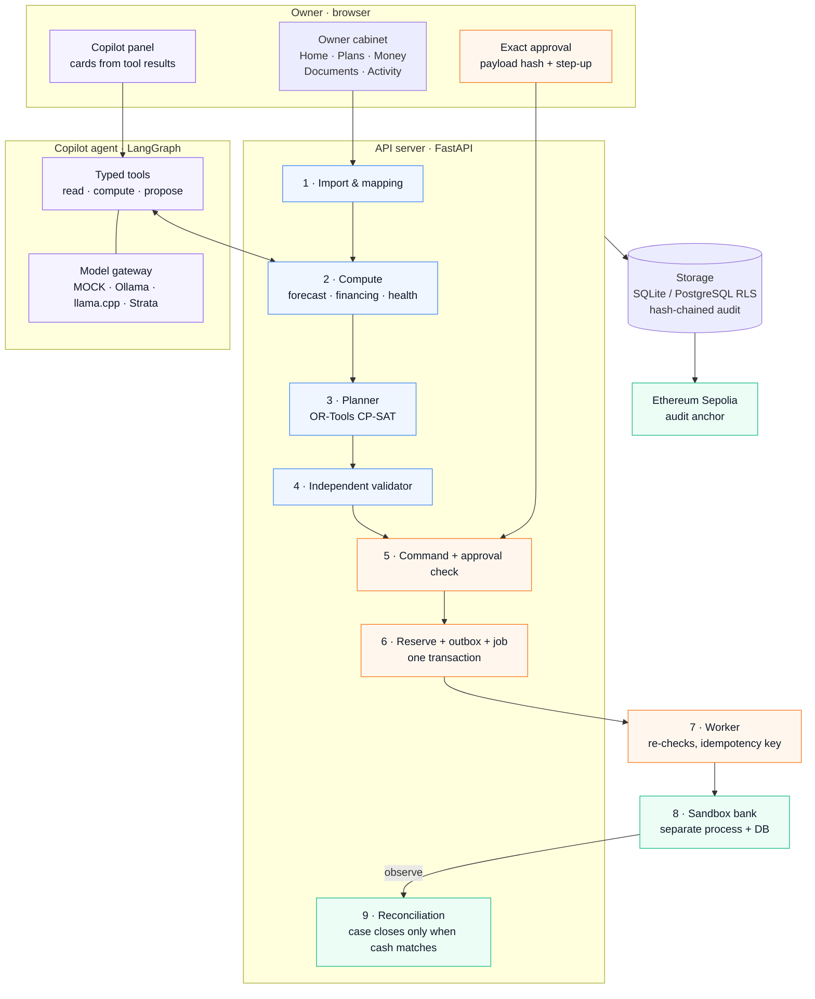

# SME Finance Copilot

**An AI finance copilot for small-business owners that goes past advice to a
reconciled result.** It finds the coming cash gap, explains why it happens, compares
ways to cover it (including financing), lets the owner approve one exact action at a
time, executes it against a sandbox bank and proves the outcome through reconciliation.

International Track · Topic E (SME finance) · version 0.3.0 · MIT license

Repository: <https://github.com/IGK-arch/SME-Finance-Copilot>

> **Data.** Company records, financing products and the bank are synthetic; the model runs MOCK by default.
> The design draws on real public sources: Chinese SME lending regulation (PBoC), the LPR reference rate and public dataset surveys (see [sources](sources/README.md)). No real company, customer or bank data is used, and no real money moves.

## For reviewers

| Submission item | Document |
|---|---|
| 1 · Technical documentation (architecture, core algorithms, security design) | [TECHNICAL_DOCUMENTATION.md](docs/submission/TECHNICAL_DOCUMENTATION.md) |
| 4 · Source code, README, deployment instructions, test cases | this README: [Quick start](#quick-start), [Deployment](#deployment), [Tests](#tests) |
| 5 · Security self-assessment (permission tiers, known-risk list) | [SECURITY_SELF_ASSESSMENT.md](docs/submission/SECURITY_SELF_ASSESSMENT.md) |
| 6 · Execution evidence (sandbox operation logs, on-chain transaction hashes) | [EXECUTION_EVIDENCE.md](docs/submission/EXECUTION_EVIDENCE.md) |
| Scoring criteria mapped to code and evidence | [Submission index](docs/submission/README.md) |

## What it does

| Topic E capability | In the product |
|---|---|
| Financing-option matching | Screens DEMO financing products (PASS / FAIL / UNKNOWN eligibility), prices them exactly (net proceeds, fees, interest, annualised cost) and picks the cheapest plan that closes the gap under a hard cost cap |
| Cash-flow management and alerts | Forecast on contract dates plus delay scenarios, reserve line, what-if for one late or partial receivable, alerts for cash gaps, overdue items, expiring offers, unknown payments and reconciliation mismatches |
| Business financial analysis | Confirmed cash, receivables and payables, ageing buckets, liquidity buffer, coverage of bills due in 30 days, customer and payee concentration |
| Execution beyond advice | Exact owner approval → separate worker → sandbox bank → reconciliation; recovery from a lost bank response without a second payment |

The owner cabinet has six sections: **Home** (one main problem, its cause and the next
step), **Plans** (options side by side, including infeasible ones with reasons),
**Money**, **Documents** (CSV/XLSX import with column mapping and review),
**Activity** and **Settings**. **Copilot** is a context panel over a LangGraph agent;
its result cards are rendered from tool results, so model prose cannot change a
number on screen. The interface is in English, counterparty data may be Chinese,
amounts are in CNY.

## Architecture



Numbers show the path of one plan: 1 import → 2 compute → 3 plan → 4 validate → 5 owner approves the exact payload → 6 reserve and queue → 7 worker sends → 8 sandbox bank settles → 9 reconciliation closes the case.

Details, algorithms and design decisions: [technical documentation](docs/submission/TECHNICAL_DOCUMENTATION.md),
[architecture notes](docs/architecture/README.md), [ADRs](docs/adr/).

## Quick start

Requirements: CPython **3.11** (3.11.9 tested on Windows 11 and Ubuntu 24.04 in CI).
The commands create a new demo workspace with synthetic data.

**Windows (PowerShell)**

```powershell
py -3.11 -m venv .venv
.venv\Scripts\python.exe -m pip install --upgrade pip
.venv\Scripts\python.exe -m pip install --index-url https://pypi.org/simple -r requirements.lock
.venv\Scripts\python.exe -m scripts.task setup
.venv\Scripts\python.exe -m scripts.task migrate
.venv\Scripts\python.exe -m scripts.task seed-demo
.venv\Scripts\python.exe -m scripts.serve --port 8080
```

**Linux / macOS**

```bash
python3.11 -m venv .venv && . .venv/bin/activate
pip install -r requirements.lock
python -m scripts.task setup && python -m scripts.task migrate && python -m scripts.task seed-demo
python -m scripts.serve --port 8080
```

Open <http://127.0.0.1:8080> and sign in with the `OWNER` value from
`.runtime/workspace/local-login.secret.json` (the server prints the path).
Approving a payment asks for the same token again (step-up). Other roles in that
file: `ACCOUNTANT` imports and proposes, `AUDITOR` reads, `ADMIN` can stop sends but
cannot approve payments. Add `?demo=1` to the URL to show the sandbox fault-injection
controls (for example, a lost bank response) in the approval dialog.

Demo walk-through: Home shows a CNY 90,000 gap → Plans compares four options →
choose the financing plan → approve each of five actions → the worker sends them to
the sandbox bank → Activity shows settlement → the case closes only after
reconciliation. The script is in [demo-script.md](docs/submission/demo-script.md).

If pip reports `No matching distribution found for numpy==…`, a local mirror is
missing the pinned wheels; the `--index-url https://pypi.org/simple` flag above
overrides it.

The workspace in `.runtime/` persists between runs; Ctrl+C stops the API, worker and
sandbox and keeps the files. Never publish `.runtime/`: it holds the login tokens.

## Deployment

| Target | Guide |
|---|---|
| Local, SQLite (default) | [Quick start](#quick-start) |
| Public HTTPS on a VPS (Ubuntu, Caddy with Let's Encrypt, systemd, firewall) | [docs/runbooks/deploy.md](docs/runbooks/deploy.md), files in [`deploy/`](deploy/) |
| PostgreSQL with row-level security | [docs/runbooks/postgres.md](docs/runbooks/postgres.md) |
| Optional self-hosted LLM (Strata, through an authenticated SSH bridge) | [docs/runbooks/strata.md](docs/runbooks/strata.md) |

On a VPS the application still listens on `127.0.0.1` only; Caddy is the single
public listener; the server accepts only loopback hosts and the host of
`SME_PUBLIC_ORIGIN`, and serves HSTS over HTTPS.
`python -m scripts.submission_copy --out <dir>` produces a clean copy of the
tracked files without infrastructure details for deployment.

## Tests

```bash
python -m scripts.test                    # full regression (unit, integration, acceptance T001–T100)
python -m scripts.check                   # syntax, ruff, mypy, format, JS syntax
python -m scripts.e2e_v03                 # product path: real HTTP server + worker + sandbox bank
python -m scripts.demo --lost-response    # golden scenario with a deliberately lost bank response
python -m scripts.verify_audit            # verify the hash-chained audit trail of .runtime/workspace
python -m scripts.security_scan           # secret scan and OSV dependency audit
```

Latest full run (20 Oct 2026, Windows 11, CPython 3.11.9): regression **377 PASSED / 4 SKIPPED / 0 FAILED**
of 381 (skipped: PostgreSQL integration, no test database configured); product E2E **23/23 PASSED**;
golden scenario 5/5 actions settled and reconciled; static checks **9/9 PASSED**; acceptance T001–T100
**95 PASSED / 5 NOT_RUN** (T023, T031, T032, T094, T097: need a trained model, external validation or OS isolation).
Raw reports: `artifacts/release-20261020/regression.json`, `artifacts/v03/e2e-latest.json`, `artifacts/golden-latest.json`.

PostgreSQL integration tests run when `SME_POSTGRES_TEST_CONFIG` points to a test
cluster config (see the PostgreSQL runbook); otherwise they are skipped. CI
(`.github/workflows/ci.yml`, Ubuntu 24.04, Python 3.11.9) runs the security scan,
static checks, full regression, golden demo, benchmark and report on every push.

Test cases by area (`tests/`):

| Area | Files |
|---|---|
| Money, time, digests and domain rules | `test_domain.py`, `test_policy_history.py`, `test_workspace.py` |
| Forecast, financing, optimiser and validator | `test_planner.py`, `test_contingency.py`, `test_analysis.py`, `test_evaluator_deadlines.py` |
| Approval, execution, idempotency, reconciliation | `test_execution.py`, `test_settlement_identity.py`, `test_webhook.py` |
| Owner cabinet and HTTP API | `test_v03.py`, `test_product.py`, `test_api.py`, `test_asgi.py`, `test_deploy.py` |
| Security controls and audit fixes | `test_security_hardening.py`, `test_audit_fixes.py`, `test_audit2_fixes.py`, `test_governance.py`, `test_anchor.py` |
| Tenant isolation (PostgreSQL RLS) | `test_postgres.py` |
| Agent graph, tools and answers | `test_workflows.py`, `test_agent_data.py`, `test_agent_edges.py`, `test_agent_challenges.py`, `test_agent_languages.py`, `test_answers.py`, `test_answer_quality.py`, `test_business_health_tools.py`, `test_health_answers.py`, `test_health_mixed.py` |
| Documents and retrieval | `test_documents.py`, `test_retrieval_quality.py` |
| Model providers and resource guards | `test_gateway.py`, `test_strata.py`, `test_llamacpp.py`, `test_resource_guard.py` |
| Evaluation harnesses | `test_live_evaluation.py`, `test_release_eval.py`, `test_business_health_eval.py`, `test_health_challenge_eval.py`, `test_multimodel_report.py`, `test_reasoning_report.py` |

## Security in brief

The model is an advisor, never an actor: it can read scoped data, calculate and
propose, but it has no approve, send, SQL, shell, secret or policy-write tool.
Every payment needs one exact OWNER approval bound to a SHA-256 payload hash with
step-up re-authentication; a separate worker re-checks everything before the bank
is called. Roles are separated (OWNER, ACCOUNTANT, AUDITOR, ADMIN), tenants are
isolated with PostgreSQL row-level security, and the audit trail is hash-chained and
anchored on the Ethereum Sepolia testnet. Full permission tiers and the known-risk
list: [security self-assessment](docs/submission/SECURITY_SELF_ASSESSMENT.md).

## Models

MOCK (default) is a deterministic tool fixture that drives the real agent graph for
tests and the demo. Opt-in providers: local Ollama or llama.cpp (loopback only) and
a self-hosted model on Strata through an authenticated SSH bridge. A failing live
model is recorded as a failed run; there is no silent fallback to MOCK. Measured
results are in the [technical documentation, §6](docs/submission/TECHNICAL_DOCUMENTATION.md#6-models).

## Repository layout

| Path | Contents |
|---|---|
| `finance/` | Backend: API, domain, storage, compute, planner, validator, execution, worker, agent |
| `sandbox/` | Independent sandbox bank (separate process and database) |
| `web/` | Owner cabinet (vanilla JS, no third-party scripts) |
| `scripts/` | Setup, server, tests, demo, evaluation and evidence tools |
| `tests/` | Unit, integration and end-to-end tests |
| `contracts/` | Versioned runtime and data contracts (JSON Schema) |
| `deploy/` | VPS deployment: install script, Caddy, systemd units |
| `docs/submission/` | Reviewer documents for the submission |
| `docs/` | ADRs, runbooks, architecture, model and data cards, acceptance matrices, known limitations, model-evaluation reports (in Russian) |
| `artifacts/` | Evidence: test reports, sandbox logs, model-evaluation summaries, on-chain anchors |
| `sources/` | Research inputs used during design (not loaded by the product) |

## Limitations

- Synthetic data and DEMO financing terms only; no real bank, lender or payment rail.
- Forecast scenarios are uncalibrated and are not probabilities of default.
- Live-model prose can still contain errors; numbers on screen come from tools.
- No secret vault, SSO or OS-level isolation of the sandbox's private files.
- On-chain anchoring uses a public testnet only.

The complete list with severities and mitigations is in the
[known-risk list](docs/submission/SECURITY_SELF_ASSESSMENT.md#5-known-risk-list).

## License

[MIT](LICENSE) © 2026 IGK-arch.
