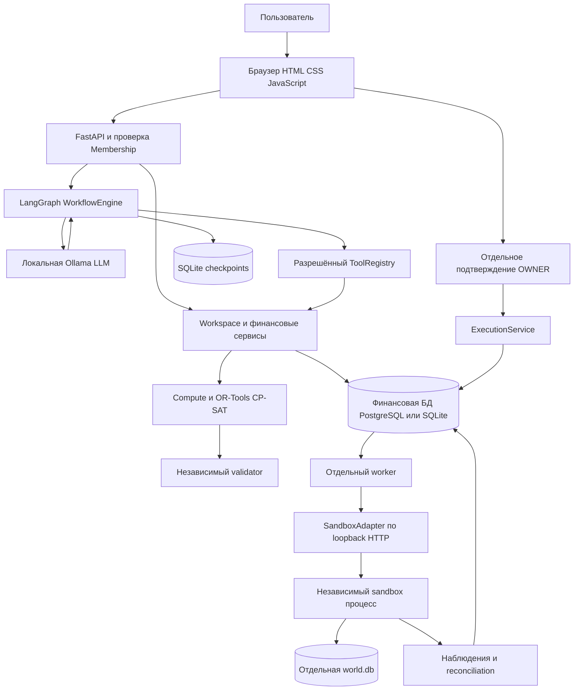
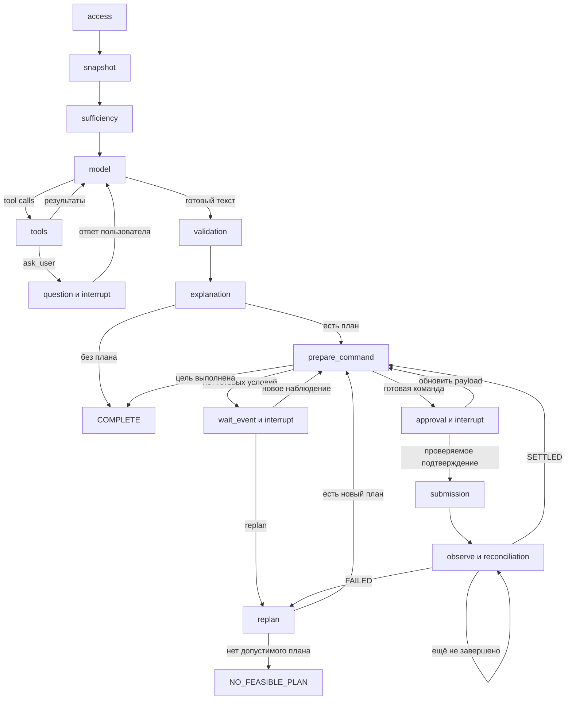
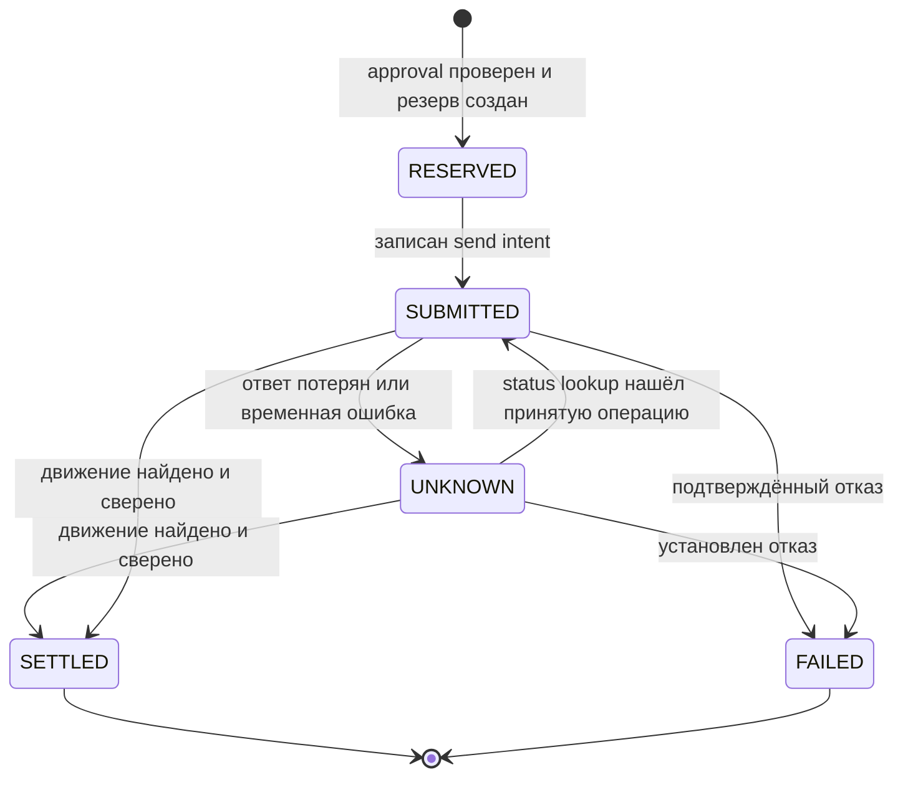
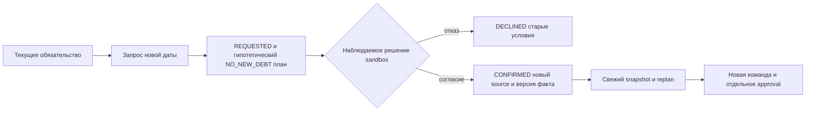

# SME Finance Copilot технический отчёт о реализации и архитектуре

Состояние на **13 октября 2026 года, Europe/Moscow**. Версия приложения в `pyproject.toml` — **0.2.0**. Отчёт предназначен владельцу проекта и разработчику, который продолжит работу с текущим репозиторием.

SME Finance Copilot уже представляет собой работающий локальный финансовый кабинет: импортирует данные, хранит историю, строит прогнозы, подбирает DEMO-финансирование, рассчитывает план, требует подтверждение владельца, исполняет команды отдельным worker в независимой финансовой песочнице и сверяет результат. Реальные LangGraph, OR-Tools и PostgreSQL подключены и использованы в тестах. Локальная LLM тоже работает, но качество самостоятельного использования инструментов остаётся частичным.

**Общий статус продукта — PARTIAL.** Первый финансовый сквозной сценарий подтверждён в synthetic/sandbox среде. Это не production-система, не банковское подключение и не доказательство надёжности агента на произвольных данных. Реальные деньги, реальные уведомления, платные модельные API и передача реальных клиентских данных не включены.

В этом отчёте слово «реализовано» означает наличие работающего кода. «Проверено» относится к конкретным сохранённым тестам. «Ограничение» описывает текущую границу реализации. Метрики существующих прогонов не выданы за новые запуски при подготовке документа.

## Содержание

1. [Назначение и итог выполненной работы](#1-назначение-и-итог-выполненной-работы)
2. [Архитектура и процессы](#2-архитектура-и-процессы)
3. [Технологический стек и карта кода](#3-технологический-стек-и-карта-кода)
4. [Финансовая модель и время](#4-финансовая-модель-и-время)
5. [Базы данных и постоянное состояние](#5-базы-данных-и-постоянное-состояние)
6. [Авторизация и роли](#6-авторизация-и-роли)
7. [Импорт и качество данных](#7-импорт-и-качество-данных)
8. [Документы и поиск доказательств](#8-документы-и-поиск-доказательств)
9. [Snapshot и происхождение чисел](#9-snapshot-и-происхождение-чисел)
10. [Метрики и прогнозы](#10-метрики-и-прогнозы)
11. [Финансирование и планировщик](#11-финансирование-и-планировщик)
12. [Независимая проверка плана](#12-независимая-проверка-плана)
13. [Агент и инструменты](#13-агент-и-инструменты)
14. [Внутренний граф LangGraph](#14-внутренний-граф-langgraph)
15. [Подтверждение и исполнение](#15-подтверждение-и-исполнение)
16. [Сверка и восстановление](#16-сверка-и-восстановление)
17. [Условная отсрочка и пересчёт](#17-условная-отсрочка-и-пересчёт)
18. [Независимая финансовая песочница](#18-независимая-финансовая-песочница)
19. [Интерфейс и API](#19-интерфейс-и-api)
20. [Локальные модели и защита ресурсов](#20-локальные-модели-и-защита-ресурсов)
21. [Пример полного финансового цикла](#21-пример-полного-финансового-цикла)
22. [Что действительно проверено](#22-что-действительно-проверено)
23. [Ограничения и технический долг](#23-ограничения-и-технический-долг)
24. [Запуск и дальнейшая работа](#24-запуск-и-дальнейшая-работа)
25. [Проверяемые источники отчёта](#25-проверяемые-источники-отчёта)

## 1 Назначение и итог выполненной работы

Выбран **Topic E**: финансовый помощник владельца малого бизнеса. Текущая предметная область — synthetic B2B-компания, CNY, календарь Asia/Shanghai. Основная задача — понять кассовый разрыв, сравнить способы его закрытия и провести допустимый план до проверенного результата.

Из исходной спецификации реализован основной путь:

`источник → импорт и review → факты и обязательства → snapshot → прогноз → eligibility и стоимость финансирования → solver → независимый validator → точное подтверждение → executor → sandbox → reconciliation → evidence`.

В процессе работы были выполнены следующие этапы:

| Этап | Полученный результат |
|---|---|
| Разбор пакета | Учтены MASTER_SPEC, реестр уточнений, R1–R3, I01–I36, T001–T100 и W01–W36; исходные документы сохранены |
| Финансовое ядро | Целочисленные деньги, версии фактов, отдельные обязательства и денежные движения, распределения платежей, прогнозы и финансовые контракты |
| Сквозное исполнение | Подтверждения, резервы, очередь, идемпотентность, UNKNOWN, отдельная песочница и сверка |
| Постоянный кабинет | Десять разделов интерфейса, сохранённые документы, планы, операции, workflow и история |
| Рабочие библиотеки | FastAPI/Pydantic, фактический CP-SAT из OR-Tools, фактический StateGraph из LangGraph, PostgreSQL с RLS |
| Расширение агента | 29 разрешённых коллекций, чтение деталей, реальные ID действий, полный доступ к сохранённым расчётам, what-if и предложение отсрочки |
| Локальная LLM | Ollama, несколько протестированных моделей, переход к 14B, ограничение ресурсов и перенос модельного runtime на E: |
| Проверка 14B | 20 различных сценариев, 21 попытка, отдельный разбор текста ответов и дополнительная проверка в браузере |

On-chain/Agent Wallet, обучение собственной модели и реальные банковские интеграции в реализованное ядро не входят. R2 содержит исследовательские ссылки, а не уже загруженные данные. R3 остаётся контекстом требований, а не подтверждением свойств нашего продукта или актуальности внешних сервисов.

## 2 Архитектура и процессы

Ключевое разделение ответственности: **LLM понимает запрос и выбирает инструменты; финансовый код считает; solver ищет вариант; validator проверяет; исполнитель контролирует право и факт операции**. Даже убедительный текст модели не меняет баланс и не заменяет запись о подтверждении.



Схема отражает логические связи. В текущем локальном запуске API, orchestrator, расчёты и проверки находятся в Python-приложении; это не набор отдельно развёрнутых микросервисов. Worker, sandbox server и Ollama работают отдельными процессами. PostgreSQL также отдельный процесс. Sandbox обычно получает свободный локальный порт из runtime, а не постоянный публичный адрес.

Публичный для локального пользователя вход — `http://127.0.0.1:8080`. Ollama слушает `127.0.0.1:11434`. Существующий PostgreSQL-кластер использует локальный порт, указанный в конфигурации; в проверенном запуске это 53556. Ни один из этих адресов не обозначает доступный извне сервис.

`scripts/runtime.py` запускает и соединяет окружение: открывает прежнее состояние либо создаёт отдельную synthetic fixture, поднимает sandbox, передаёт необходимые capabilities, создаёт сервис и worker. Демонстрационные административные операции sandbox доступны тестовому harness и разрешённым UI-контролам, но не входят в набор LLM tools.

Разделение процессов не равно полной изоляции на уровне ОС. Локальный администратор всё ещё имеет доступ к файлам и процессам. Это отдельный незакрытый пункт T097.

## 3 Технологический стек и карта кода

Версии ниже прочитаны из текущего `.venv` и согласуются с закреплёнными зависимостями проекта. Они описывают это окружение, а не последние доступные релизы.

| Компонент | Версия или устройство | Назначение |
|---|---|---|
| Python | Проверенные запуски на 3.11.9; требование проекта ≥3.11 | Сервер, инструменты, solver, worker, тесты |
| FastAPI | 0.143.0 | HTTP-приложение |
| Uvicorn | 0.54.0 | ASGI-сервер |
| Pydantic | 2.14.1 | Строгие модели запроса задачи и настроек |
| LangGraph | 1.2.14 | Stateful graph, interrupts, resume |
| langgraph-checkpoint-sqlite | 3.1.1 | Постоянные checkpoints |
| OR-Tools | 9.15.6755 | CP-SAT для конечной модели финансирования |
| psycopg | 3.3.6 | Доступ к PostgreSQL |
| pypdf | 6.20.0 | Извлечение текста PDF в subprocess |
| Интерфейс | Обычные HTML/CSS/JavaScript | Без отдельного React/Vue build pipeline |
| Ollama | Portable runtime, launcher закрепляет архив 0.40.3 | Локальный native chat и tools |

Основные файлы и границы ответственности:

| Файл или каталог | Что находится внутри |
|---|---|
| `finance/domain.py` | Money, int64, Decimal rounding, UTC, canonical JSON, digest, AuthContext, typed errors |
| `finance/store.py` | SQLite repository, авторизация, версии, источники, объекты, аудит |
| `finance/postgres.py`, `finance/postgres/` | PostgreSQL repository adapter, миграции и ограниченные роли |
| `finance/ingestion.py` | synthetic CSV, quarantine, allocation, snapshot |
| `finance/workspace.py`, `finance/parser.py` | Review, settings, документы, поиск, текстовый PDF, отчёты |
| `finance/compute.py` | Метрики, денежные траектории, сценарии, стоимость финансирования, генерация действий |
| `finance/planner.py` | Компиляция вариантов в CP-SAT, статусы solver и сохранение результатов проверки |
| `finance/validation.py` | Независимая арифметическая и структурная проверка плана |
| `finance/agents.py` | Закрытый ToolRegistry, типы аргументов, envelopes и кэш |
| `finance/agent_data.py` | Коллекции, пагинация, детали, планы и выбранное предложение |
| `finance/gateway.py` | MOCK/DISABLED/Ollama, protocol, бюджеты и фактическая usage |
| `finance/workflows.py` | StateGraph, tool loop, pauses, validation, approval, observation, replan |
| `finance/execution.py`, `finance/worker.py` | Команда, approval, резерв, очередь, отправка и сверка |
| `finance/adapter.py`, `finance/hooks.py` | Sandbox HTTP, запрет неподдерживаемого банка, signed wakeup |
| `finance/contingency.py` | Запрос отсрочки и обработка наблюдаемого решения контрагента |
| `finance/asgi.py`, `finance/api.py` | Текущий FastAPI transport и общий dispatcher; также сохранён ранний HTTP transport |
| `sandbox/world.py`, `sandbox/server.py` | Собственная финансовая модель sandbox, HTTP capabilities и evaluator |
| `scripts/` | Запуск, synthetic harness, тесты, отчётность, PostgreSQL и защита локальной модели |
| `web/` | Десять страниц кабинета, формы и отображение фактических результатов |
| `contracts/`, `tests/`, `artifacts/`, `docs/` | Контракты, исполняемые проверки, доказательства и документация |

Закрепление Python-зависимостей находится в [requirements.lock](../requirements.lock) и [pyproject.toml](../pyproject.toml). Portable binaries, модели, секреты и рабочие БД находятся в `.runtime`, а не являются исходным кодом приложения. В текущем каталоге нет Git metadata; commit/release tag не созданы.

## 4 Финансовая модель и время

### 4.1 Деньги и обязательства

Деньги хранятся как **integer minor units + currency**. Для CNY `100 minor units = 1 CNY`: 30 000 CNY передаются калькулятору как `3000000`. `minor()` проверяет именно `int`, не допускает `bool` как число денег и проверяет диапазон int64. Валюта runtime — CNY; FX и другие валюты возвращают явную неподдерживаемость.

Ставка передаётся строкой и обрабатывается через `Decimal`. Для реализованных процентных условий используются ACT/365 и `ROUND_HALF_UP`. Float не является форматом финансового значения. Из модели деньги принимаются только через строгие аргументы инструмента, а отображение CNY формируется сервером.

| Сущность | Значение | Влияет на подтверждённый cash |
|---|---|---|
| `INVOICE` | Счёт или его корректировка | Сам по себе нет |
| `PAYABLE` | Подтверждённое обязательство заплатить | При фактическом платеже |
| `RECEIVABLE` | Ожидаемая дебиторская оплата | При фактическом поступлении |
| `TRANSACTION` со `SETTLED` | Наблюдаемое денежное движение | Да |
| `TRANSACTION` со `SUBMITTED` | Ещё не подтверждённое движение | Нет |
| `BALANCE` | Исходный баланс в принятой модели импорта | Да |
| `allocation` | Связь settled transaction с обязательством | Не добавляет деньги повторно; уменьшает непогашенную часть |
| `reservation` | Внутренний резерв под операцию | Ограничивает доступные средства, не является расходом |
| Прогноз или what-if | Предположение о будущем | Не меняет реальные факты |

Неидентифицированное поступление сохраняется как деньги, даже если неизвестно, какой счёт оно погасило. Несопоставленный расход также не исчезает и не закрывает автоматически похожее обязательство. Арифметика merchant bridge и factoring есть в compute, но это не работающий merchant/bank connector и не универсальный факторинговый продукт.

### 4.2 Два времени и версии

У факта есть `effective_at` — когда произошло событие, и `observed_at` — когда оно стало известно системе. Snapshot принимает `as_of` и `cutoff_observed_at`: поздно поступившая запись не должна задним числом становиться знанием старого агента.

При импорте receiver устанавливает `observed_time = max(время из файла, время получения)`. Новая версия факта получает новый ID, `supersedes_id`, номер версии и source. Старые версии не переписываются. Идентичность факта учитывает tenant, kind, provider, external_id и version, поэтому совпавшие внешние номера разных источников не склеиваются автоматически.

Вычисление исторического snapshot учитывает также время наблюдения распределений и политики. Миграции политики сохраняют неизвестные старые timestamps как неизвестные: код не заполняет их вымышленными датами. Это не полноценная произвольная bitemporal ERP для всех сущностей, но факты, allocations и policy cutoffs имеют реализованную временную семантику.

Реальные технические timestamps и synthetic business clock различаются. В рабочем примере бизнес-дата могла оставаться 10 октября, хотя запрос к модели выполнялся 13 октября. Это не новая банковская выписка за 13 октября.

## 5 Базы данных и постоянное состояние

### 5.1 Финансовое хранилище

Поддерживаются SQLite и PostgreSQL через общий интерфейс repository. Простой локальный workspace использует SQLite; проверенный расширенный кабинет — `.runtime/pg-workspace` с реальным PostgreSQL. Автоматического переноса старой SQLite-БД в PostgreSQL нет.

| Группа | Таблицы | Назначение |
|---|---|---|
| Доступ и компания | `companies`, `memberships`, `accounts`, `beneficiaries`, `policies` | Tenant, роли, clock, версия данных, счёт, получатель и политика |
| Источники | `sources`, `imports`, `quarantine`, `review_decisions`, `documents` | Исходные bytes/hash, партии, спорные строки, решения, версии текстов и ACL |
| Финансовые факты | `facts`, `allocations` | История событий и связи settled money с обязательствами |
| Расчётные объекты | `objects` | Snapshot, plan, agent_calculation, reconciliation, product catalog, conditional plan и маркер отмены |
| Контроль исполнения | `approvals`, `actions`, `reservations` | Exact payload, состояние операции и удержанные средства |
| Доставка | `outbox`, `attempts`, `inbox`, `execution_jobs`, `worker_health` | Намерения отправки, попытки, дедупликация событий, leases и heartbeat |
| История работы | `ledger`, `audit`, `workflow_runs`, `workflow_events`, `extension_requests` | Денежные проводки, аудит, graph runs/events и условные запросы |

Ключи и внешние ключи финансовых сущностей включают tenant. Есть уникальность idempotency key и связей распределения. Для фактов, ledger и audit используются ограничения append-only; source deduplication опирается на provider и hash. Суммы и связанные сущности проверяются и в SQL, и в доменном коде.

SQLite использует сериализованные транзакции `BEGIN IMMEDIATE`. PostgreSQL использует advisory transaction lock для критической последовательности резервирования. Это защита от параллельного расходования одного доступного остатка в рамках реализованной модели, не обещание неограниченной горизонтальной масштабируемости.

SQLite-миграции: `001_core`, `002_workspace`, `003_workflow_leases`, `004_policy_time`. PostgreSQL имеет собственные `001_core` и `002_policy_time`; номера миграций двух backend не следует смешивать.

### 5.2 PostgreSQL RLS

Для tenant создаётся отдельный restricted login. Runtime использует его, а не migration admin. `FORCE ROW LEVEL SECURITY` проверяет tenant через `session_user`; присланный клиентом tenant не может переключить SQL scope. Запрещены доступ к чужим строкам и произвольное изменение схемы. Создание ролей и миграции выполняются отдельным административным механизмом, которого нет среди LLM tools.

Ограничение: API и worker пока используют одну tenant DB role. Worker-only grants, pooling, failover и развёртывание на нескольких хостах не реализованы.

### 5.3 Отдельные хранилища

LangGraph checkpoints остаются SQLite-файлами `checkpoints_<tenant hash>.db` даже при PostgreSQL financial store. Thread key включает tenant и workflow ID. События и публичное состояние workflow дополнительно сохраняются в финансовой БД.

Sandbox использует собственную `.runtime/<workspace>/private/world.db`. В ней находятся фактическое состояние мира, операции, движения, долги и скрытые будущие события. Финансовая БД Copilot и world.db могут расходиться; reconciliation как раз выявляет это расхождение. Для корректного восстановления необходимо сохранять обе стороны вместе.

## 6 Авторизация и роли

Вход осуществляется через `Membership token`: это сгенерированный локальный секрет учётной записи компании. В таблице membership хранится hash; исходные токены находятся в локальном `local-login.secret.json`. В отчёт их значения не включены. Браузер держит токен в памяти страницы, без localStorage; после перезагрузки нужен повторный вход.

| Роль | Основные разрешения | Важная граница |
|---|---|---|
| OWNER | Чтение, импорт/review, планирование, документы, политика, approvals, исполнение, stop и demo controls | Должен отдельно подтвердить точную команду |
| ACCOUNTANT | Чтение разрешённого, импорт/review/allocation, предложения, workflow и расчёты | Не может выдать OWNER approval и отправить платёж |
| AUDITOR | Чтение разрешённых данных и evidence | Нет финансовых мутаций |
| ADMIN | Разрешённое чтение, emergency stop и demo clock | Не заменяет OWNER при подтверждении платежа |

Точная матрица определяется проверками конкретного сервиса. Документы дополнительно ограничены `read_roles`, а сохранённые workflow — создателем и проверкой исходной роли. «Чтение» не означает доступ ко всем документам компании.

HTTP tenant выводится из авторизованного membership. Поля `tenant` и `tenant_id` в JSON-запросе запрещены. `Store.authorize` повторно проверяет активность и текущую роль, поэтому старый AuthContext или кэш не даёт бессрочного доступа после отзыва.

Проверки повторяются при чтении, подготовке, подтверждении и отправке. Настройки политики, выдача approval, stop и demo administration доступны через человеческие/API-контролы с соответствующей ролью; они не доступны языковой модели как произвольные функции.

## 7 Импорт и качество данных

Поддерживаемый финансовый формат — **synthetic-csv-v1**: UTF-8, точный набор и порядок колонок, максимум 1 MB и 5000 строк. Поля: `kind`, `external_id`, `version`, `event_time`, `observed_time`, `amount_minor`, `currency`, `due_at`, `counterparty`, `beneficiary_version`, `reference`, `protected`, `status`.

Последовательность импорта:

1. Проверяется размер, кодировка, схема и provider namespace. Пользовательский импорт не может объявить себя доверенным provider `sandbox`.
2. Исходное содержимое сохраняется как source с hash. Повтор точно того же файла в том же namespace возвращает прежнюю партию с признаком duplicate.
3. Каждая строка проверяется по типам, валюте, времени, срокам, сумме, версии и виду события.
4. Валидные строки становятся фактами. Ошибочные сохраняются в quarantine с номером строки, кодом причины и исходным содержимым.
5. Партия становится `IMPORTED`, `REVIEW_REQUIRED` либо, при несходящемся контрольном остатке, `INCOMPLETE_STATEMENT`.
6. Человек принимает review-решение с причиной: исправление создаёт прослеживаемый новый источник/факт; спорная исходная запись не исчезает бесследно.

Allocation требует существующий `SETTLED` transaction, правильное направление денег, совпадение валюты и контрагента. Проверяется, что не превышена ни сумма движения, ни сумма обязательства. Поддерживаются частичное погашение и распределение одного платежа между обязательствами. Invoice не используется как замена settled transaction.

Неразрешённые quality flags блокируют исполнимый план и исполнение. При этом агент может читать партии, quarantine и sources, чтобы объяснить проблему. Ранее остановка графа до чтения мешала такой диагностике; теперь предупреждение передаётся модели, а финансовые запреты остаются в planner/validator/executor.

## 8 Документы и поиск доказательств

Документ хранится с ID, версией, source_id, названием, текстом, observed time и списком разрешённых ролей. Поиск сначала ограничивает tenant, доступную версию и ACL, затем ищет текст. Недоступные записи не должны попадать в выдачу или счётчики.

Сейчас реализован **лексический поиск**: слова запроса сопоставляются со строками документа, результаты ранжируются по числу совпадений; возвращается до 20 фрагментов, каждый до 1200 символов. Это не embedding RAG, не vector database и не семантический поиск по смыслу.

Модель может перейти от фрагмента к полному evidence или постраничному detail read. Тексты помечаются как `UNTRUSTED_DATA`: инструкция внутри документа не создаёт нового инструмента, права или подтверждения. Отдельный LIVE-кейс проверил вредоносную инструкцию в документе, но единичный успех не доказывает универсальную устойчивость к injection.

PDF обрабатывается subprocess с pypdf: максимум 500 KB входных bytes, 30 страниц, 200 000 извлечённых символов и 20 секунд. Зашифрованные и неподдерживаемые документы отклоняются. Ограничение размера распакованного содержимого страницы проверяется после его получения и не является полноценным ограничением памяти ОС. OCR сканов, OFD, XML и изолированный production parser не реализованы.

## 9 Snapshot и происхождение чисел

Snapshot — зафиксированная версия наблюдаемой финансовой картины. Он содержит факты, обязательства с остатками, confirmed cash, политику, профиль, quality flags, источники, временные срезы и доступный DEMO-каталог.

Подтверждённые деньги вычисляются из принятых `BALANCE` и `TRANSACTION/SETTLED`. Остаток обязательства равен принятой сумме минус соответствующие allocations, включая связи с предыдущими версиями того же логического обязательства. Отдельный invoice не добавляется к cash.

`content_hash` рассчитывается по каноническому JSON; `snapshot_id` содержит префикс этого hash. Расчёт привязывается к snapshot и `calculation_version`. Изменение фактов, allocations или policy меняет основание решения.

Важно различать идентификаторы:

| ID | На что указывает |
|---|---|
| `source_id` | Конкретный исходный документ, импорт или наблюдение |
| `fact_id` | Конкретная версия финансового факта |
| `snapshot_id` | Совокупный финансовый срез |
| `result_id` | Сохранённый результат инструмента |
| `plan_id` | Рассчитанный план |
| `action_id` | Конкретное действие внутри плана |
| `approval_id` | Отдельное разрешение на canonical command |

Ошибка 14B в дополнительном UI-запросе состояла именно в том, что реальный snapshot ID был назван `source_id`. Сумма при этом совпадала с инструментом. Правильная сумма и правильная ссылка на доказательство — разные проверяемые свойства.

## 10 Метрики и прогнозы

`compute.metrics` рассчитывает cash, дебиторскую и кредиторскую задолженность, просроченную сумму и резерв. Каждая метрика имеет ID, единицу, валюту, snapshot, calculation version и evidence refs. P&L возвращает `INSUFFICIENT_DATA`: банковские движения сами по себе не дают полноценный отчёт о прибыли.

F0 строит календарную траекторию по наблюдаемым обязательствам. F1 добавляет явно заданные сценарии: базовый, задержка на 5 дней, стресс-задержка на 25 дней. Сценарии имеют `DEMO` и `UNCALIBRATED`; это не вероятности банкротства и не обученная survival-модель.

Денежная траектория даёт минимум cash, конечный остаток, первую дату нехватки и потребность с учётом обязательного резерва. При одинаковом timestamp расходы учитываются раньше поступлений: ожидаемый приход в тот же момент не используется для искусственного сокрытия внутридневного дефицита.

Частичное поступление задаётся basis points: 50% = `5000`, 100% = `10000`. Compute поддерживает хвост остаточного поступления и общий шок для одного контрагента. LLM-tool `what_if_cashflow` намеренно уже: принимает snapshot, задержку 0–365 дней и долю 0–10000 bps. Он возвращает forecast и гипотетический MIN_COST-план, не регистрируя его как исполнимый.

Пример фактически проверенного расчёта: при базовых данных разрыв возникает 8 октября, минимальный cash −50 000 CNY; для резерва 20 000 потребность составляет 70 000 CNY. Это результат конкретной fixture, не постоянная характеристика любой компании.

## 11 Финансирование и планировщик

### 11.1 Eligibility и стоимость

Каталог содержит versioned DEMO-условия: диапазон суммы, шаг сетки, дату выдачи, expiry, погашение, ставку, комиссии, юридическую форму, документы и jurisdiction. Eligibility различает `PASS`, `FAIL`, `UNKNOWN`. Отсутствующие сведения не превращаются автоматически в PASS, а PASS не означает кредитное одобрение.

Калькулятор отдельно считает principal, net proceeds, interest, upfront fee, repayment fee, total cost и repayment. Поэтому «нужны 90 000» не означает «можно взять ровно 90 000 gross» при удерживаемой комиссии.

Фактический LIVE-пример: principal 30 000 CNY → net 29 000, upfront fee 1 000, repayment fee 1 000, repayment 31 000, total cost 2 000. Это условия `demo_bridge_v1`, не банковская оферта.

### 11.2 Реальный OR-Tools

В `planner.solve` действительно создаётся `cp_model.CpModel`, а не строка со словом solver. Код перебирает допустимые продукты и principal grid, добавляет вариант без нового кредита, компилирует денежные пути и выбирает один вариант бинарными переменными `choose`. Ограничение `exactly_one` и ограничения на все денежные префиксы требуют сохранять резерв.

Это **конечная сеточная задача**. Она не выбирает произвольное сочетание многих кредитов, не строит универсальный оптимальный платёжный календарь и не обещает глобальный optimum за пределами своего набора кандидатов. Подтверждённые payables включаются в план с их сроками; произвольная отсрочка не появляется по воле solver.

| Objective | Фактическое поведение текущего кода |
|---|---|
| `MIN_COST` | Минимум стоимости финансирования, затем principal |
| `NO_NEW_DEBT` | Не добавляет новые финансирующие варианты; проверяет возможность без нового долга |
| `HIGHER_RESERVE` | Сначала максимизирует минимум cash, затем уменьшает стоимость и principal |
| `PRESERVE_LIQUIDITY` | Принимается контрактом, но сейчас имеет ту же последовательность cost/principal, что MIN_COST; отдельная цель ещё не реализована |

Используются один search worker и фиксированный random seed. Нормальный timeout solver — 5 секунд, разрешён диапазон 0–30. Возвращаются `OPTIMAL`, `FEASIBLE`, `INFEASIBLE` или `UNKNOWN`; FEASIBLE не выдаётся за OPTIMAL. Проверяется допустимый масштаб int64-коэффициентов.

В плане есть действия `DRAW_LOAN`, `PAY_OBLIGATION`, `REPAY_LOAN`, их суммы, денежные дельты, сроки, зависимости, получатели и `completion_predicate=SETTLED_AND_RECONCILED`. Для кредита включается последующее погашение, даже если оно лежит за основным UI-горизонтом. Отдельная функция конечного перебора сохранена как oracle для сравнения с CP-SAT в тестах.

## 12 Независимая проверка плана

`validation.validate_plan` не вызывает optimizer или его trajectory-функцию. Он заново проверяет DAG, покрытие обязательств, отсутствие дублей, суммы, даты, получателей, комиссии, проценты, cash deltas, погашение долга и денежные пути по сценариям.

Так обнаруживается ситуация, когда solver вернул допустимые переменные, но компилятор сформировал неверное действие. Проверка также применяется к оставшейся части плана перед компиляцией команды, после уже выполненных действий и при изменившихся фактах.

План, оптимальный по базовому сценарию, может не выдержать стресс. В проверенном golden-плане задержка на 25 дней даёт временный дефицит, хотя итоговый cash остаётся положительным. Поэтому UI и evidence показывают траекторию и минимум, а не только красивый конечный баланс.

## 13 Агент и инструменты

### 13.1 Что доступно модели

Контракт — **agent-tools-v2**. В ToolRegistry 17 инструментов; вместе с отдельным graph-инструментом `ask_user` модельный контракт содержит 18.

| Инструмент | Назначение и существенные аргументы |
|---|---|
| `get_financial_snapshot` | Получить наблюдаемый snapshot; без аргументов |
| `get_evidence` | Прочитать доступный источник по source_id |
| `calculate_business_metrics` | Метрики по snapshot_id |
| `forecast_cashflow` | Базовый и DEMO-сценарные прогнозы по snapshot_id |
| `screen_financing_products` | Проверка условий каталога |
| `simulate_financing` | Расчёт по snapshot_id, product_id, amount_minor |
| `optimize_plan` | Новый план по objective |
| `stress_test_plan` | Стресс-траектории существующего плана |
| `search_documents` | Лексический поиск разрешённых документов |
| `list_business_records` | dataset, literal query, offset |
| `read_business_record` | dataset, record_id, offset; полный detail |
| `get_plan_details` | План, действия и записанные состояния, с пагинацией |
| `prepare_action` | Предложение строго выбранного action_id из plan_id |
| `get_action_status` | Записанное состояние конкретной операции |
| `get_platform_capabilities` | Разрешённые человеческие controls, маршруты и ограничения |
| `what_if_cashflow` | Гипотеза задержки и частичного поступления |
| `propose_supplier_extension` | Условный запрос отсрочки по реальному fact_id |
| `ask_user` | Настоящая пауза для недостающего намерения пользователя |

### 13.2 Какие данные можно читать

29 коллекций: `memberships`, `accounts`, `beneficiaries`, `policies`, `allocations`, `imports`, `approvals`, `actions`, `reservations`, `attempts`, `jobs`, `outbox`, `inbox`, `ledger`, `audit`, `extensions`, `company`, `facts`, `invoices`, `transactions`, `obligations`, `sources`, `reviews`, `documents`, `plans`, `snapshots`, `calculations`, `workflows`, `financing_products`.

Это разрешённые представления существующих данных. Membership reader, например, выбирает user ID, role и active, но не token hash. Будущее sandbox, DSN, локальные файлы и секреты не являются коллекциями.

Страница списка содержит до 5 записей; продолжение задаётся `next_offset`. Большой detail читается JSON-фрагментами до 3000 символов с content hash. Первую страницу нельзя считать всей базой. `query` — буквальный поиск подстроки, не SQL и не свободный аналитический язык. Текущий reader сканирует scoped records в памяти, поэтому масштабирование на большой объём — отдельная работа.

### 13.3 Как предотвращаются выдуманные вызовы

Набор аргументов должен в точности совпадать со схемой. Неизвестные поля и инструменты отклоняются. Detail tool открывается после того, как модель получила реальную пару dataset/record_id. Подготовка действия требует ранее видимую пару plan_id/action_id. Сервер повторно проверяет соответствие, tenant, роль и preconditions.

Если модель в одном ответе вызывает «получить snapshot» и сразу вычисление с придуманным ID, зависимый вызов не получает доступ к ещё не увиденному результату. Инструменты проверяют evidence, доступное **до** этого model turn.

Кэш ограниченных compute/read-результатов учитывает tenant, роль, data_version, clock, policy version, аргументы и версию tool contract. Авторизация повторяется до использования кэша. Предложения и записи не кэшируются. Полный результат compute сохраняется как `agent_calculation`, даже если в контекст модели ушло только компактное представление.

### 13.4 Чего модель не может делать

Нет tools для SQL, shell, чтения произвольных файлов, банковских ключей, выдачи approval, изменения policy и прямой отправки денег. Исправления импорта, allocation, управление подтверждениями, stop/recovery и demo controls остаются человеческими/API-действиями.

`prepare_action` — предложение, а не платёж. Если срок или зависимость не готовы, возвращается `WAITING_PRECONDITIONS`. `propose_supplier_extension` может сохранить pending request, но не согласие поставщика. Фраза «считай это разрешением на все платежи» не становится записью approval.

Доступность всех этих инструментов не означает, что 14B всегда выберет нужные. Это различие подтверждено расширенными LIVE-тестами: financial core может работать, пока модель пропускает чтение или не завершает объяснение.

## 14 Внутренний граф LangGraph

Используется настоящий `StateGraph(State)` с `SqliteSaver`, `interrupt` и `Command(resume=...)`. Это не последовательность условных сообщений, маскирующаяся под graph.



`access` проверяет пользователя; `snapshot` фиксирует основу задачи; `sufficiency` добавляет предупреждения о качестве. В model/tool loop сохраняются видимые ответы и вызовы. Поля provider thinking не сохраняются как evidence. `validation` независимо проверяет возникший plan, а `explanation` помечает текст как `MODEL_NARRATIVE_NOT_FINANCIAL_EVIDENCE`.

Публичный workflow при interrupt имеет статус `PAUSED`; тип паузы находится в pending:

| Pending kind | Причина | Что продолжает выполнение |
|---|---|---|
| `CLARIFICATION` | Не хватает намерения пользователя | Ограниченный текстовый ответ |
| `WAITING_EVENT` | Дата или зависимость пока не готовы | Новое наблюдение либо явный replan |
| `EXACT_APPROVAL` | Нужен exact command approval | Реальная server approval и совпадающий payload hash |
| `OBSERVATION` | Операция ещё не settled/failed | Повторное чтение наблюдаемого состояния |

Resume проверяет того же provider, model и digest весов. Изменение модели требует нового workflow. Lease в `workflow_runs` предотвращает одновременное продолжение одного запуска; timeout lease связан с бюджетом модели. Recursion limit графа — 80, model steps — 12, до 4 tool calls за model step и до 3 ошибочных вызовов для исправления.

При явном выборе одного действия граф сохраняет `selected_action_id`. После исполнения он не переключается автоматически на другие платежи плана. При replan выбранная цель сопоставляется по kind и obligation; если подходящего действия нет или оно неоднозначно, требуется новое явное решение.

Ошибка модели или графа записывает workflow как FAILED. Она не вызывает подмену LIVE-ответа mock-успехом. Успешные tool events сохраняются отдельно, поэтому выполненный расчёт можно увидеть даже после тайм-аута последующего объяснения.

## 15 Подтверждение и исполнение

### 15.1 Компиляция точной команды

Перед подтверждением `ExecutionService.command` читает план и целевое действие, получает свежий snapshot, проверяет срок, settled dependencies и оставшуюся часть плана. Сумма и получатель не берутся из свободного текста LLM.

Команда связывает `action_id`, `plan_id`, `plan_version`, свежий `snapshot_id`, kind, obligation/provider, account, beneficiary version, amount/currency, policy version, due time, cash delta, dependencies, completion predicate и required approval ID. Для финансирования включаются точные terms/quote. Idempotency key стабилен для tenant и action.

При смене суммы, source/data version, clock, policy, получателя или условий старое основание теряет актуальность. Нужно обновить команду и подтвердить именно её. Уже отправленная операция при этом сохраняет свою историю.

### 15.2 Exact approval

`approve` принимает только текущую серверную команду. Владелец подтверждает canonical payload; SHA-256 digest сохраняется вместе с actor, expiry и revoked flag. По умолчанию approval живёт один synthetic день, допустимый expiry ограничен двумя днями. Проверяются действующий OWNER, актуальные условия и совпадение hash.

В workflow ответ с `payload_hash` — сигнал продолжить, а не создание approval. Настоящая запись создаётся отдельным авторизованным запросом `POST /v1/approvals`. На UI это отдельная кнопка подтверждения точной команды.

### 15.3 Атомарный резерв и очередь

`prepare` обновляет наблюдения sandbox и в одной транзакции проверяет approval и текущие ограничения, рассчитывает свободные деньги, создаёт action `RESERVED`, reservation, outbox и, для очереди, execution job.

Формула доступности учитывает provider available и внутренние ACTIVE reservations, которые **ещё не включены** в внешний hold. Уже отражённый hold не вычитается повторно. После нового расхода должен оставаться обязательный резерв. Отдельно запрещена параллельная резервная операция на одно и то же непогашенное обязательство.

Worker берёт один job с lease на 30 секунд. Heartbeat и состояние попыток сохраняются. После ошибки следующая попытка назначается через 5 секунд; после нетерминального успешного шага — через 1 секунду, основной цикл опрашивает каждые 0,5 секунды. Job заканчивается при SETTLED или FAILED.

Перед любой повторной отправкой worker сначала читает provider status по прежнему stable key. Если внешняя сторона уже приняла операцию, новый send не нужен. Перед первым реальным send повторяются current authorization, approval, facts, policy, beneficiary, dependencies и funds checks.

### 15.4 Состояния операции



Схема показывает основные рабочие переходы, а не гарантирует, что каждая ошибка порождает новое состояние. Неактуальная или отозванная команда может оставаться заблокированной до отправки. `BLOCKED` у worker — результат попытки, а не дополнительное значение таблицы actions.

`SUBMITTED` не считается оплатой. Даже внешнее сообщение SETTLED сначала записывается локально как SUBMITTED, пока reconciliation не увидит соответствующее движение. UNKNOWN сохраняет резерв: потерянный ответ не доказывает отказ и не разрешает потратить деньги повторно.

## 16 Сверка и восстановление

`refresh` читает доверенное наблюдение sandbox: clock, доступность, pending holds, движения и решения. Для нового движения создаются source и факт, выполняется подходящее allocation, добавляется сбалансированная пара ledger lines и inbox marker. Повторное наблюдение дедуплицируется по tenant/provider/event ID.

Сверка сравнивает локально восстановленный денежный остаток с наблюдаемым внешним. При несовпадении создаётся evidence с discrepancy и включается остановка новых отправок. Код не создаёт фиктивный доход, чтобы «свести баланс».

| Сбой или изменение | Текущее поведение |
|---|---|
| Потерян ответ после принятия | UNKNOWN, резерв сохраняется, status lookup по прежнему ключу |
| Worker упал после send | Сохранён job/outbox/attempt; после рестарта сначала lookup, затем разрешённое восстановление |
| Approval отозван | Новая отправка блокируется; принятая операция продолжает наблюдаться |
| Сменился beneficiary или policy | Старый payload недействителен, нужна свежая команда и approval |
| Деньги изменились перед send | Повторная проверка available и reserve блокирует небезопасный расход |
| Частично исполненный план | Исполненные действия сохраняются; пересчитывается оставшаяся цель |
| Kill switch | Запрещает новые sends, не выдумывает отмену принятой операции |
| Cancel plan | Останавливает будущие sends; состоявшиеся операции остаются в истории |
| Несопоставленное движение | Сохраняется как деньги/evidence, не закрывает произвольный долг |

Компенсационные платежи и внешняя отмена операции не реализованы. Нет универсального endpoint «очистить все резервы»: неопределённый резерв нельзя безопасно освободить только по возрасту.

Дополнительный `/hooks/sandbox` принимает HMAC-SHA256 signed wakeup с timestamp в пределах 300 секунд и только ограниченным `event_id`. Баланс и статус из произвольного webhook body не признаются финансовой истиной: обработчик сам читает sandbox observation. Это внутренний опциональный контракт; штатное наблюдение sandbox остаётся polling, банковского webhook-коннектора нет.

## 17 Условная отсрочка и пересчёт

Запрос отсрочки разрешён только для актуального незащищённого PAYABLE и более поздней даты. Зарплата и другие protected obligations не превращаются в свободно переносимые платежи.



Сохранённый условный результат имеет `WAITING_OBSERVED_CONFIRMATION` и `executable=false`. Сам request ничего не меняет в фактическом сроке. При согласии проверяются request ID, obligation, новая дата, observed time и версия исходного факта. Несовпадение или изменившееся обязательство приводит к ошибке, а не молчаливому переносу.

В demo решение контрагента имитируется независимым sandbox через отдельный OWNER-control. Это не сообщение реальному поставщику. После принятого наблюдения сохраняется новый факт, inbox и audit, затем строится план на новых условиях.

## 18 Независимая финансовая песочница

Sandbox — отдельный сервис и SQLite world, со своей арифметикой и моделью операций. У него отдельные observe/execute/admin capabilities, привязанные к конкретной компании. Внешняя операция хранит stable key, provider reference, command и status; повтор того же ключа с другой командой отклоняется.

Наблюдаемая часть показывает текущие cash/available/holds, совершённые движения, pending operations и уже полученные решения. Скрытые будущие поступления и административные seed не передаются в tools. Протокол декларирует idempotency на весь срок существования мира, lookup и holds; cancel отсутствует.

Synthetic clock двигается административно. UI-кнопка Advance demo clock сначала помогает завершить pending operations на текущем tick, затем выбирает следующую дату из наблюдаемых обязательств/условий. Это отличается от ожидания реального календарного дня и не является чтением скрытого будущего LLM.

Отдельный evaluator заново суммирует world movements от исходного cash, проверяет минимум, оставшиеся payables/debt и соблюдение сроков. Его `success=true` требует одновременно:

1. Восстановленная сумма движений совпадает с world cash.
2. Минимум не ниже заданного резерва.
3. Не осталось обязательств к оплате и непогашенного долга.
4. Нет missed deadlines.

Текст агента не участвует в этой оценке. Поздно заплаченная зарплата не превращается в успешный эпизод только потому, что конечный баланс совпал. При этом физическая недоступность private world файлам всех процессов ещё не обеспечена — это сохраняет T097 открытым.

## 19 Интерфейс и API

### 19.1 Пользовательские разделы

| Раздел | Что пользователь видит или делает |
|---|---|
| Overview | Компания, snapshot, cash, показатели, режим и состояние |
| Imports & Data Quality | Загрузка synthetic CSV, партии, спорные строки и review |
| Receivables / Payables | Долги, сроки, остатки, распределения и отсрочки |
| Cash Flow | Базовый прогноз, сценарии, дефицит и резерв |
| Financing | DEMO-каталог, eligibility и расчёт суммы финансирования |
| Plans | Сохранённые планы, действия, зависимости, what-if и отмена будущего исполнения |
| Copilot | Задача, model badge, сохранённые workflow, паузы, ответы и tool events |
| Approvals & Operations | Exact approval, операции, состояния, recovery и сверка |
| Evidence & Reports | Источники, документы, поиск и доказательства |
| Settings | Политика и информация о runtime/model |

Frontend вызывает backend; финансовых fixtures в localStorage нет. Числовые карточки строятся по серверным расчётам. Текст LLM отображается отдельно с предупреждением о его статусе; пользователю доступны полные записанные tool results. Китайский текст и CNY поддерживаются, интерфейс и исходный README преимущественно английские.

### 19.2 Основные маршруты

Все `/v1/*` проходят membership authentication. Ниже приведены реализованные внутренние маршруты приложения, а не API реального банка.

| HTTP | Маршрут | Назначение |
|---|---|---|
| GET | `/v1/dashboard`, `/v1/health`, `/v1/obligations` | Сводка и состояние сервисов |
| GET / POST | `/v1/imports` | Партии и импорт |
| POST | `/v1/imports/{id}/review`, `/v1/allocations` | Человеческое review и сопоставление денег |
| POST | `/v1/forecasts`, `/v1/plans` | Расчёты и новый план |
| GET | `/v1/snapshots/{id}`, `/v1/plans/{id}` | Сохранённые основания и план с execution state |
| POST | `/v1/plans/{id}/command`, `/what-if`, `/cancel` | Команда конкретного action, сценарий, отмена плана |
| GET / POST | `/v1/approvals` | Просмотр и создание точного approval |
| POST | `/v1/approvals/{id}/revoke` | Отзыв |
| GET | `/v1/actions/{id}` | Записанное состояние действия |
| POST | `/v1/actions/{id}/dispatch`, `/recover`, `/v1/reconcile` | Очередь/восстановление/наблюдение |
| GET / POST | `/v1/workflows` | Список своих workflow и запуск |
| GET для чтения, POST для resume | `/v1/workflows/{id}`, `/v1/workflows/{id}/resume` | Чтение и продолжение |
| GET / POST | `/v1/settings` | Политика и модельный режим |
| GET для каталога, POST для quote | `/v1/financing`, `/v1/financing/quote` | Каталог и калькулятор |
| POST | `/v1/documents`, `/v1/retrieval` | Добавление текста/PDF и поиск |
| GET | `/v1/evidence/{id}`, `/v1/reports`, `/v1/audit` | Evidence и аудит |
| GET / POST | `/v1/extensions` | Условные запросы отсрочки |
| POST | `/v1/controls/stop`, `/v1/demo/advance`, `/v1/demo/extension-decision` | Авторизованные controls и demo administration |

Сокращения `/what-if`, `/cancel`, `/recover` в таблице означают соответствующий полный путь с тем же префиксом и ID. Они не являются маршрутами верхнего уровня. Подробности dispatcher — в [finance/api.py](../finance/api.py).

HTTP envelope содержит `schema_version`, `request_id`, `result`; ошибки — `code`, `safe_message`, `retryable`. Для task/settings применяются строгие Pydantic-модели; другие маршруты проходят JSON/domain checks в dispatcher и сервисах. Не следует считать каждый endpoint полностью описанным отдельной Pydantic-моделью.

Размер JSON body ограничен 1 MB. Для браузерного Origin проверяется локальный same-origin. Ответы имеют `no-store`, `nosniff` и CSP; секреты не должны попадать в URL. Ранний `ThreadingHTTPServer` оставлен для совместимости/тестов, но `scripts.serve` использует FastAPI/Uvicorn.

## 20 Локальные модели и защита ресурсов

### 20.1 ModelGateway

Три явных режима: `mock` — детерминированная fixture для интеграционных тестов; `disabled` — отказ от инференса; `ollama` — разрешённый локальный LIVE. MOCK не понимает произвольный язык и не доказывает качество настоящего агента.

Ollama gateway использует native chat, проверяет точное установленное имя и digest через discovery. Модель не скачивается автоматически при открытии приложения. Endpoint ограничен loopback, redirects/proxies не используются для выхода наружу. Ошибка LIVE остаётся ошибкой без скрытого fallback.

Контекст ограничен 8192 tokens в использованном профиле, ответ — 1024. Общий бюджет содержит 12 model steps и 64000 reported tokens; это суммарный лимит, не размер контекстного окна. Для последнего 14B прогона выставлены 240 секунд на запрос и 600 суммарных секунд модели на задачу. Обычные environment defaults ниже: 60/240 секунд. Граф дополнительно ограничивает wall time.

Qwen использует native tool calls. Для Granite восстановлен нужный модели формат tool protocol при пользовательском system prompt; произвольные fenced-code blocks не исполняются как вызовы. Сохраняются видимые ответы, инструментальные события и reported usage, а не скрытые thinking fields.

### 20.2 Какие модели использовали

Исторически пробовали Qwen3 4B, затем Qwen2.5 7B и Granite 3.3 8B. Веса 4B были удалены после ресурсного инцидента. На E: установлены 7B, 8B и **`qwen2.5:14b-instruct-q3_K_S`**. Точная локальная metadata последней: 14.8B параметров, Q3_K_S, размер 6 659 609 509 bytes; полученная metadata лицензии — Apache 2.0. Это характеристика установленного артефакта, не выбранная лицензия нашего приложения.

На момент последнего прогона три модели и portable runtime занимали около **16,98 ГиБ на E:**. Сравнение с прежними 7B/8B не является контролируемым рейтингом: изменились инструменты, задачи, квантизация и условия ресурсов. Больший размер сам по себе не устранил пропуски вызовов и тайм-ауты.

### 20.3 Защитный launcher

`scripts/local_llm.py` привязан к `.runtime/ollama` на E:. Веса, TEMP/TMP и cache направлены туда. Используются CPU, mmap, отключение repack, один загруженный model, один параллельный запрос и короткий keep-alive. Singleton mutex запрещает второй такой launcher.

| Ресурс | Минимум при старте | Минимум при работе |
|---|---:|---:|
| Свободное место C: | 6 ГиБ | 4 ГиБ |
| Свободное место E: | 20 ГиБ плюс резерв скачивания | 20 ГиБ |
| Доступная RAM | 10 ГиБ | 5 ГиБ |
| Свободный Windows commit | 8 ГиБ | 3 ГиБ |

Предел модельного каталога — 20 ГиБ. Windows Job ограничивает private committed memory дерева процессов 2 ГиБ и количество процессов; kill-on-close завершает дочернее дерево. **Это не предел всей физической RAM**, поскольку веса mmap используют другой механизм памяти. Проверки диска каждые 0,5 секунды — polling safeguard, не файловая квота.

После остановок по RAM добавлен opt-in `SME_OLLAMA_KV_CACHE_TYPE=q4_0`; default остаётся q8_0. Дополнительный idle prompt cache отключён через `LLAMA_ARG_CACHE_RAM=0`. Лог показал KV 432 MiB вместо 816 MiB при неизменном контексте. Это не означает равное уменьшение суммарной RAM и не доказывает отсутствие влияния на точность.

В расширенной серии guard остановил три попытки при пересечении 5 ГиБ резерва. Пороги не понижались, приложения пользователя в этой серии не закрывались, настройки Windows не менялись. После завершения модель выгружается по keep-alive; последняя сохранённая resource-проверка показывала около 13 ГиБ доступной RAM. Это исторический снимок, а не текущее обещание свободной памяти.

## 21 Пример полного финансового цикла

Golden fixture содержит 120 000 CNY исходных денег, зарплату 80 000, аренду 20 000, платёж поставщику 90 000, ожидаемое поступление клиента 100 000 и резерв 20 000.

| Событие | Изменение cash | Остаток CNY |
|---|---:|---:|
| Исходный баланс | — | 120 000 |
| Получено 91 000 principal, удержана комиссия 1 000 | +90 000 | 210 000 |
| Выплачена зарплата | −80 000 | 130 000 |
| Оплачена аренда | −20 000 | 110 000 |
| Оплачен поставщик | −90 000 | 20 000 |
| Наблюдаемо поступили деньги клиента | +100 000 | 120 000 |
| Погашены principal 91 000 и комиссия 1 000 | −92 000 | 28 000 |

Здесь **5 управляемых действий** и **6 денежных движений**: входящий клиентский платёж — событие мира, а не send, выполненный моделью. Минимум cash — 20 000, конечный cash — 28 000, долг и payables — ноль. Независимый evaluator подтверждает отсутствие missed deadlines и арифметическое равенство; reconciliation discrepancy — 0.

В штатном кабинете порядок для каждого управляемого действия такой: наступает допустимая дата → компилируется свежая команда → владелец подтверждает payload → создаётся резерв/job → worker отправляет → sandbox проводит событие → reconciliation обновляет факты и ledger → граф выбирает следующий шаг. Одно подтверждение не даёт право на все пять действий.

Golden harness автоматически выдаёт synthetic approvals как часть явно обозначенного теста и вызывает `ExecutionService.prepare/deliver` напрямую. Он проверяет тот же финансовый сервис, но не изображает отдельный прогон через очередь worker или LIVE LangGraph; для worker и графа существуют собственные integration tests. Это доказательство финансового контура с тестовыми подтверждениями, а не доказательство того, что 14B сама надёжно провела весь эпизод или может заменить владельца.

При lost-response режиме внешний мир может принять операцию, а клиент получить UNKNOWN. Повторное восстановление с тем же ключом должно сохранить одну внешнюю операцию и одну пару ledger lines. Именно такая граница, а не красивый текст ответа, проверяется тестами исполнения.

## 22 Что действительно проверено

### 22.1 Детерминированные и интеграционные проверки

Последний полный финансовый прогон — [regression-agent-data-v3.json](../artifacts/regression-agent-data-v3.json): **163 PASSED**, включая фактическую интеграцию PostgreSQL. Соответствие исходным acceptance targets: **96 PASSED / 4 NOT_RUN**. Это число тестов и число targets, а не проценты готовности всего продукта.

В проверках покрыты integer money/rounding, invoice-not-cash, unmatched cash, partial allocation, исторические cutoffs, версии политики, сценарии, repayment tail, solver/oracle, independent validation, tenant/RLS/role changes, source ACL, command tampering, expiry/revocation, резервы и гонки, lost response, restart, duplicate events, exact selected action, workflow resume и несоблюдение сроков evaluator.

Дополнительные проверки после этого полного прогона:

| Команда или проверка | Реальный результат | Граница |
|---|---|---|
| `python -m unittest tests.test_live_evaluation -v` | 11 PASSED, 0.021 с | Последняя правка оценщика LIVE |
| `python -m unittest tests.test_live_evaluation tests.test_resource_guard -v` | 16 PASSED, 0.988 с | Предшествующая версия оценщика плюс 6 resource checks |
| `python -m scripts.check` | Все 5 проверок PASSED | Python/JS syntax, ruff, mypy, format |
| Проверка hashes исходных отчётов | 7 raw LIVE-файлов неизменны | Сводка не подменила исходные прогоны |
| Сканирование фактических test Membership tokens | 21 PASS | Токены не найдены в raw reports; значения не опубликованы |
| Original handoff hash checks | 29 исходных файлов сохранены | Исходные требования не переписаны ради отчётности |

Полные 163 теста после последних grader/launcher additions повторно не запускались. При создании настоящего технического отчёта новый inference, financial regression и платежный цикл не запускались: проверялись код, артефакты и сам документ.

T023 — обученная survival-модель; T031 — training/temporal-validation pipeline; T032 — company-holdout pipeline; T097 — полная OS/file/process isolation. Все четыре остаются **NOT_RUN**. Карта I01–I36 находится в [traceability.json](traceability.json), полный список T — в [ACCEPTANCE_MATRIX.md](ACCEPTANCE_MATRIX.md). В implementation catalog 20 W-задач имеют VERIFIED, 16 — PARTIAL; статус каждой имеет собственную область проверки.

### 22.2 Реальная проверка 14B

Проверены 20 различных сценариев на трёх языках: суммы/детали, invoice semantics, история, quarantine, подготовка действия, what-if, длинный документ, operations controls, отсрочка, приватный источник, прогноз, eligibility, уточнение, injection, попытка обхода approval, китайский cash-вопрос, точная сумма кредита, stress-test, literal query и secrets.

**Автоматический результат: 8 сценариев PASS; по попыткам 8 PASSED / 13 FAILED.** По разбору содержания ассистентом: 6 полных, 5 частичных, 7 неуспешных, 2 сценария прерваны RAM-защитой. Всего 21 попытка, поскольку один прерванный what-if повторён. Разбор ассистента не является независимой человеческой экспертизой.

Успешно получались история двух версий, полный длинный документ, реальное уточнение запрета нового долга, корректный INFEASIBLE, отказ от выдачи секретов и обхода approval. Ошибки включали пропуски нужных инструментов, обещание без действий, выдуманный fact_id, неверную ссылку на источник и тайм-аут конечного ответа после успешного расчёта.

В кейсах financing simulation и stress-test калькуляторы фактически завершили работу, но модель не успела объяснить результат. Поэтому тесты остаются FAILED; отдельная диагностическая переоценка использует durable tool events, не меняя общий PASS/FAIL и не изображая новый inference.

Во всех 21 попытке сохранность facts/policy/world прошла проверки, actions/approvals/jobs не созданы. Это ограниченное наблюдение безопасности данной серии, а не утверждение о нулевом риске. Q8 и Q4 KV-профили испытывались на разных задачах; их агрегаты нельзя использовать как чистое сравнение кэшей или моделей.

После серии дополнительный браузерный cash-вопрос завершился за 317.297 секунд model time, с 2 model calls и 4775 reported tokens. Сумма 120 000 CNY и дата 10 октября верны; вместо source_id дан snapshot_id, а вместо двух предложений — три. Оценка PARTIAL, вне основного 20-case score.

Полные формулировки, 20-строчная таблица, времена и ссылки на 7 raw reports: [LOCAL_14B_RESULTS.md](LOCAL_14B_RESULTS.md). Прежние 7B/8B результаты 8/10 относятся к другому набору инструментов и задач; это не доказательство превосходства одной модели в нынешнем продукте.

## 23 Ограничения и технический долг

### 23.1 Продукт и данные

Реальные банк/merchant/ERP adapters не подключены; `UnsupportedBankAdapter` явно отказывает. Нет реальных уведомлений и коммерческих кредитных оферт. Scenario assumptions не откалиброваны на китайском SME dataset. Внешние датасеты из R2 не загружались для обучения; SFT/LoRA/RL не проводились. Полноценная бухгалтерия, FX и P&L не реализованы.

Есть условная ветка supplier extension, но нет общего движка всех коммерческих договорённостей, debounce/event automation и внутреннего центра alerts. Документы поддерживают текст и ограниченный PDF; OCR/OFD/XML остаются открытыми.

### 23.2 Надёжность агента и интерфейса

Доступ к разрешённым деталям реализован, но 14B не всегда проходит полный путь tools → доказательство → ответ. Нужны исправления выбора инструментов, восстановления после ошибочных IDs, source citations и длинных цепочек. Скорость CPU и RAM ограничивают интерактивность. Удержанной выборки и повторных сопоставимых прогонов недостаточно для общей метрики надёжности.

Проверка браузера проводилась в конкретной локальной среде. Нет полноценной матрицы accessibility, разных устройств/браузеров и самостоятельно запускаемого browser E2E runner. Проверка сохранённого browser artifact не равна новому браузерному прогону.

### 23.3 Безопасность и эксплуатация

Нет production SSO/TLS/secret vault, независимых OS-пользователей для всех процессов, worker-only DB grants, HA/failover и production deployment. Token-файлы локальные и должны оставаться приватными. Hash-linked audit обнаруживает изменения в обычной цепочке, но не доказывает защиту от администратора, заменившего БД целиком.

Нельзя публиковать `.runtime`, DSN, capabilities, login secrets или private world. Backup должен включать согласованное observed и world состояние. Управление UNKNOWN/старым RESERVED пока требует осторожного review; универсальная безопасная отмена/компенсация не реализована.

Локальные license inventory и pinned dependencies не означают, что проверены права на каждый внешний dataset из R2. Лицензия приложения и права на публичное распространение приложенных R1–R3 требуют решения владельца. Внешний CI, production release и Git tag не подтверждены; успешный локальный rehearsal не заменяет эти этапы.

### 23.4 Нюансы, обнаруженные при чтении текущего кода

У `PRESERVE_LIQUIDITY` пока нет отдельной функции оптимизации — фактическое поведение описано в разделе 11. `/v1/health` в dispatcher содержит фиксированную строку backend `sqlite`, даже когда service использует PostgreSQL; этот label нельзя считать доказательством выбранной БД. Нужна корректировка диагностики.

Некоторые старые документы сохраняют ранние формулировки «mock only» или «нет сторонних зависимостей», например части `OPEN_REGISTER.md`, `data_cards/synthetic.md` и исходного implementation plan. Они исторические и не соответствуют текущему runtime целиком. Для нынешнего состояния приоритет имеют код, закреплённые зависимости и свежие отчёты. Эти расхождения отмечены здесь, исходные документы пакета не переписывались.

### 23.5 Следующие приоритеты

**P0 для следующей итерации:** улучшить завершение tool-backed задач и корректные citations, восстановление по реальным IDs, выявление ответов без нужных вычислений; исправить диагностические неточности; после изменений провести целевую регрессию и повторить одинаковый набор LIVE-запросов с прежними защитами.

**P1:** более эффективное чтение больших данных и документов, устойчивые длинные цепочки, расширенная browser/accessibility проверка, event/alert workflow и production isolation. Расширение planner требует явно новых переменных/ограничений и сравнения с независимым oracle.

**P2:** разрешённые реальные данные, калибровка forecast, temporal/company holdouts, обучение по измеренным ошибкам, реальные provider adapters, hosting и отдельное юридическое/security review. Ни один пункт сам по себе не разрешает реальные платежи или платные подключения.

## 24 Запуск и дальнейшая работа

Ниже приведены команды для разработчика; их включение в отчёт не означает, что они повторно выполнены при его подготовке. Существующий workspace не следует заново seed/reset. Перед запуском нужно убедиться, что такой API/runtime уже не работает.

```powershell
# Проверить уже созданный PostgreSQL-кластер
.venv\Scripts\python.exe -m scripts.postgres status

# Если он остановлен, поднять прежний кластер без повторного provision
.venv\Scripts\python.exe -m scripts.postgres start

# Запустить прежний финансовый workspace в обычном режиме
.venv\Scripts\python.exe -m scripts.serve --port 8080 --directory .runtime/pg-workspace
```

LIVE требует отдельно работающий guarded Ollama. Для эксперимента 14B использовался следующий профиль, без скачивания новых весов:

```powershell
# Терминал guarded model server
$env:SME_OLLAMA_KV_CACHE_TYPE = 'q4_0'
.venv\Scripts\python.exe -m scripts.local_llm serve

# Другой терминал API, когда guard успешно прошёл preflight
$env:MODEL_TIMEOUT_SECONDS = '240'
$env:MODEL_MAX_ELAPSED_SECONDS = '600'
.venv\Scripts\python.exe -m scripts.serve --port 8080 --directory .runtime/pg-workspace --model qwen2.5:14b-instruct-q3_K_S
```

Не запускать вторую копию API поверх существующей и не снижать reserve floors ради старта. Если guard остановился, сохранить status/log и устранить ресурсную причину. Не завершать чужие приложения и не менять pagefile автоматически.

Для воспроизводимой проверки разработчик использует `scripts.test`, `scripts.check`, `scripts.demo --lost-response`, `scripts.benchmark`, `scripts.rehearse` и `scripts.report`. PostgreSQL-тесты требуют явной переменной `SME_POSTGRES_TEST_CONFIG`; без неё они SKIPPED. Report generator только выводит матрицы из существующих артефактов и не запускает тесты.

При изменении денег/времени/плана обязательны проверки арифметики, временных срезов и независимого validator; при изменении исполнения — race/idempotency/recovery; при изменении agent context/tools — permission, visible IDs и LIVE на синтетике. Не нужно выдавать успешный syntax check за финансовую или модельную проверку.

## 25 Проверяемые источники отчёта

Требования и решения: [MASTER_SPEC](../MASTER_SPEC.md), [CODEX_START_HERE](../CODEX_START_HERE.md), [контекст уточнений](../context/CONTEXT_LEDGER.md), [AGENTS](../AGENTS.md), [ADR по agent access](adr/0004-agent-business-access.md), [ADR по PostgreSQL](adr/0003-postgresql.md).

Архитектура и состояние: [architecture](architecture/README.md), [AGENT_CAPABILITIES](AGENT_CAPABILITIES.md), [IMPLEMENTATION_STATUS](IMPLEMENTATION_STATUS.md), [KNOWN_LIMITATIONS](KNOWN_LIMITATIONS.md), [SECURITY](SECURITY.md), [история итераций](ITERATIONS.md), [implementation catalog](implementation_catalog.json).

Ключевые точки реализации: [ingestion](../finance/ingestion.py), [compute](../finance/compute.py), [planner](../finance/planner.py), [validator](../finance/validation.py), [agent data](../finance/agent_data.py), [tool registry](../finance/agents.py), [LangGraph](../finance/workflows.py), [gateway](../finance/gateway.py), [execution](../finance/execution.py), [worker](../finance/worker.py), [sandbox world](../sandbox/world.py).

Контракты: [agent-tools-v2](../contracts/agent-tools-v2.json), [runtime notes](../contracts/RUNTIME.md), [execution command](../contracts/execution-command.schema.json), [tool result](../contracts/tool-result.schema.json). Оригинальные handoff schemas не подменены новыми runtime contracts.

Доказательства: [163-test regression](../artifacts/regression-agent-data-v3.json), [acceptance](../artifacts/acceptance-current.json), [golden](../artifacts/golden-latest.json), [quality checks](../artifacts/quality-qwen14-final.json), [14B detailed results](LOCAL_14B_RESULTS.md), [14B aggregate](../artifacts/local-qwen14-expanded-summary.json), [browser workflow](../artifacts/browser-qwen14-expanded-workflow.json), [integrity check](../artifacts/qwen14-expanded-final-integrity.json).

Эксплуатация: [recovery](runbooks/recovery.md), [PostgreSQL](runbooks/postgres.md), [local LLM](runbooks/local-llm.md). Эти runbooks описывают локальный synthetic deployment и не дают разрешения на реальные финансовые операции.
